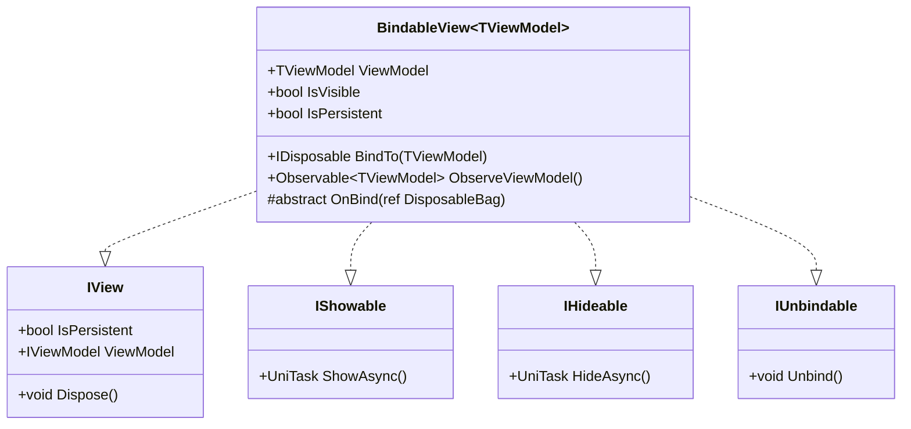
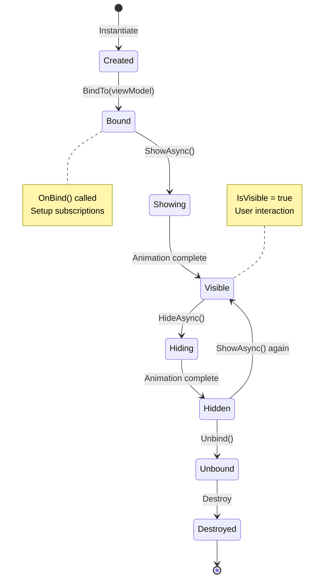
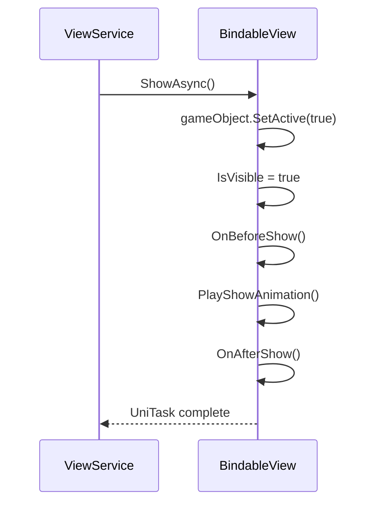
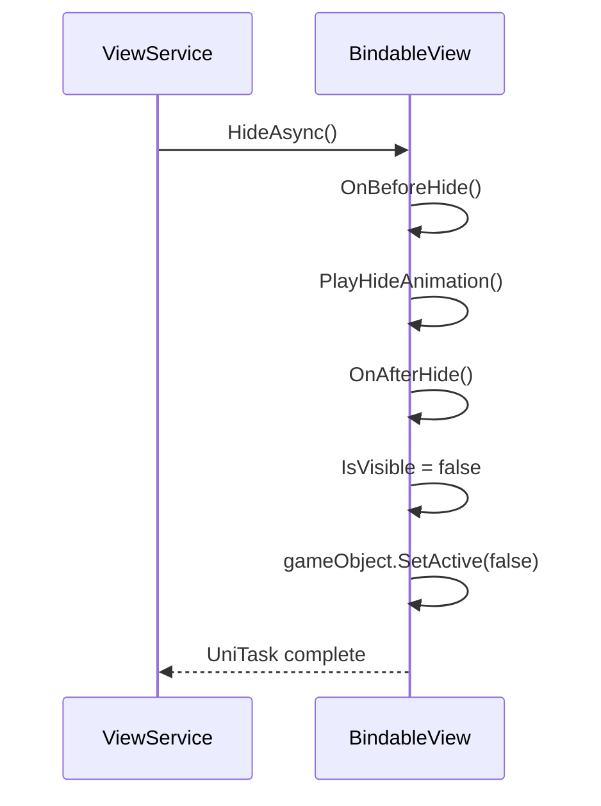

# BindableView

Базовый класс для всех View в MVVM архитектуре.

---

## Назначение

`BindableView<TViewModel>` — это MonoBehaviour, который:
- Связывается с ViewModel через паттерн привязки
- Управляет реактивными подписками через R3
- Контролирует жизненный цикл показа/скрытия
- Обеспечивает автоматическую очистку ресурсов

---

## Определение класса

```csharp
public abstract class BindableView<TViewModel> : MonoBehaviour, 
    IView, 
    IShowable, 
    IHideable, 
    IUnbindable 
    where TViewModel : DisposableObject
{
    [SerializeField] private CanvasGroup _canvasGroup;
    [SerializeField] private bool _isPersistent;

    public TViewModel ViewModel => _viewModel.Value;
    public bool IsVisible { get; protected set; }
    public virtual bool IsPersistent => _isPersistent;

    private readonly ReactiveProperty<TViewModel> _viewModel = new(null);
    private DisposableBag _disposables;
}
```

---

## Реализуемые интерфейсы



---

## Публичный API

### Свойства

| Свойство | Тип | Описание |
|----------|-----|----------|
| `ViewModel` | `TViewModel` | Текущая ViewModel |
| `IsVisible` | `bool` | Логическая видимость View |
| `IsPersistent` | `bool` | Не уничтожается при скрытии |

### Методы

| Метод | Описание |
|-------|----------|
| `BindTo(viewModel)` | Привязка ViewModel к View |
| `ObserveViewModel(includeCurrent)` | Observable на смену ViewModel |
| `ShowAsync()` | Показать View |
| `HideAsync()` | Скрыть View |
| `Unbind()` | Отвязать ViewModel и очистить подписки |
| `Dispose()` | Освободить все ресурсы |

---

## Lifecycle



### Порядок вызовов при показе



### Порядок вызовов при скрытии



---

## Обязательный метод: OnBind

Единственный абстрактный метод, который **необходимо** реализовать:

```csharp
protected abstract void OnBind(ref DisposableBag disposables);
```

**Здесь вы:**
- Подписываетесь на ReactiveProperty ViewModel
- Подключаете UI элементы к командам
- Настраиваете все реактивные связи

### Пример реализации

```csharp
public class HeroCardView : BindableView<HeroCardViewModel>
{
    [SerializeField] private TMP_Text _nameText;
    [SerializeField] private TMP_Text _levelText;
    [SerializeField] private Image _iconImage;
    [SerializeField] private Button _selectButton;

    protected override void OnBind(ref DisposableBag disposables)
    {
        // Текстовые поля
        ViewModel.Name
            .Subscribe(_nameText, static (name, text) => text.text = name)
            .AddTo(ref disposables);

        ViewModel.Level
            .Subscribe(_levelText, static (level, text) => text.text = $"Lv.{level}")
            .AddTo(ref disposables);

        // Изображение
        ViewModel.Icon
            .Subscribe(_iconImage, static (sprite, img) => img.sprite = sprite)
            .AddTo(ref disposables);

        // Кнопка
        _selectButton.OnClickAsObservable()
            .Subscribe(ViewModel.SelectCommand, static (_, cmd) => cmd.Execute(Unit.Default))
            .AddTo(ref disposables);
    }
}
```

---

## Static Lambda паттерн

Для избежания аллокаций используйте **static lambda с state**:

```csharp
// ❌ BAD: создаёт замыкание, аллокация каждый раз
ViewModel.Name
    .Subscribe(name => _nameText.text = name)
    .AddTo(ref disposables);

// ✅ GOOD: static lambda + state, zero allocation
ViewModel.Name
    .Subscribe(_nameText, static (name, text) => text.text = name)
    .AddTo(ref disposables);
```

### Паттерн с несколькими полями

```csharp
// Tuple как state
ViewModel.SomeProperty
    .Subscribe(
        (_field1, _field2), 
        static (value, state) =>
        {
            state._field1.text = value.ToString();
            state._field2.color = Color.green;
        })
    .AddTo(ref disposables);

// Или передача self
ViewModel.Data
    .Subscribe(this, static (data, self) => self.UpdateUI(data))
    .AddTo(ref disposables);
```

---

## Lifecycle Hooks

Виртуальные методы для переопределения:

```csharp
// Перед показом (View уже активен)
protected virtual UniTask OnBeforeShow() => UniTask.CompletedTask;

// После показа (анимация завершена)
protected virtual UniTask OnAfterShow() => UniTask.CompletedTask;

// Перед скрытием
protected virtual UniTask OnBeforeHide() => UniTask.CompletedTask;

// После скрытия (перед деактивацией)
protected virtual UniTask OnAfterHide() => UniTask.CompletedTask;
```

### Пример использования hooks

```csharp
public class InventoryView : BindableView<InventoryViewModel>
{
    protected override async UniTask OnBeforeShow()
    {
        // Загрузить данные перед показом
        await ViewModel.LoadInventoryAsync();
    }

    protected override UniTask OnAfterShow()
    {
        // Запустить анимацию появления предметов
        PlayItemsEnterAnimation();
        return UniTask.CompletedTask;
    }

    protected override UniTask OnBeforeHide()
    {
        // Сохранить изменения
        ViewModel.SaveChanges();
        return UniTask.CompletedTask;
    }
}
```

---

## Наблюдение за ViewModel

```csharp
// Реагировать на смену ViewModel
public Observable<TViewModel> ObserveViewModel(bool includeCurrent = true)
{
    return includeCurrent ? _viewModel : _viewModel.Skip(1);
}
```

### Использование

```csharp
protected override void OnBind(ref DisposableBag disposables)
{
    // Только будущие изменения (re-bind)
    ObserveViewModel(includeCurrent: false)
        .Subscribe(this, static (vm, self) => 
            Debug.Log($"ViewModel changed to: {vm}"))
        .AddTo(ref disposables);
}
```

---

## Очистка и Unbind

### Unbind

```csharp
public virtual void Unbind()
{
    var currentViewModel = _viewModel.Value;
    _viewModel.Value = null;
    
    // ⚠️ ViewModel уничтожается!
    currentViewModel?.Dispose();
    
    _disposables.Dispose();
    _disposables = new DisposableBag();
}
```

**Важно:** После `Unbind()` ViewModel больше нельзя использовать!

### OnDestroy

```csharp
protected virtual void OnDestroy()
{
    Unbind();
    _disposables.Dispose();
}
```

---

## Persistent Views

```csharp
public class SettingsView : BindableView<SettingsViewModel>
{
    // Через SerializeField (в Inspector)
    [SerializeField] private bool _isPersistent = true;

    // Или через override
    public override bool IsPersistent => true;
}
```

**Persistent View:**
- Не уничтожается при `HideAsync()`
- Остаётся в кеше `ViewService`
- Повторный `ShowAsync()` не создаёт заново

---

## Кастомные анимации

Переопределите методы анимации:

```csharp
protected virtual UniTask PlayShowAnimation()
{
    // Дефолт: мгновенная установка значений
    if (_canvasGroup != null)
    {
        _canvasGroup.alpha = 1f;
        _canvasGroup.interactable = true;
        _canvasGroup.blocksRaycasts = true;
    }
    return UniTask.CompletedTask;
}

protected virtual UniTask PlayHideAnimation()
{
    if (_canvasGroup != null)
    {
        _canvasGroup.alpha = 0f;
        _canvasGroup.interactable = false;
        _canvasGroup.blocksRaycasts = false;
    }
    return UniTask.CompletedTask;
}
```

**Важно:** Для анимаций используйте `ViewAnimator` через `ViewShowParams`:

```csharp
await _viewService.ShowAsync<MyView, MyViewModel>(
    new ViewShowParams()
        .SetTransition(ViewTransitionStyle.Fade | ViewTransitionStyle.Scale)
);
```

---

## Полный пример

```csharp
public class SettingsView : BindableView<SettingsViewModel>
{
    public override bool IsPersistent => true;

    [Header("UI")]
    [SerializeField] private Button _closeButton;
    [SerializeField] private Slider _volumeSlider;
    [SerializeField] private TMP_Text _volumeText;
    [SerializeField] private Toggle _musicToggle;

    [Inject] private IAudioService _audioService;

    protected override void OnBind(ref DisposableBag disposables)
    {
        // Кнопка закрытия
        _closeButton.OnClickAsObservable()
            .Subscribe(ViewModel.CloseCommand, 
                static (_, cmd) => cmd.Execute(Unit.Default))
            .AddTo(ref disposables);

        // Громкость: двусторонняя привязка
        ViewModel.Volume
            .Subscribe((_volumeSlider, _volumeText), 
                static (v, state) =>
                {
                    state._volumeSlider.value = v;
                    state._volumeText.text = $"{(int)(v * 100)}%";
                })
            .AddTo(ref disposables);

        _volumeSlider.onValueChanged.AsObservable()
            .Subscribe(ViewModel.Volume, 
                static (v, prop) => prop.Value = v)
            .AddTo(ref disposables);

        // Toggle
        BindToggle(_musicToggle, ViewModel.IsMusicEnabled, ref disposables);
    }

    private static void BindToggle(
        Toggle toggle, 
        ReactiveProperty<bool> property, 
        ref DisposableBag disposables)
    {
        property
            .Subscribe(toggle, static (v, t) => t.isOn = v)
            .AddTo(ref disposables);

        toggle.onValueChanged.AsObservable()
            .Subscribe(property, static (v, prop) => prop.Value = v)
            .AddTo(ref disposables);
    }

    protected override async UniTask OnAfterShow()
    {
        // Начать воспроизведение фоновой музыки настроек
        await _audioService.PlayAsync("settings_ambient");
    }
}
```

---

## Best Practices

### ✅ DO

1. **Используй static lambdas** для zero-allocation подписок
2. **Добавляй все подписки** в `disposables`
3. **Используй lifecycle hooks** для инициализации/очистки
4. **Кешируй SerializeField** — не используй GetComponent в OnBind

### ❌ DON'T

1. **Не храни ссылки на ViewModel вне View**
2. **Не вызывай Dispose() напрямую** — используй ViewService
3. **Не создавай подписки вне OnBind** — они не очистятся
4. **Не используй Find/GetComponent в Update**

---

## См. также

- [ViewModel.md](ViewModel.md) — базовый класс ViewModel
- [ViewService.md](ViewService.md) — показ/скрытие View
- [Lifecycle.md](Lifecycle.md) — полный жизненный цикл
