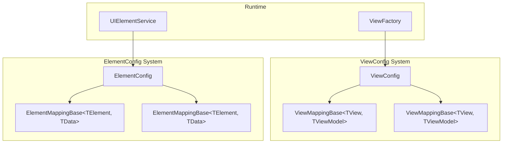

# Config — ViewConfig и ElementConfig

Система конфигурации маппинга ViewModel → View и Element → Prefab через ScriptableObject.

---

## Назначение

Config система предоставляет:
- **ViewConfig** — маппинг ViewModel → View Prefab (Addressables)
- **ElementConfig** — маппинг ElementType → Element Prefab (Addressables)
- **Mapping ScriptableObjects** — типизированные маппинги для редактора

---

## Архитектура



---

## ViewConfig

### Интерфейс IViewConfig

```csharp
public interface IViewConfig
{
    string GetViewAddress<TViewModel>() 
        where TViewModel : DisposableObject;
    
    string GetViewAddress(Type viewModelType);
    
    AssetReferenceT<GameObject> GetViewReference<TViewModel>() 
        where TViewModel : class;
    
    AssetReferenceT<GameObject> GetViewReference(Type viewModelType);
}
```

### Реализация ViewConfig

```csharp
[CreateAssetMenu(fileName = "ViewConfig", menuName = "MVVM/View Config")]
public class ViewConfig : ConfigBase, IViewConfig
{
    [SerializeField] internal List<ViewMappingBase> _mappings = new();
    internal Dictionary<Type, ViewMappingBase> _typeCache;

    private void OnEnable()
    {
        BuildCache();
    }

    internal void BuildCache()
    {
        _typeCache = new Dictionary<Type, ViewMappingBase>();
        foreach (var mapping in _mappings)
        {
            if (mapping != null && mapping.ViewModelType != null)
            {
                _typeCache[mapping.ViewModelType] = mapping;
            }
        }
    }

    public string GetViewAddress(Type viewModelType)
    {
        if (_typeCache == null) BuildCache();
        
        if (!_typeCache.TryGetValue(viewModelType, out var mapping))
            throw new KeyNotFoundException(
                $"View mapping not found for ViewModel: {viewModelType.Name}");
        
        if (mapping.ViewPrefab != null)
        {
            var key = mapping.ViewPrefab.RuntimeKey.ToString();
            if (!string.IsNullOrEmpty(key))
                return key;
        }
        
        throw new KeyNotFoundException(
            $"View address not found for ViewModel: {viewModelType.Name}");
    }

    public AssetReferenceT<GameObject> GetViewReference(Type viewModelType)
    {
        if (_typeCache == null) BuildCache();
        
        if (_typeCache.TryGetValue(viewModelType, out var mapping) && 
            mapping.ViewPrefab != null)
        {
            return mapping.ViewPrefab;
        }
        
        throw new KeyNotFoundException(
            $"View reference not found for ViewModel: {viewModelType.Name}");
    }
}
```

---

## ViewMappingBase

### Базовый класс

```csharp
public abstract class ViewMappingBase : ScriptableObject
{
    public AssetReferenceT<GameObject> ViewPrefab;
    public abstract Type ViewType { get; }
    public abstract Type ViewModelType { get; }
}
```

### Типизированный маппинг

```csharp
public abstract class ViewMappingBase<TView, TViewModel> : ViewMappingBase
    where TView : BindableView<TViewModel>, IView
    where TViewModel : DisposableObject
{
    public override Type ViewType => typeof(TView);
    public override Type ViewModelType => typeof(TViewModel);
}
```

### Создание конкретного маппинга

```csharp
[CreateAssetMenu(fileName = "SettingsViewMapping", 
    menuName = "MVVM/View Mappings/Settings View")]
public class SettingsViewMapping : ViewMappingBase<SettingsView, SettingsViewModel>
{
    // Только SerializeField нужны, типы определены через generic параметры
}
```

---

## ElementConfig

### Интерфейс IElementConfig

```csharp
public interface IElementConfig
{
    string GetElementAddress<TElement, TData>()
        where TElement : MonoBehaviour
        where TData : struct, IElementData;

    string GetElementAddress(Type elementType);

    AssetReferenceT<GameObject> GetElementReference<TElement, TData>()
        where TElement : MonoBehaviour
        where TData : struct, IElementData;

    AssetReferenceT<GameObject> GetElementReference(Type elementType);

    bool TryGetMapping<TElement, TData>(out ElementMappingBase mapping)
        where TElement : MonoBehaviour
        where TData : struct, IElementData;

    bool TryGetMapping(Type elementType, out ElementMappingBase mapping);
}
```

### Реализация ElementConfig

```csharp
[CreateAssetMenu(fileName = "ElementConfig", menuName = "MVVM/Element Config")]
public class ElementConfig : ConfigBase, IElementConfig
{
    [SerializeField] internal List<ElementMappingBase> _mappings = new();
    
    internal Dictionary<Type, ElementMappingBase> _elementTypeCache;
    internal Dictionary<Type, ElementMappingBase> _dataTypeCache;

    private void OnEnable()
    {
        BuildCache();
    }

    internal void BuildCache()
    {
        _elementTypeCache = new Dictionary<Type, ElementMappingBase>();
        _dataTypeCache = new Dictionary<Type, ElementMappingBase>();

        foreach (var mapping in _mappings)
        {
            if (mapping == null) continue;

            _elementTypeCache[mapping.ElementType] = mapping;
            _dataTypeCache[mapping.DataType] = mapping;
        }
    }

    public string GetElementAddress(Type elementType)
    {
        if (_elementTypeCache == null) BuildCache();

        if (!_elementTypeCache.TryGetValue(elementType, out var mapping))
            throw new KeyNotFoundException(
                $"Element mapping not found for: {elementType.Name}");

        if (mapping.ElementPrefab != null && 
            mapping.ElementPrefab.RuntimeKeyIsValid())
        {
            return mapping.ElementPrefab.RuntimeKey.ToString();
        }

        throw new KeyNotFoundException(
            $"Element address not found for: {elementType.Name}");
    }

    public AssetReferenceT<GameObject> GetElementReference(Type elementType)
    {
        if (_elementTypeCache == null) BuildCache();

        if (_elementTypeCache.TryGetValue(elementType, out var mapping) && 
            mapping.ElementPrefab != null)
        {
            return mapping.ElementPrefab;
        }

        throw new KeyNotFoundException(
            $"Element reference not found for: {elementType.Name}");
    }
}
```

---

## ElementMappingBase

### Базовый класс

```csharp
public abstract class ElementMappingBase : ScriptableObject
{
    public AssetReferenceT<GameObject> ElementPrefab;
    public abstract Type ElementType { get; }
    public abstract Type DataType { get; }
}
```

### Типизированный маппинг

```csharp
public abstract class ElementMappingBase<TElement, TData> : ElementMappingBase
    where TElement : BindableElement<TData>
    where TData : struct, IElementData
{
    public override Type ElementType => typeof(TElement);
    public override Type DataType => typeof(TData);
}
```

### Создание конкретного маппинга

```csharp
[CreateAssetMenu(fileName = "HeroSlotElementMapping", 
    menuName = "MVVM/Element Mappings/Hero Slot")]
public class HeroSlotElementMapping : ElementMappingBase<HeroSlotElement, HeroSlotData>
{
    // Автоматическое определение типов через generic
}
```

---

## Настройка в Unity Editor

### 1. Создание ViewConfig

**Assets → Create → MVVM → View Config**

→ Создаётся `ViewConfig.asset`

### 2. Создание ViewMapping

Для каждой пары View+ViewModel:

**Assets → Create → MVVM → View Mappings → [Name] View**

```csharp
// Пример: SettingsViewMapping.cs
[CreateAssetMenu(fileName = "SettingsViewMapping", 
    menuName = "MVVM/View Mappings/Settings View")]
public class SettingsViewMapping : ViewMappingBase<SettingsView, SettingsViewModel>
{
}
```

### 3. Настройка ViewMapping в Inspector

1. Открыть созданный mapping asset
2. В поле **ViewPrefab** назначить AssetReference на prefab SettingsView
3. Типы (ViewType, ViewModelType) определяются автоматически из generic параметров

### 4. Добавление mapping в ViewConfig

1. Открыть ViewConfig.asset
2. В массиве **Mappings** добавить новый элемент
3. Перетащить SettingsViewMapping в слот

### 5. Регистрация ViewConfig в DI

```csharp
public class InfrastructureBindings : MonoBehaviour
{
    [SerializeField] private ViewConfig _viewConfig;
    [SerializeField] private ElementConfig _elementConfig;

    private void Awake()
    {
        var builder = new ContainerBuilder();
        
        builder.AddSingleton<IViewConfig>(_viewConfig);
        builder.AddSingleton<IElementConfig>(_elementConfig);
        
        // ... остальные регистрации
    }
}
```

---

## Пример полной настройки

### 1. Структура ScriptableObjects

```
Assets/Config/MVVM/
├── ViewConfig.asset
├── ElementConfig.asset
└── Mappings/
    ├── Views/
    │   ├── MainMenuViewMapping.asset
    │   ├── SettingsViewMapping.asset
    │   └── HeroDetailViewMapping.asset
    └── Elements/
        ├── HeroSlotElementMapping.asset
        ├── ItemSlotElementMapping.asset
        └── SkillButtonElementMapping.asset
```

### 2. Пример маппингов

**ViewConfig.asset:**
```
Mappings:
  [0] MainMenuViewMapping
  [1] SettingsViewMapping
  [2] HeroDetailViewMapping
```

**ElementConfig.asset:**
```
Mappings:
  [0] HeroSlotElementMapping
  [1] ItemSlotElementMapping
  [2] SkillButtonElementMapping
```

### 3. Inspector MainMenuViewMapping

```
ViewPrefab: Assets/Prefabs/UI/MainMenuView.prefab
ViewType: MainMenuView (readonly)
ViewModelType: MainMenuViewModel (readonly)
```

---

## Editor Extensions (опционально)

### Автоматическое добавление маппингов

```csharp
#if UNITY_EDITOR
public void AddMapping(ViewMappingBase mapping)
{
    if (_mappings.Contains(mapping)) return;

    _mappings.Add(mapping);
    BuildCache();
    UnityEditor.EditorUtility.SetDirty(this);
}

public void RemoveMapping(ViewMappingBase mapping)
{
    _mappings.Remove(mapping);
    BuildCache();
    UnityEditor.EditorUtility.SetDirty(this);
}

public IReadOnlyList<ViewMappingBase> GetAllMappings() => _mappings;
#endif
```

### Валидация в Editor

```csharp
#if UNITY_EDITOR
[UnityEditor.CustomEditor(typeof(ViewConfig))]
public class ViewConfigEditor : UnityEditor.Editor
{
    public override void OnInspectorGUI()
    {
        base.OnInspectorGUI();

        var config = (ViewConfig)target;

        if (GUILayout.Button("Validate Mappings"))
        {
            ValidateMappings(config);
        }
    }

    private void ValidateMappings(ViewConfig config)
    {
        foreach (var mapping in config._mappings)
        {
            if (mapping == null)
            {
                Debug.LogError("[ViewConfig] Null mapping found!");
                continue;
            }

            if (mapping.ViewPrefab == null || !mapping.ViewPrefab.RuntimeKeyIsValid())
            {
                Debug.LogError($"[ViewConfig] Invalid prefab in: {mapping.name}");
            }
        }

        Debug.Log("[ViewConfig] Validation complete");
    }
}
#endif
```

---

## Кеширование и производительность

### BuildCache вызов

- **OnEnable** — при загрузке config asset
- **Manual** — после изменений в Editor (#if UNITY_EDITOR)

### Сложность операций

| Операция | Сложность | Заметки |
|----------|-----------|---------|
| BuildCache | O(n) | n = количество маппингов |
| GetAddress | O(1) | Dictionary lookup |
| GetReference | O(1) | Dictionary lookup |

---

## Best Practices

### ✅ DO

1. **Создавай mapping ScriptableObjects** для каждой пары View+ViewModel
2. **Используй generic ViewMappingBase<TView, TViewModel>** для type-safety
3. **Валидируй маппинги** перед билдом через Editor Extension
4. **Храни ViewConfig в Resources** или передавай через DI
5. **Кешируй типы через BuildCache** для быстрого доступа

### ❌ DON'T

1. **Не редактируй ViewConfig в runtime** — только read-only
2. **Не забывай BuildCache** после изменений
3. **Не дублируй маппинги** для одного ViewModel
4. **Не используй Find/Resources.Load** вместо конфига

---

## Troubleshooting

### KeyNotFoundException при ShowAsync

**Причина:** ViewMapping не зарегистрирован в ViewConfig

**Решение:**
1. Создать ViewMappingBase<TView, TViewModel> ScriptableObject
2. Назначить ViewPrefab
3. Добавить маппинг в ViewConfig._mappings

### RuntimeKey is empty

**Причина:** AssetReference не назначен или не valid

**Решение:**
1. Открыть mapping asset
2. Переназначить ViewPrefab через Inspector
3. Убедиться что prefab находится в Addressables группе

---

## См. также

- [ViewFactory.md](ViewFactory.md) — использование ViewConfig
- [ElementSystem.md](ElementSystem.md) — использование ElementConfig
- [README.md](README.md) — общая архитектура
