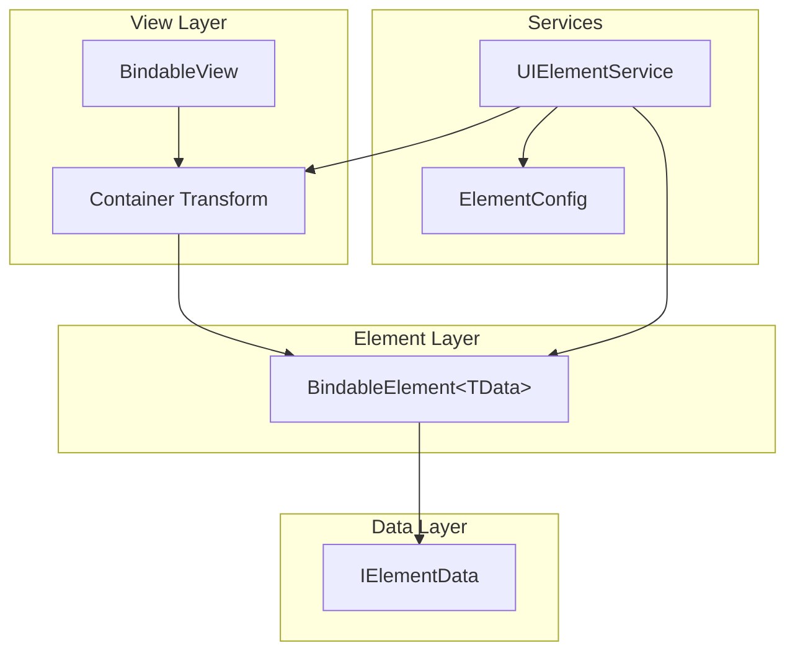
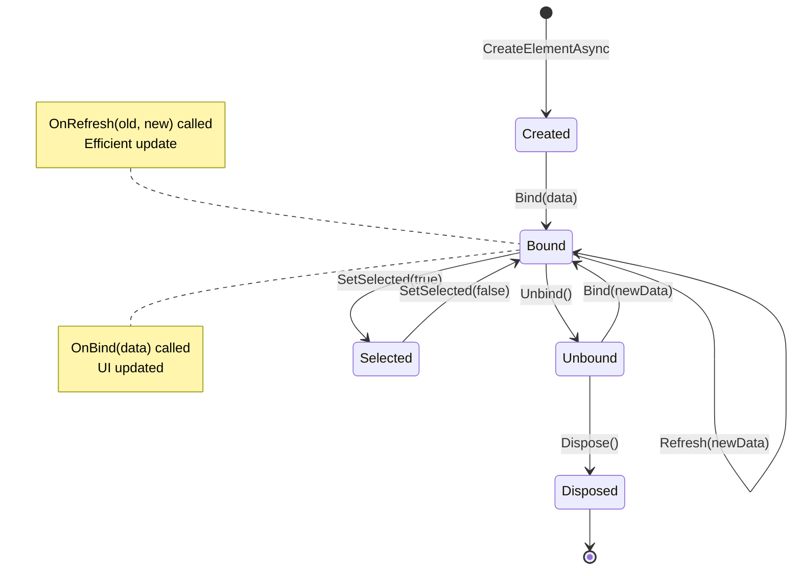
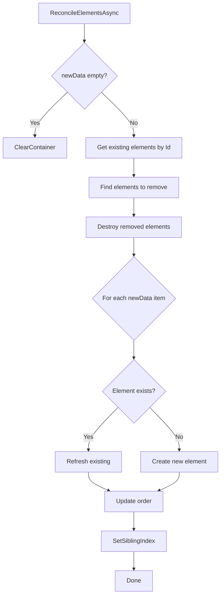
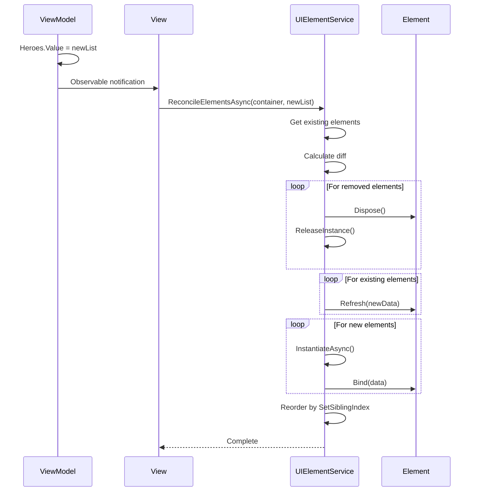

# Element System

Система для работы с динамическими переиспользуемыми UI элементами.

---

## Назначение

Element System предназначена для:
- Создания списков, гридов, слотов
- Эффективного обновления (reconciliation)
- Переиспользования элементов (pooling)
- Унифицированного lifecycle управления

---

## Архитектура



---

## Основные компоненты

### IElementData

Интерфейс данных элемента:

```csharp
public interface IElementData
{
    string Id { get; }  // Уникальный идентификатор
}
```

**Требования:**
- Должен быть `struct` (производительность, zero GC)
- Уникальный `Id` для reconciliation
- Рекомендуется реализовать `IEquatable<T>`

**Пример:**

```csharp
public readonly struct HeroSlotData : IElementData, IEquatable<HeroSlotData>
{
    public string Id { get; }
    public string Name { get; }
    public int Level { get; }
    public Sprite Icon { get; }
    public bool IsLocked { get; }

    public HeroSlotData(string id, string name, int level, Sprite icon, bool isLocked)
    {
        Id = id;
        Name = name;
        Level = level;
        Icon = icon;
        IsLocked = isLocked;
    }

    public bool Equals(HeroSlotData other) => 
        Id == other.Id && Level == other.Level && IsLocked == other.IsLocked;

    public override int GetHashCode() => Id?.GetHashCode() ?? 0;
}
```

---

### BindableElement<TData>

Базовый класс для UI элементов:

```csharp
[RequireComponent(typeof(RectTransform))]
public abstract class BindableElement<TData> : MonoBehaviour, ISelectableElement<TData>
    where TData : struct, IElementData
{
    [Header("Interaction")]
    [SerializeField] protected Button _clickButton;

    [Header("Selection")]
    [SerializeField] protected GameObject _selectionIndicator;

    [Header("Popup")]
    [SerializeField] protected PopupTrigger _popupTrigger;

    // Properties
    public string ElementId { get; }
    public bool IsBound { get; }
    public bool IsSelected { get; }
    public bool HasPopup { get; }

    // Callbacks
    public Action<TData> OnClicked { set; }

    // Protected access
    protected TData CurrentData { get; }
    protected ref DisposableBag Disposables { get; }
}
```

---

## Lifecycle элемента



### Lifecycle методы

```csharp
// Первая привязка данных
protected abstract void OnBind(TData data);

// Обновление данных (по умолчанию вызывает OnBind)
protected virtual void OnRefresh(TData oldData, TData newData) 
    => OnBind(newData);

// Отвязка данных
protected virtual void OnUnbind() { }

// Изменение выделения
protected virtual void OnSelectionChanged(bool selected) { }

// Финальная очистка
protected virtual void OnDispose() { }

// Данные для popup
protected virtual IPopupData GetPopupData(TData data) => null;
```

---

## Реализация элемента

```csharp
public class HeroSlotElement : BindableElement<HeroSlotData>
{
    [Header("UI")]
    [SerializeField] private Image _iconImage;
    [SerializeField] private TMP_Text _nameText;
    [SerializeField] private TMP_Text _levelText;
    [SerializeField] private GameObject _lockedOverlay;
    [SerializeField] private CanvasGroup _canvasGroup;

    protected override void OnBind(HeroSlotData data)
    {
        _iconImage.sprite = data.Icon;
        _nameText.text = data.Name;
        _levelText.text = $"Lv.{data.Level}";
        _lockedOverlay.SetActive(data.IsLocked);
        _canvasGroup.alpha = data.IsLocked ? 0.5f : 1f;
        _canvasGroup.interactable = !data.IsLocked;
    }

    protected override void OnRefresh(HeroSlotData oldData, HeroSlotData newData)
    {
        // Оптимизированное обновление — только изменённые поля
        if (oldData.Icon != newData.Icon)
            _iconImage.sprite = newData.Icon;

        if (oldData.Level != newData.Level)
            _levelText.text = $"Lv.{newData.Level}";

        if (oldData.IsLocked != newData.IsLocked)
        {
            _lockedOverlay.SetActive(newData.IsLocked);
            _canvasGroup.alpha = newData.IsLocked ? 0.5f : 1f;
            _canvasGroup.interactable = !newData.IsLocked;
        }
    }

    protected override void OnSelectionChanged(bool selected)
    {
        // Анимация выделения
        transform.DOScale(selected ? 1.1f : 1f, 0.2f);
    }

    protected override IPopupData GetPopupData(HeroSlotData data)
    {
        return new HeroPopupData(data.Id, data.Name, data.Level);
    }
}
```

---

## UIElementService

Сервис управления элементами:

```csharp
public interface IUIElementService
{
    // Создание элемента
    UniTask<TElement> CreateElementAsync<TElement, TData>(
        Transform container,
        TData data,
        Action<TData> onClick = null)
        where TElement : MonoBehaviour, IBindableElement<TData>
        where TData : struct, IElementData;

    // Уничтожение
    void DestroyElement(IBindableElement element);
    void ClearContainer(Transform container);

    // Получение элементов
    IReadOnlyList<TElement> GetElementsInContainer<TElement, TData>(Transform container)
        where TElement : MonoBehaviour, IBindableElement<TData>
        where TData : struct, IElementData;

    // Reconciliation — ключевой метод!
    UniTask ReconcileElementsAsync<TElement, TData>(
        Transform container,
        IReadOnlyList<TData> newData,
        Action<TData> onClick = null)
        where TElement : MonoBehaviour, IBindableElement<TData>
        where TData : struct, IElementData, IEquatable<TData>;
}
```

---

## Reconciliation

Алгоритм эффективного обновления списка:



### Как работает

```csharp
// Было:     [Hero1, Hero2, Hero3]
// Стало:    [Hero2, Hero4, Hero1]

// Reconcile:
// 1. Hero3 — не в новом списке → удалён
// 2. Hero2 — есть → Refresh(newData)
// 3. Hero4 — нет → Create new
// 4. Hero1 — есть → Refresh(newData)
// 5. Переупорядочить по SetSiblingIndex
```

---

## Использование в View

### Базовый пример

```csharp
public class HeroGridView : BindableView<HeroGridViewModel>
{
    [SerializeField] private Transform _gridContainer;

    [Inject] private IUIElementService _elementService;

    protected override void OnBind(ref DisposableBag disposables)
    {
        // Подписка на изменение данных
        ViewModel.Heroes
            .Subscribe(this, static (heroes, self) => 
                self.UpdateGrid(heroes).Forget())
            .AddTo(ref disposables);
    }

    private async UniTaskVoid UpdateGrid(IReadOnlyList<HeroSlotData> heroes)
    {
        await _elementService.ReconcileElementsAsync<HeroSlotElement, HeroSlotData>(
            _gridContainer,
            heroes,
            onClick: OnHeroClicked
        );
    }

    private void OnHeroClicked(HeroSlotData data)
    {
        ViewModel.SelectHeroCommand.Execute(data);
    }
}
```

### С ручным управлением

```csharp
public class InventoryView : BindableView<InventoryViewModel>
{
    [SerializeField] private Transform _slotsContainer;

    [Inject] private IUIElementService _elementService;

    protected override void OnBind(ref DisposableBag disposables)
    {
        // Начальное создание слотов
        CreateInitialSlots().Forget();

        // Подписка на добавление предметов
        ViewModel.OnItemAdded
            .Subscribe(this, static (item, self) => 
                self.AddItem(item).Forget())
            .AddTo(ref disposables);

        // Подписка на удаление
        ViewModel.OnItemRemoved
            .Subscribe(this, static (itemId, self) => 
                self.RemoveItem(itemId))
            .AddTo(ref disposables);
    }

    private async UniTaskVoid CreateInitialSlots()
    {
        foreach (var slot in ViewModel.Slots.Value)
        {
            await _elementService.CreateElementAsync<InventorySlotElement, InventorySlotData>(
                _slotsContainer,
                slot,
                OnSlotClicked
            );
        }
    }

    private async UniTaskVoid AddItem(InventorySlotData item)
    {
        await _elementService.CreateElementAsync<InventorySlotElement, InventorySlotData>(
            _slotsContainer,
            item,
            OnSlotClicked
        );
    }

    private void RemoveItem(string itemId)
    {
        var elements = _elementService
            .GetElementsInContainer<InventorySlotElement, InventorySlotData>(_slotsContainer);

        var element = elements.FirstOrDefault(e => e.ElementId == itemId);
        if (element != null)
        {
            _elementService.DestroyElement(element);
        }
    }

    private void OnSlotClicked(InventorySlotData data)
    {
        ViewModel.UseItemCommand.Execute(data.Id);
    }
}
```

---

## ElementConfig

Маппинг Element → Prefab:

```csharp
[CreateAssetMenu(fileName = "ElementConfig", menuName = "MVVM/Element Config")]
public class ElementConfig : ConfigBase, IElementConfig
{
    [SerializeField] internal List<ElementMappingBase> _mappings = new();

    public string GetElementAddress<TElement, TData>()
        where TElement : MonoBehaviour
        where TData : struct, IElementData;

    public string GetElementAddress(Type elementType);

    public AssetReferenceT<GameObject> GetElementReference<TElement, TData>()
        where TElement : MonoBehaviour
        where TData : struct, IElementData;
}
```

### ElementMappingBase

```csharp
public abstract class ElementMappingBase : ScriptableObject
{
    public AssetReferenceT<GameObject> ElementPrefab;
    public abstract Type ElementType { get; }
    public abstract Type DataType { get; }
}

public abstract class ElementMappingBase<TElement, TData> : ElementMappingBase
    where TElement : MonoBehaviour, IBindableElement<TData>
    where TData : struct, IElementData
{
    public override Type ElementType => typeof(TElement);
    public override Type DataType => typeof(TData);
}
```

---

## Tracking и Container Management

UIElementService отслеживает элементы по контейнерам:

```csharp
private readonly Dictionary<Transform, List<IBindableElement>> _containerElements = new();

private void TrackElement(Transform container, IBindableElement element)
{
    if (!_containerElements.TryGetValue(container, out var list))
    {
        list = new List<IBindableElement>();
        _containerElements[container] = list;
    }
    list.Add(element);
}

private void UntrackElement(Transform container, IBindableElement element)
{
    if (_containerElements.TryGetValue(container, out var list))
    {
        list.Remove(element);
    }
}
```

---

## Selection Management

```csharp
// В View
private HeroSlotElement _selectedElement;

private void OnHeroClicked(HeroSlotData data)
{
    // Снять выделение с предыдущего
    _selectedElement?.SetSelected(false);

    // Найти и выделить новый
    var elements = _elementService
        .GetElementsInContainer<HeroSlotElement, HeroSlotData>(_gridContainer);

    _selectedElement = elements.FirstOrDefault(e => e.ElementId == data.Id);
    _selectedElement?.SetSelected(true);

    ViewModel.SelectHeroCommand.Execute(data);
}
```

---

## Popup Integration

```csharp
public class ItemSlotElement : BindableElement<ItemSlotData>
{
    [SerializeField] protected PopupTrigger _popupTrigger;

    protected override void OnBind(ItemSlotData data)
    {
        // ...

        // Popup автоматически обновляется
        // через UpdatePopupData в базовом классе
    }

    protected override IPopupData GetPopupData(ItemSlotData data)
    {
        return new ItemPopupData
        {
            Name = data.Name,
            Description = data.Description,
            Stats = data.Stats
        };
    }
}
```

---

## Диаграмма потока данных



---

## Best Practices

### ✅ DO

1. **Используй ReconcileElementsAsync** вместо Clear + Create
2. **Реализуй OnRefresh** для оптимизированного обновления
3. **Используй struct для IElementData**
4. **Реализуй IEquatable<T>** для правильного сравнения
5. **Кешируй SerializeField** в элементах

### ❌ DON'T

1. **Не создавай элементы через Instantiate** напрямую
2. **Не храни ссылки на элементы** после Dispose
3. **Не делай тяжёлые операции в OnBind** — это блокирует UI
4. **Не забывай очищать контейнер** в OnDestroy View

---

## Производительность

| Операция | Сложность |
|----------|-----------|
| CreateElementAsync | O(1) + async load |
| DestroyElement | O(n) tracking |
| ClearContainer | O(n) |
| ReconcileElementsAsync | O(n) diff + O(k) create |
| GetElementsInContainer | O(n) filter |

**Рекомендации:**
- Для списков > 100 элементов используй виртуализацию
- Prefetch Addressables для быстрого создания
- Batch updates через Reconcile, не по одному

---

## См. также

- [BindableView.md](BindableView.md) — использование в View
- [ViewFactory.md](ViewFactory.md) — создание View
- [Lifecycle.md](Lifecycle.md) — жизненный цикл
