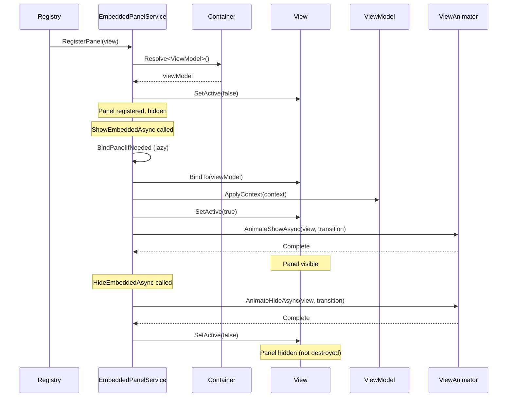

# EmbeddedPanelService

Сервис управления встраиваемыми (embedded) панелями — View, которые предустановлены в сцене.

---

## Назначение

`EmbeddedPanelService` отвечает за:
- Управление панелями, уже размещёнными в сцене (не через Addressables)
- Показ/скрытие embedded View
- Анимации переходов embedded панелей
- Применение контекста к ViewModel

**Отличие от ViewService:**
- ViewService создаёт View динамически (Addressables)
- EmbeddedPanelService работает с prefab'ами, уже присутствующими в иерархии

---

## Интерфейс IEmbeddedPanelHost

```csharp
public interface IEmbeddedPanelHost
{
    void RegisterPanel<TViewModel>(BindableView<TViewModel> view)
        where TViewModel : DisposableObject;

    UniTask<bool> ShowEmbeddedAsync<TViewModel>(
        IViewContext context, 
        CancellationToken ct = default)
        where TViewModel : DisposableObject;

    UniTask HideEmbeddedAsync<TViewModel>(CancellationToken ct = default)
        where TViewModel : DisposableObject;

    bool IsEmbeddedVisible<TViewModel>()
        where TViewModel : DisposableObject;

    TViewModel GetEmbeddedViewModel<TViewModel>()
        where TViewModel : DisposableObject;
}
```

---

## Основные отличия от ViewService

| Аспект | ViewService | EmbeddedPanelService |
|--------|-------------|----------------------|
| Создание | Addressables (динамически) | Prefab в сцене (статично) |
| Lifecycle | Create → Show → Hide → Destroy | Register → Show/Hide (не destroy) |
| Навигация | Stack, история | Нет навигации |
| Sorting Order | Автоматический | Управляется вручную |
| Использование | Полноэкранные View | Панели, врезки, tabs |

---

## Реализация

```csharp
public class EmbeddedPanelService : IEmbeddedPanelHost
{
    private readonly Container _container;
    private readonly IViewAnimator _viewAnimator;
    private readonly IMediator _mediator;
    private readonly ILogger _logger;

    private readonly Dictionary<Type, EmbeddedPanelInfo> _panels = new();

    private const float AnimationDuration = 0.3f;

    public EmbeddedPanelService(
        Container container,
        IViewAnimator viewAnimator,
        IMediator mediator,
        ILogger logger)
    {
        _container = container;
        _viewAnimator = viewAnimator;
        _mediator = mediator;
        _logger = logger;
    }

    private class EmbeddedPanelInfo
    {
        public IView View;
        public GameObject GameObject;
        public DisposableObject ViewModel;
        public bool IsVisible;
        public bool IsBound;
    }
}
```

---

## Регистрация панели

```csharp
public void RegisterPanel<TViewModel>(BindableView<TViewModel> view)
    where TViewModel : DisposableObject
{
    var vmType = typeof(TViewModel);

    if (_panels.ContainsKey(vmType))
    {
        _logger.Warn("[EmbeddedPanelService] Panel already registered: {0}", vmType.Name);
        return;
    }

    view.gameObject.SetActive(false);  // Скрыть по умолчанию

    var viewModel = _container.Resolve<TViewModel>();

    _panels[vmType] = new EmbeddedPanelInfo
    {
        View = view,
        GameObject = view.gameObject,
        ViewModel = viewModel,
        IsVisible = false,
        IsBound = false
    };

    _logger.Info("[EmbeddedPanelService] Registered panel: {0}", vmType.Name);
}
```

---

## Показ панели

```csharp
public async UniTask<bool> ShowEmbeddedAsync<TViewModel>(
    IViewContext context,
    CancellationToken ct = default)
    where TViewModel : DisposableObject
{
    var vmType = typeof(TViewModel);

    if (!_panels.TryGetValue(vmType, out var panel))
    {
        _logger.Error("[EmbeddedPanelService] Panel not registered: {0}", vmType.Name);
        return false;
    }

    // Панель уже видима — применить новый контекст
    if (panel.IsVisible)
    {
        ApplyContext(panel.ViewModel, context);
        return true;
    }

    // Привязка ViewModel (lazy)
    BindPanelIfNeeded<TViewModel>(panel);
    
    // Применить контекст
    ApplyContext(panel.ViewModel, context);

    // Активировать GameObject
    panel.GameObject.SetActive(true);
    panel.IsVisible = true;

    // Анимация появления
    var transition = GetTransitionStyle(panel.ViewModel);
    await _viewAnimator.AnimateShowAsync(panel.View, transition, AnimationDuration);

    // Уведомление
    await _mediator.Publish(
        new EmbeddedPanelStateChangedNotification(vmType, true), ct);

    return true;
}
```

---

## Скрытие панели

```csharp
public async UniTask HideEmbeddedAsync<TViewModel>(CancellationToken ct = default)
    where TViewModel : DisposableObject
{
    var vmType = typeof(TViewModel);

    if (!_panels.TryGetValue(vmType, out var panel) || !panel.IsVisible)
        return;

    panel.IsVisible = false;

    // Анимация скрытия
    var transition = GetTransitionStyle(panel.ViewModel);
    await _viewAnimator.AnimateHideAsync(panel.View, transition, AnimationDuration);

    // Деактивация GameObject
    panel.GameObject.SetActive(false);

    // Уведомление
    await _mediator.Publish(
        new EmbeddedPanelStateChangedNotification(vmType, false), ct);
}
```

---

## Применение контекста

```csharp
private void ApplyContext(DisposableObject viewModel, IViewContext context)
{
    if (context is EmptyContext || viewModel == null)
        return;

    if (viewModel is IContextApplicable applicable)
        applicable.ApplyContext(context);
}
```

**IContextApplicable:**

```csharp
public interface IContextApplicable
{
    void ApplyContext(IViewContext context);
}
```

**Пример ViewModel:**

```csharp
public class HeroDetailPanelViewModel : DisposableObject, IContextApplicable
{
    public ReactiveProperty<string> HeroId { get; } = new("");

    public void ApplyContext(IViewContext context)
    {
        if (context is HeroDetailContext heroContext)
        {
            HeroId.Value = heroContext.HeroId;
            LoadHeroAsync(heroContext.HeroId).Forget();
        }
    }

    private async UniTask LoadHeroAsync(string heroId)
    {
        // Load hero data
    }
}

public class HeroDetailContext : IViewContext
{
    public string HeroId { get; }
    public HeroDetailContext(string heroId) => HeroId = heroId;
}
```

---

## Transition Style Provider

```csharp
private static ViewTransitionStyle GetTransitionStyle(DisposableObject viewModel)
{
    return viewModel is IPanelTransitionProvider provider
        ? provider.TransitionStyle
        : ViewTransitionStyle.SlideLeft | ViewTransitionStyle.Fade;
}
```

**IPanelTransitionProvider:**

```csharp
public interface IPanelTransitionProvider
{
    ViewTransitionStyle TransitionStyle { get; }
}
```

**Пример:**

```csharp
public class SidePanelViewModel : DisposableObject, IPanelTransitionProvider
{
    public ViewTransitionStyle TransitionStyle => 
        ViewTransitionStyle.SlideLeft | ViewTransitionStyle.Fade;
}
```

---

## Настройка в сцене

### 1. Создать иерархию

```
MainMenuScene
├── UI
│   ├── ScreenCanvas
│   │   ├── MainPanel (всегда видна)
│   │   └── EmbeddedPanels
│   │       ├── HeroDetailPanel (prefab, inactive)
│   │       ├── InventoryPanel (prefab, inactive)
│   │       └── SettingsPanel (prefab, inactive)
```

### 2. MonoBehaviour регистратор

```csharp
public class EmbeddedPanelRegistry : MonoBehaviour
{
    [SerializeField] private HeroDetailPanelView _heroDetailPanel;
    [SerializeField] private InventoryPanelView _inventoryPanel;
    [SerializeField] private SettingsPanelView _settingsPanel;

    [Inject] private IEmbeddedPanelHost _embeddedPanelService;

    private void Start()
    {
        _embeddedPanelService.RegisterPanel(_heroDetailPanel);
        _embeddedPanelService.RegisterPanel(_inventoryPanel);
        _embeddedPanelService.RegisterPanel(_settingsPanel);
    }
}
```

---

## Примеры использования

### Показ панели

```csharp
// Без контекста
await _embeddedPanelService.ShowEmbeddedAsync<SettingsPanelViewModel>(
    EmptyContext.Instance);

// С контекстом
await _embeddedPanelService.ShowEmbeddedAsync<HeroDetailPanelViewModel>(
    new HeroDetailContext("hero_123"));
```

### Скрытие панели

```csharp
await _embeddedPanelService.HideEmbeddedAsync<SettingsPanelViewModel>();
```

### Проверка состояния

```csharp
if (_embeddedPanelService.IsEmbeddedVisible<SettingsPanelViewModel>())
{
    var vm = _embeddedPanelService.GetEmbeddedViewModel<SettingsPanelViewModel>();
    vm.SomeProperty.Value = "updated";
}
```

---

## Уведомления

```csharp
public class EmbeddedPanelStateChangedNotification : INotification
{
    public Type ViewModelType { get; }
    public bool IsVisible { get; }

    public EmbeddedPanelStateChangedNotification(Type viewModelType, bool isVisible)
    {
        ViewModelType = viewModelType;
        IsVisible = isVisible;
    }
}
```

**Подписка:**

```csharp
_mediator.Subscribe<EmbeddedPanelStateChangedNotification>(notification =>
{
    Debug.Log($"Panel {notification.ViewModelType.Name} visibility: {notification.IsVisible}");
});
```

---

## Lifecycle диаграмма



---

## Lazy Binding

```csharp
private void BindPanelIfNeeded<TViewModel>(EmbeddedPanelInfo panel)
    where TViewModel : DisposableObject
{
    if (panel.IsBound || panel.View == null || panel.ViewModel == null)
        return;

    if (panel.View is BindableView<TViewModel> bindableView)
    {
        bindableView.BindTo((TViewModel)panel.ViewModel);
        panel.IsBound = true;
    }
}
```

**Важно:** Binding происходит при первом показе панели, не при регистрации.

---

## Best Practices

### ✅ DO

1. **Используй embedded панели** для постоянных UI элементов (tabs, side panels)
2. **Регистрируй в Start** через MonoBehaviour
3. **Реализуй IContextApplicable** для динамического контекста
4. **Реализуй IPanelTransitionProvider** для кастомных анимаций
5. **Слушай EmbeddedPanelStateChangedNotification** для синхронизации

### ❌ DON'T

1. **Не используй для полноэкранных View** — используй ViewService
2. **Не забывай RegisterPanel** перед использованием
3. **Не уничтожай GameObject** вручную — сервис управляет lifecycle
4. **Не вызывай ShowAsync для незарегистрированных панелей**

---

## Регистрация в DI

```csharp
container.AddSingleton<IEmbeddedPanelHost, EmbeddedPanelService>();
```

---

## См. также

- [ViewService.md](ViewService.md) — динамические View
- [ViewAnimator.md](ViewAnimator.md) — анимации
- [BindableView.md](BindableView.md) — базовый класс
