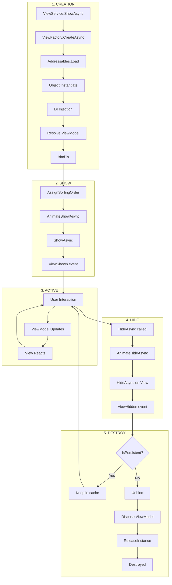
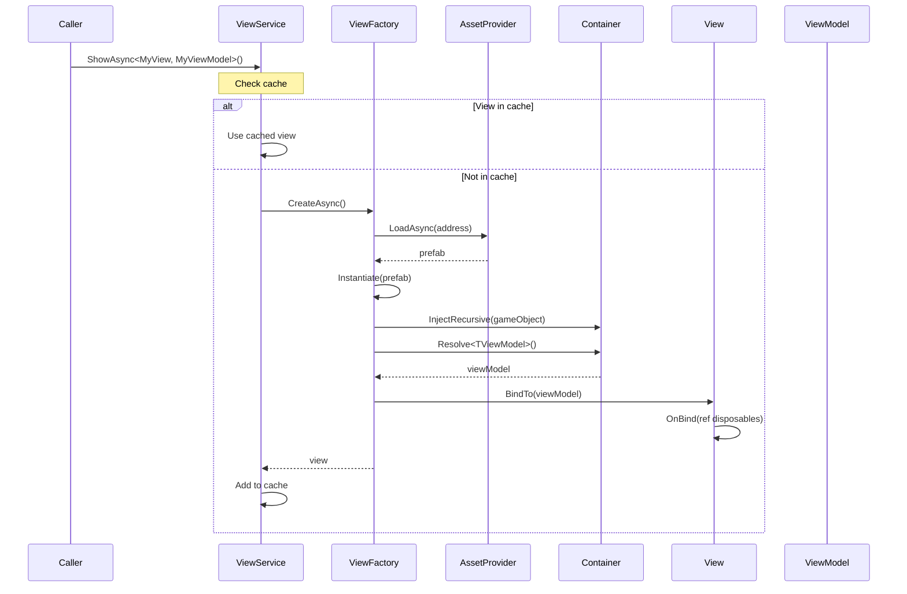
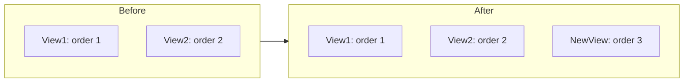
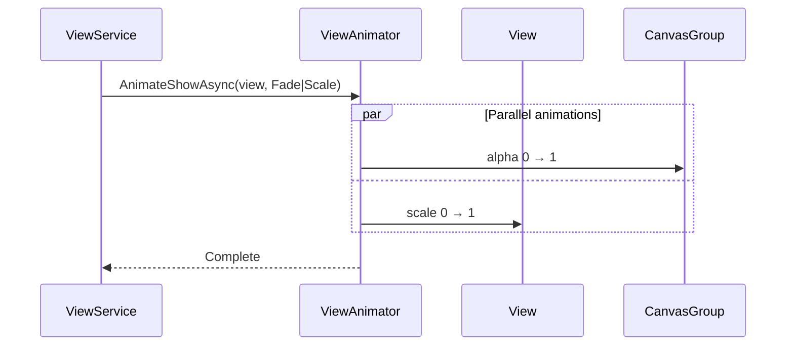
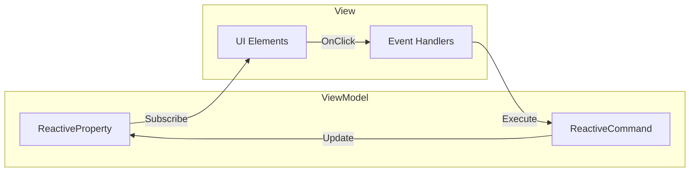
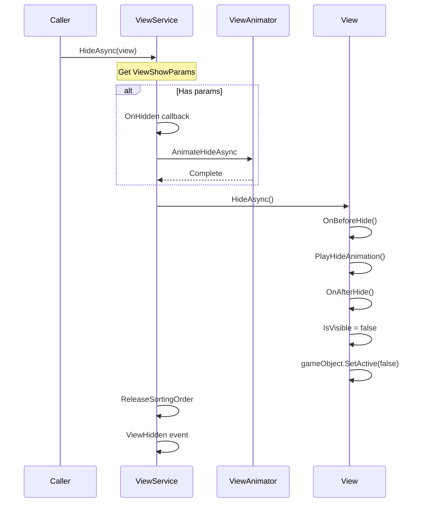
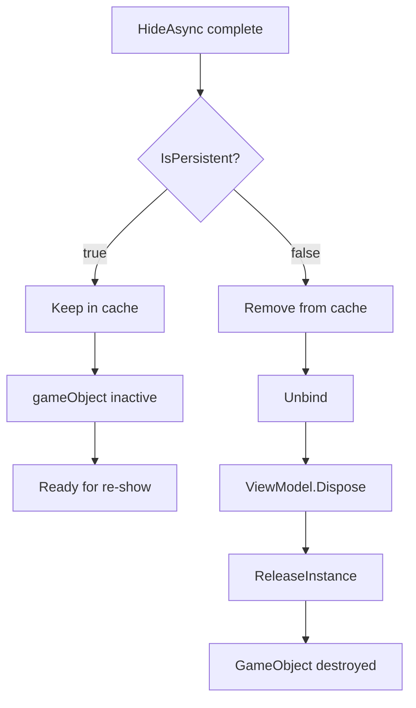
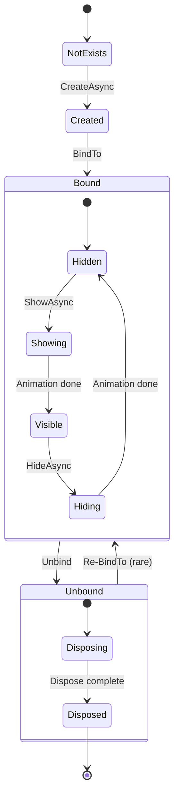
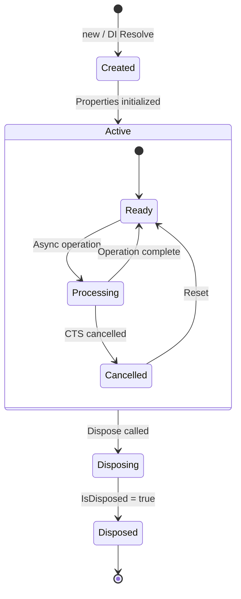
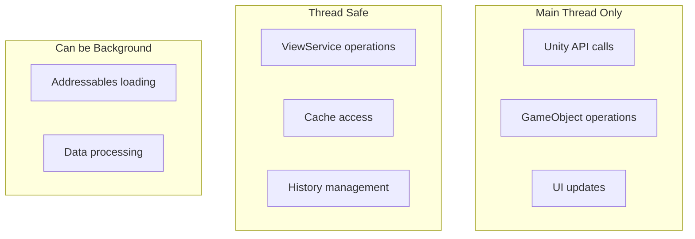

# Lifecycle — Жизненный цикл MVVM

Полное описание жизненного цикла View и ViewModel от создания до уничтожения.

---

## Общая схема



---

## Фаза 1: Создание (Creation)

### 1.1 ViewService.ShowAsync

```csharp
// Точка входа
await _viewService.ShowAsync<MyView, MyViewModel>(showParams);
```



### 1.2 ViewFactory.CreateAsync

Порядок операций:

| Шаг | Операция | Описание |
|-----|----------|----------|
| 1 | GetViewAddress | Получить Addressables адрес из ViewConfig |
| 2 | ResolveParent | Определить родительский Transform |
| 3 | InstantiateAsync | Загрузить и создать prefab |
| 4 | InjectRecursive | DI инъекция во все компоненты |
| 5 | Resolve ViewModel | Получить ViewModel из контейнера |
| 6 | BindTo | Привязать ViewModel к View |

### 1.3 BindTo и OnBind

```csharp
public IDisposable BindTo(TViewModel viewModel)
{
    // 1. Очистить предыдущие подписки
    _disposables.Dispose();
    _disposables = new DisposableBag();

    // 2. Установить ViewModel
    _viewModel.Value = viewModel;

    // 3. Настроить подписки (пользовательский код)
    OnBind(ref _disposables);

    return _disposables;
}
```

---

## Фаза 2: Показ (Show)

### 2.1 Sorting Order



```csharp
private void AssignSortingOrder(IView view)
{
    var canvas = GetOrAddCanvas(view);
    _currentMaxSortingOrder++;
    canvas.overrideSorting = true;
    canvas.sortingOrder = _currentMaxSortingOrder;
}
```

### 2.2 AnimateShowAsync



### 2.3 ShowAsync на View

```csharp
public virtual async UniTask ShowAsync()
{
    gameObject.SetActive(true);      // 1
    IsVisible = true;                 // 2
    await OnBeforeShow();             // 3 - hook
    await PlayShowAnimation();        // 4 - fallback
    await OnAfterShow();              // 5 - hook
}
```

---

## Фаза 3: Активное состояние

### 3.1 Реактивный поток данных



### 3.2 Пример потока

```csharp
// ViewModel
public ReactiveProperty<int> Score { get; } = new(0);
public ReactiveCommand<Unit> IncrementCommand { get; }

IncrementCommand = new ReactiveCommand<Unit>();
IncrementCommand.Subscribe(_ => Score.Value++);

// View
ViewModel.Score
    .Subscribe(_scoreText, static (s, t) => t.text = s.ToString())
    .AddTo(ref disposables);

_button.OnClickAsObservable()
    .Subscribe(ViewModel.IncrementCommand, 
        static (_, cmd) => cmd.Execute(Unit.Default))
    .AddTo(ref disposables);
```

---

## Фаза 4: Скрытие (Hide)

### 4.1 HideAsync flow



### 4.2 HideAsync на View

```csharp
public virtual async UniTask HideAsync()
{
    await OnBeforeHide();              // 1 - hook
    await PlayHideAnimation();         // 2 - fallback
    await OnAfterHide();               // 3 - hook
    IsVisible = false;                 // 4
    gameObject.SetActive(false);       // 5
}
```

---

## Фаза 5: Уничтожение (Destroy)

### 5.1 Persistent vs Non-Persistent



### 5.2 Unbind

```csharp
public virtual void Unbind()
{
    var currentViewModel = _viewModel.Value;
    _viewModel.Value = null;
    
    // ⚠️ ViewModel уничтожается!
    currentViewModel?.Dispose();
    
    _disposables.Dispose();
    _disposables = new DisposableBag();
}
```

### 5.3 ViewModel.Dispose

```csharp
public virtual void Dispose()
{
    if (IsDisposed) return;
    IsDisposed = true;

    // Отмена async операций
    SafeCancelAndDisposeRequestCts();
    
    // Очистка всех подписок
    _disposables.Dispose();
}
```

### 5.4 ReleaseInstance

```csharp
// ViewFactory
public void Destroy(IView view)
{
    if (view is IUnbindable unbindable)
        unbindable.Unbind();

    _assetProvider.ReleaseInstance(component.gameObject);
}
```

---

## Lifecycle Hooks Reference

### BindableView hooks

| Hook | Когда вызывается | Использование |
|------|------------------|---------------|
| `OnBind` | После BindTo | Настройка подписок |
| `OnBeforeShow` | Перед анимацией показа | Загрузка данных |
| `OnAfterShow` | После анимации показа | Запуск анимаций UI |
| `OnBeforeHide` | Перед анимацией скрытия | Сохранение данных |
| `OnAfterHide` | После анимации скрытия | Очистка UI |
| `OnDestroy` | При уничтожении | Автоматический Unbind |

### BindableElement hooks

| Hook | Когда вызывается | Использование |
|------|------------------|---------------|
| `OnBind` | Первая привязка | Установка UI |
| `OnRefresh` | Обновление данных | Оптимизированное обновление |
| `OnUnbind` | Отвязка данных | Сброс состояния |
| `OnSelectionChanged` | Изменение выделения | Визуальный отклик |
| `OnDispose` | Уничтожение | Очистка ресурсов |

---

## Диаграмма состояний View



---

## Диаграмма состояний ViewModel



---

## Timing и производительность

### Типичное время операций

| Операция | Время | Заметки |
|----------|-------|---------|
| Addressables.LoadAsync | 10-100ms | Зависит от размера |
| Instantiate | 1-5ms | Сложность prefab |
| DI Injection | <1ms | Количество полей |
| BindTo + OnBind | 1-10ms | Количество подписок |
| AnimateShow | 200-300ms | Настраиваемо |
| AnimateHide | 150-250ms | Настраиваемо |

### Оптимизации

1. **Preload Addressables** для критичных View
2. **Cache View** через IsPersistent
3. **Static lambdas** для zero-allocation подписок
4. **Batch Reconcile** вместо поэлементного обновления

---

## Thread Safety



ViewService использует:
- `ConcurrentDictionary` для кеша
- `lock(_sync)` для стеков
- `Interlocked.Exchange` для currentView

---

## Debugging Lifecycle

### События для отладки

```csharp
// В ViewService
_viewService.ViewShown += view => 
    Debug.Log($"[MVVM] Shown: {view.GetType().Name}");

_viewService.ViewHidden += view => 
    Debug.Log($"[MVVM] Hidden: {view.GetType().Name}");
```

### Проверка состояния

```csharp
// В любом месте
Debug.Log($"Current: {_viewService.CurrentView?.GetType().Name}");
Debug.Log($"Active: {_viewService.ActiveViews.Count}");
Debug.Log($"History: {_viewService.ViewHistory.Count}");
Debug.Log($"IsActive<T>: {_viewService.IsViewActive<MyView>()}");
```

---

## Частые ошибки

### ❌ Забыли AddTo

```csharp
// BAD: утечка памяти
ViewModel.Name.Subscribe(n => _text.text = n);

// GOOD
ViewModel.Name.Subscribe(...).AddTo(ref disposables);
```

### ❌ Использование после Dispose

```csharp
// BAD: может крашнуть
public async UniTask LoadAsync()
{
    var data = await _service.GetAsync();
    Name.Value = data.Name; // ViewModel может быть disposed!
}

// GOOD
public async UniTask LoadAsync()
{
    var data = await _service.GetAsync();
    if (IsDisposed) return;
    Name.Value = data.Name;
}
```

### ❌ Забыли проверить IsDisposed

```csharp
// BAD
public void DoSomething() => SomeProperty.Value = "value";

// GOOD
public void DoSomething()
{
    if (IsDisposed) return;
    SomeProperty.Value = "value";
}
```

---

## См. также

- [BindableView.md](BindableView.md) — детали View
- [ViewModel.md](ViewModel.md) — детали ViewModel
- [ViewService.md](ViewService.md) — API сервиса
- [ViewAnimator.md](ViewAnimator.md) — анимации
