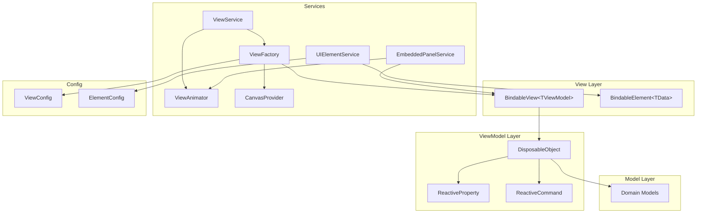
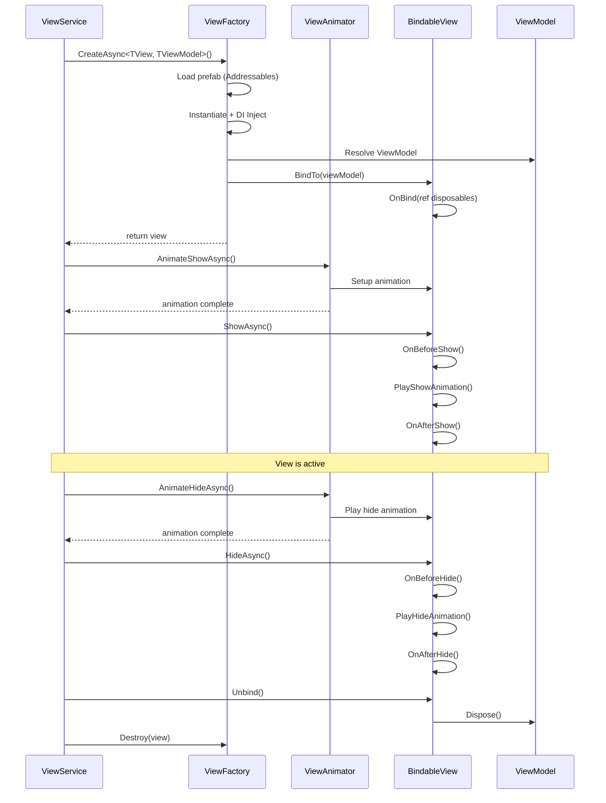
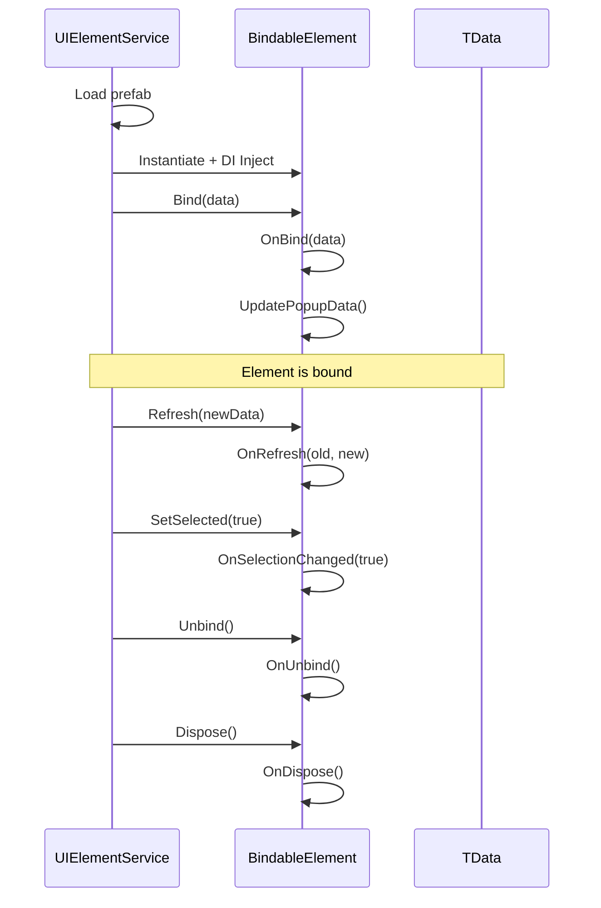

# MVVM Infrastructure — Архитектура

Инфраструктура MVVM (Model-View-ViewModel) для Unity проекта EndlessAdventure.

---

## Содержание документации

| Файл | Описание |
|------|----------|
| [ViewService.md](ViewService.md) | Сервис управления View — показ, скрытие, навигация |
| [ViewFactory.md](ViewFactory.md) | Фабрика создания View с DI |
| [ViewAnimator.md](ViewAnimator.md) | Система анимаций переходов (LitMotion) |
| [BindableView.md](BindableView.md) | Базовый класс View с lifecycle hooks |
| [ViewModel.md](ViewModel.md) | DisposableObject — базовый класс ViewModel |
| [ElementSystem.md](ElementSystem.md) | Система переиспользуемых UI элементов |
| [EmbeddedPanelService.md](EmbeddedPanelService.md) | Управление встраиваемыми панелями в сцене |
| [CanvasProvider.md](CanvasProvider.md) | Управление Canvas слоями |
| [UIElementFactory.md](UIElementFactory.md) | Простая фабрика UI элементов с DI |
| [Config.md](Config.md) | ViewConfig и ElementConfig — маппинг типов |
| [Lifecycle.md](Lifecycle.md) | Полный жизненный цикл View/ViewModel |

---

## Архитектура системы



---

## Слои архитектуры

### 1. View Layer
- **BindableView<TViewModel>** — MonoBehaviour, привязывается к ViewModel
- **BindableElement<TData>** — переиспользуемые UI элементы (списки, слоты)
- UI компоненты Unity (Button, Text, Image)
- Подписки через R3 (ReactiveExtensions)

### 2. ViewModel Layer
- **DisposableObject** — базовый класс с lifecycle management
- **ReactiveProperty<T>** — наблюдаемые свойства
- **ReactiveCommand** — команды с async поддержкой
- Бизнес-логика представления

### 3. Model Layer
- Domain модели (чистые данные)
- События изменений
- Валидация

### 4. Services Layer
- **ViewService** — управление показом/скрытием динамических View
- **ViewFactory** — создание View и инъекция зависимостей
- **ViewAnimator** — анимации переходов (LitMotion)
- **UIElementService** — создание и reconciliation элементов
- **EmbeddedPanelService** — управление встраиваемыми панелями в сцене
- **CanvasProvider** — управление Canvas слоями

---

## Жизненный цикл View



---

## Жизненный цикл Element



---

## Поток данных

```
┌──────────────────────────────────────────────────────────────────┐
│                         DATA FLOW                                 │
├──────────────────────────────────────────────────────────────────┤
│                                                                   │
│   Model ──────► ViewModel ──────► View                           │
│     │              │                │                             │
│     │              │                │                             │
│   state       ReactiveProperty    UI binding                     │
│   events      transformation      display                        │
│                                                                   │
│                                                                   │
│   View ───────► ViewModel ──────► Model                          │
│     │              │                │                             │
│     │              │                │                             │
│   user input   ReactiveCommand    state update                   │
│   UI events    validation         persistence                    │
│                                                                   │
└──────────────────────────────────────────────────────────────────┘
```

---

## Dependency Injection

Все компоненты MVVM используют **Reflex** для DI:

```csharp
// Container регистрация
container.AddSingleton<IViewService, ViewService>();
container.AddSingleton<IViewFactory, ViewFactory>();
container.AddSingleton<IViewAnimator, ViewAnimator>();
container.AddSingleton<IUIElementService, UIElementService>();
container.AddSingleton<ICanvasProvider, CanvasProvider>();

// ScriptableObject конфиги
container.AddSingleton<IViewConfig>(viewConfig);
container.AddSingleton<IElementConfig>(elementConfig);

// ViewModel регистрация (transient)
container.AddTransient<SettingsViewModel>();
container.AddTransient<HeroDetailPanelViewModel>();
```

---

## Быстрый старт

### 1. Создать ViewModel

```csharp
public class MyPanelViewModel : DisposableObject
{
    public ReactiveProperty<string> Title { get; } = new("Default");
    public ReactiveCommand<Unit> CloseCommand { get; }

    public MyPanelViewModel(IMediator mediator)
    {
        CloseCommand = new ReactiveCommand<Unit>(_ =>
        {
            // logic
        });
        CloseCommand.AddTo(ref Disposables);
    }
}
```

### 2. Создать View

```csharp
public class MyPanelView : BindableView<MyPanelViewModel>
{
    [SerializeField] private TMP_Text _title;
    [SerializeField] private Button _closeButton;

    protected override void OnBind(ref DisposableBag disposables)
    {
        ViewModel.Title
            .Subscribe(_title, static (t, text) => text.text = t)
            .AddTo(ref disposables);

        _closeButton.OnClickAsObservable()
            .Subscribe(ViewModel.CloseCommand, static (_, cmd) => cmd.Execute(Unit.Default))
            .AddTo(ref disposables);
    }
}
```

### 3. Настроить ViewConfig

В ScriptableObject `ViewConfig` добавить маппинг:
- ViewModel Type: `MyPanelViewModel`
- View Prefab: ссылка на prefab с `MyPanelView`

### 4. Показать View

```csharp
// Простой показ
await _viewService.ShowAsync<MyPanelView, MyPanelViewModel>();

// С параметрами
await _viewService.ShowAsync<MyPanelView, MyPanelViewModel>(
    new ViewShowParams()
        .SetDisplayMode(ViewDisplayMode.Additive)
        .SetTransition(ViewTransitionStyle.Fade | ViewTransitionStyle.Scale)
        .SetCanvas(CanvasLayer.Overlay)
);
```

---

## Best Practices

### ✅ DO

1. **Используй static lambdas** в Subscribe для избежания аллокаций:
   ```csharp
   property.Subscribe(this, static (value, self) => self.UpdateUI(value))
   ```

2. **Добавляй подписки в DisposableBag**:
   ```csharp
   observable.Subscribe(...).AddTo(ref disposables);
   ```

3. **Используй ViewShowParams** для настройки анимаций и режимов

4. **Reconcile элементы** вместо пересоздания:
   ```csharp
   await _elementService.ReconcileElementsAsync<TElement, TData>(container, newData);
   ```

5. **Делай ViewModel тестируемым** — без зависимости от MonoBehaviour

### ❌ DON'T

1. **Не храни ссылки на View в ViewModel**

2. **Не вызывай Unity API из ViewModel** (кроме Debug.Log)

3. **Не забывай Dispose()** — утечки памяти

4. **Не используй Find/GetComponent в Update** — кешируй

5. **Не создавай элементы вручную** — используй UIElementService

---

## См. также

- [ViewService.md](ViewService.md) — детали API сервиса
- [ElementSystem.md](ElementSystem.md) — система элементов
- [BindableView.md](BindableView.md) — создание View
