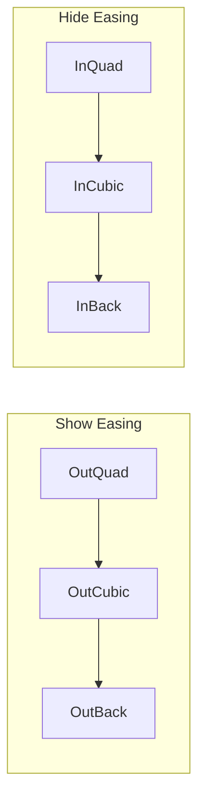
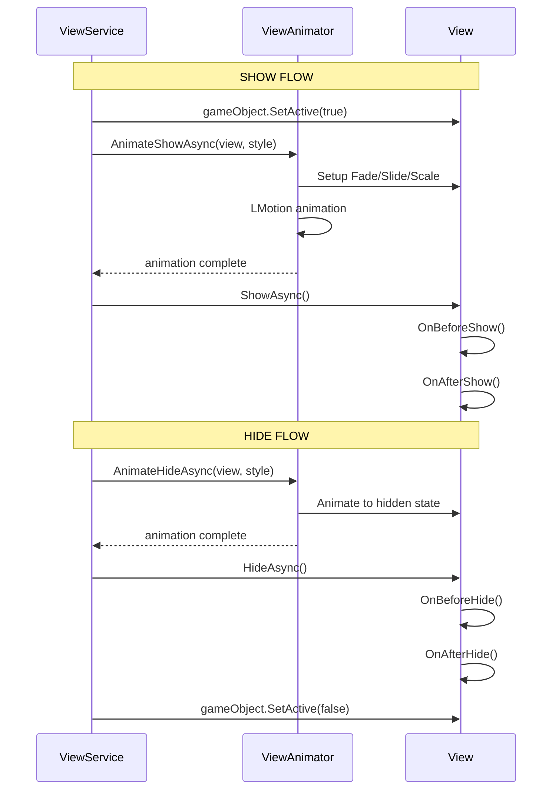

# ViewAnimator

Система анимаций переходов для View.

---

## Назначение

`ViewAnimator` отвечает за:
- Анимации появления (Show) View
- Анимации скрытия (Hide) View
- Комбинирование стилей анимации
- Управление активными анимациями

---

## Интерфейс IViewAnimator

```csharp
public interface IViewAnimator
{
    UniTask AnimateShowAsync(
        IView view, 
        ViewTransitionStyle transitionStyle, 
        float? duration = null);

    UniTask AnimateHideAsync(
        IView view, 
        ViewTransitionStyle transitionStyle, 
        float? duration = null);

    void StopAnimation(IView view);
}
```

---

## Стили анимации

```csharp
[Flags]
public enum ViewTransitionStyle
{
    None       = 0,        // Без анимации
    Fade       = 1 << 0,   // Alpha: 0 → 1 / 1 → 0
    SlideUp    = 1 << 1,   // Снизу вверх
    SlideDown  = 1 << 2,   // Сверху вниз
    SlideLeft  = 1 << 3,   // Справа налево (появляется справа)
    SlideRight = 1 << 4,   // Слева направо (появляется слева)
    Scale      = 1 << 5,   // Scale: 0 → 1 / 1 → 0
    Bounce     = 1 << 6    // Bounce easing для Slide
}
```

### Визуализация стилей

```
┌─────────────────────────────────────────────────────────────┐
│                      ANIMATION STYLES                        │
├─────────────────────────────────────────────────────────────┤
│                                                             │
│  Fade:        ▓▓▓▓▓▓▓▓ → ████████                          │
│               (alpha 0)   (alpha 1)                         │
│                                                             │
│  SlideUp:         ↑                                         │
│               ┌──────┐                                      │
│               │ View │  (from below screen)                 │
│               └──────┘                                      │
│                                                             │
│  SlideDown:       ↓                                         │
│               ┌──────┐                                      │
│               │ View │  (from above screen)                 │
│               └──────┘                                      │
│                                                             │
│  SlideLeft:   ┌──────┐ ←                                    │
│               │ View │    (from right side)                 │
│               └──────┘                                      │
│                                                             │
│  SlideRight:      → ┌──────┐                                │
│                     │ View │  (from left side)              │
│                     └──────┘                                │
│                                                             │
│  Scale:       ·  →  ┌──────┐                                │
│               (0)   │ View │ (1)                            │
│                     └──────┘                                │
│                                                             │
└─────────────────────────────────────────────────────────────┘
```

---

## Комбинации стилей

Стили можно комбинировать через `|`:

```csharp
// Fade + Slide снизу
ViewTransitionStyle.Fade | ViewTransitionStyle.SlideUp

// Scale с bounce эффектом
ViewTransitionStyle.Scale | ViewTransitionStyle.Bounce

// Полная анимация для модального окна
ViewTransitionStyle.Fade | ViewTransitionStyle.Scale | ViewTransitionStyle.Bounce

// Боковая панель
ViewTransitionStyle.SlideLeft | ViewTransitionStyle.Fade
```

---

## Реализация анимаций

### Fade (Alpha)

```csharp
private static MotionHandle AnimateFade(
    Component component, 
    float from, 
    float to, 
    float duration, 
    Ease ease)
{
    var canvasGroup = component.GetComponent<CanvasGroup>();
    if (canvasGroup == null)
        canvasGroup = component.gameObject.AddComponent<CanvasGroup>();

    canvasGroup.alpha = from;
    canvasGroup.interactable = false;
    canvasGroup.blocksRaycasts = to > 0.5f;

    return LMotion.Create(from, to, duration)
        .WithEase(ease)
        .WithOnComplete(() =>
        {
            canvasGroup.alpha = to;
            canvasGroup.interactable = to > 0.5f;
            canvasGroup.blocksRaycasts = to > 0.5f;
        })
        .Bind(alpha => canvasGroup.alpha = alpha);
}
```

### Scale

```csharp
private static MotionHandle AnimateScale(
    Component component, 
    float from, 
    float to, 
    float duration, 
    Ease ease)
{
    var transform = component.transform;
    transform.localScale = Vector3.one * from;

    return LMotion.Create(from, to, duration)
        .WithEase(ease)
        .WithOnComplete(() => transform.localScale = Vector3.one * to)
        .Bind(s => transform.localScale = Vector3.one * s);
}
```

### Slide

```csharp
private static MotionHandle AnimateSlideIn(
    Component component, 
    ViewTransitionStyle style, 
    float duration, 
    bool useBounce = false)
{
    var rectTransform = component.GetComponent<RectTransform>();
    var startPosition = GetOffscreenPosition(rectTransform, style);
    var endPosition = Vector2.zero;

    rectTransform.anchoredPosition = startPosition;

    var ease = useBounce ? Ease.OutBack : Ease.OutCubic;

    return LMotion.Create(startPosition, endPosition, duration)
        .WithEase(ease)
        .Bind(pos => rectTransform.anchoredPosition = pos);
}
```

---

## Easing

ViewAnimator использует **LitMotion** для анимаций:

| Тип | Show | Hide |
|-----|------|------|
| Fade | `OutQuad` | `InQuad` |
| Scale | `OutBack` | `InCubic` |
| Slide | `OutCubic` | `InCubic` |
| Bounce | `OutBack` | `InBack` |



---

## Длительность анимаций

```csharp
private const float DefaultShowDuration = 0.25f;
private const float DefaultHideDuration = 0.2f;

// Кастомная длительность
await _viewAnimator.AnimateShowAsync(view, style, duration: 0.5f);
```

---

## Отмена анимации

```csharp
// Остановить текущую анимацию
_viewAnimator.StopAnimation(view);
```

**Реализация:**
```csharp
public void StopAnimation(IView view)
{
    if (!_activeAnimations.TryGetValue(view, out var handles))
        return;

    foreach (var handle in handles)
    {
        if (handle.IsActive())
            handle.Cancel();
    }

    _activeAnimations.Remove(view);
}
```

---

## Инверсия направления при скрытии

При скрытии Slide анимация инвертируется:

```csharp
private static ViewTransitionStyle InvertSlideDirection(ViewTransitionStyle style)
{
    var result = style;
    
    if (style.HasFlag(ViewTransitionStyle.SlideLeft))
    {
        result &= ~ViewTransitionStyle.SlideLeft;
        result |= ViewTransitionStyle.SlideRight;
    }
    else if (style.HasFlag(ViewTransitionStyle.SlideRight))
    {
        result &= ~ViewTransitionStyle.SlideRight;
        result |= ViewTransitionStyle.SlideLeft;
    }
    
    // Аналогично для Up/Down
    
    return result;
}
```

**Пример:**
- Show: `SlideLeft` → появляется справа, едет влево
- Hide: инвертируется → едет вправо, исчезает справа

---

## Примеры использования

### В ViewService

```csharp
// ViewService автоматически вызывает animator
await _viewService.ShowAsync<MyView, MyViewModel>(
    new ViewShowParams()
        .SetTransition(ViewTransitionStyle.Fade | ViewTransitionStyle.Scale)
        .SetAnimationDuration(0.3f)
);
```

### Напрямую

```csharp
// Ручная анимация
await _viewAnimator.AnimateShowAsync(
    view, 
    ViewTransitionStyle.Fade | ViewTransitionStyle.SlideUp, 
    0.25f);

// Скрытие
await _viewAnimator.AnimateHideAsync(
    view, 
    ViewTransitionStyle.Fade, 
    0.2f);
```

### В EmbeddedPanelService

```csharp
public async UniTask<bool> ShowEmbeddedAsync<TViewModel>(...)
{
    panel.GameObject.SetActive(true);
    
    var transition = GetTransitionStyle(vmType);
    await _viewAnimator.AnimateShowAsync(panel.View, transition, AnimationDuration);
    
    return true;
}
```

---

## Lifecycle с анимацией



---

## Offscreen Position

Расчёт позиции за экраном:

```csharp
private static Vector2 GetOffscreenPosition(
    RectTransform rectTransform, 
    ViewTransitionStyle style)
{
    var offset = Vector2.zero;
    var rect = rectTransform.rect;

    if (style.HasFlag(ViewTransitionStyle.SlideUp))
        offset.y -= rect.height + 100f;

    if (style.HasFlag(ViewTransitionStyle.SlideDown))
        offset.y += rect.height + 100f;

    if (style.HasFlag(ViewTransitionStyle.SlideLeft))
        offset.x += rect.width + 100f;

    if (style.HasFlag(ViewTransitionStyle.SlideRight))
        offset.x -= rect.width + 100f;

    return offset;
}
```

**Отступ +100f** предотвращает мелькание на границе экрана.

---

## Требования к View

Для работы анимаций View должен иметь:

| Анимация | Требуемый компонент |
|----------|---------------------|
| Fade | `CanvasGroup` (создаётся автоматически) |
| Scale | `Transform` |
| Slide | `RectTransform` |

---

## Best Practices

### ✅ DO

1. **Используй Fade** для большинства View
2. **Добавляй CanvasGroup** заранее для оптимизации
3. **Комбинируй стили** для богатых переходов
4. **Используй Bounce** для важных UI элементов

### ❌ DON'T

1. **Не анимируй слишком долго** — пользователь ждёт
2. **Не используй тяжёлые анимации** на мобильных
3. **Не забывай StopAnimation** при быстром закрытии

---

## См. также

- [ViewService.md](ViewService.md) — использование анимаций
- [BindableView.md](BindableView.md) — кастомные анимации в View
