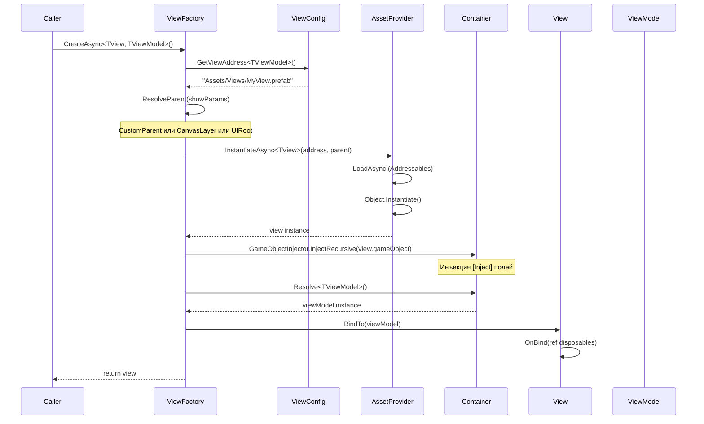
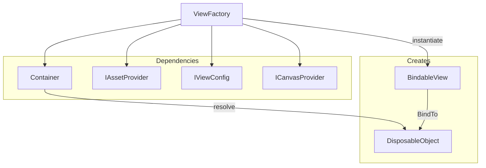

# ViewFactory

Фабрика создания View с загрузкой ассетов и инъекцией зависимостей.

---

## Назначение

`ViewFactory` отвечает за:
- Загрузку prefab'ов View через Addressables
- Инстанцирование View
- Инъекцию зависимостей (DI) в иерархию GameObject
- Резолв и привязку ViewModel
- Уничтожение View с освобождением ресурсов

---

## Интерфейс IViewFactory

```csharp
public interface IViewFactory
{
    // Создание по типу ViewModel
    UniTask<IView> CreateAsync(Type viewModelType, ViewShowParams showParams = null);

    // Типизированное создание
    UniTask<TView> CreateAsync<TView, TViewModel>(Transform parent = null) 
        where TView : BindableView<TViewModel> 
        where TViewModel : DisposableObject;

    UniTask<TView> CreateAsync<TView, TViewModel>(string address, Transform parent = null) 
        where TView : BindableView<TViewModel> 
        where TViewModel : DisposableObject;

    UniTask<TView> CreateAsync<TView, TViewModel>(ViewShowParams showParams) 
        where TView : BindableView<TViewModel> 
        where TViewModel : DisposableObject;

    // Уничтожение
    void Destroy(IView view);
}
```

---

## Процесс создания View



---

## Реализация

```csharp
public class ViewFactory : IViewFactory
{
    private readonly Container _container;
    private readonly IAssetProvider _assetProvider;
    private readonly IViewConfig _viewConfig;
    private readonly ICanvasProvider _canvasProvider;
    private readonly Transform _uiRoot;

    public ViewFactory(
        Container container, 
        IAssetProvider assetProvider, 
        IViewConfig viewConfig, 
        ICanvasProvider canvasProvider = null)
    {
        _container = container;
        _assetProvider = assetProvider;
        _viewConfig = viewConfig;
        _canvasProvider = canvasProvider;
        _uiRoot = CreateUIRoot();
    }
}
```

---

## UI Root

ViewFactory создаёт корневой объект `[UIRoot]`:

```csharp
private static Transform CreateUIRoot()
{
    var existing = GameObject.Find("[UIRoot]");
    if (existing != null)
        return existing.transform;

    var root = new GameObject("[UIRoot]");
    Object.DontDestroyOnLoad(root);
    return root.transform;
}
```

**Иерархия:**
```
[UIRoot]
├── MainMenuView
├── SettingsView
└── ConfirmDialogView
```

---

## Определение родителя (Parent Resolution)

```csharp
private Transform ResolveParent(ViewShowParams showParams)
{
    // 1. Custom Parent (приоритет)
    if (showParams.CustomParent != null)
        return showParams.CustomParent;

    // 2. Target Canvas
    if (showParams.TargetCanvas.HasValue && _canvasProvider != null)
    {
        var canvasTransform = _canvasProvider.GetCanvasTransform(showParams.TargetCanvas.Value);
        if (canvasTransform != null)
            return canvasTransform;
    }

    // 3. Default UI Root
    return _uiRoot;
}
```

### CanvasLayer

```csharp
public enum CanvasLayer
{
    World,    // 3D UI в мире
    Screen,   // Основной UI
    Overlay,  // Поверх всего (диалоги)
    System    // Системные сообщения (debug)
}
```

---

## Примеры использования

### Базовое создание

```csharp
// Через ViewService (рекомендуется)
var view = await _viewService.ShowAsync<MyView, MyViewModel>();

// Напрямую через фабрику
var view = await _viewFactory.CreateAsync<MyView, MyViewModel>();
view.gameObject.SetActive(true);
```

### С кастомным parent

```csharp
[SerializeField] private Transform _panelContainer;

var view = await _viewFactory.CreateAsync<SubPanelView, SubPanelViewModel>(_panelContainer);
```

### С ViewShowParams

```csharp
var view = await _viewFactory.CreateAsync<DialogView, DialogViewModel>(
    new ViewShowParams()
        .SetCanvas(CanvasLayer.Overlay)
        .SetCustomParent(dialogContainer)
);
```

---

## Dependency Injection

ViewFactory использует **Reflex** для DI:

```csharp
// Инъекция во все компоненты GameObject
GameObjectInjector.InjectRecursive(instance.gameObject, _container);
```

**Пример View с инъекцией:**

```csharp
public class SettingsView : BindableView<SettingsViewModel>
{
    [Inject] private IInputService _inputService;
    [Inject] private IAudioService _audioService;

    protected override void OnBind(ref DisposableBag disposables)
    {
        // _inputService и _audioService уже заинжектированы
    }
}
```

---

## BindTo процесс

```csharp
// ViewFactory вызывает BindTo
view.BindTo(viewModel);

// Внутри BindableView
public IDisposable BindTo(TViewModel viewModel)
{
    _disposables.Dispose();
    _disposables = new DisposableBag();
    
    _viewModel.Value = viewModel;
    
    OnBind(ref _disposables);  // ← Пользовательская логика
    
    return _disposables;
}
```

---

## Уничтожение View

```csharp
public void Destroy(IView view)
{
    if (view is not Component component)
        return;

    // Unbind (очистка подписок)
    if (view is IUnbindable unbindable)
        unbindable.Unbind();

    // Освобождение Addressable ресурса
    _assetProvider.ReleaseInstance(component.gameObject);
}
```

**Важно:** `ReleaseInstance` освобождает ресурс Addressables и уничтожает GameObject.

---

## Диаграмма зависимостей



---

## Создание View через рефлексию

Для динамического создания по типу ViewModel:

```csharp
public async UniTask<IView> CreateAsync(Type viewModelType, ViewShowParams showParams = null)
{
    var address = _viewConfig.GetViewAddress(viewModelType);
    var parent = showParams != null ? ResolveParent(showParams) : _uiRoot;
    
    var prefab = await _assetProvider.LoadAsync<GameObject>(address);
    var instance = Object.Instantiate(prefab, parent);
    GameObjectInjector.InjectRecursive(instance, _container);
    
    var view = instance.GetComponent<IView>();
    var viewModel = _container.Resolve(viewModelType);
    
    // Рефлексия для вызова BindTo
    var bindMethod = view.GetType().GetMethod("BindTo");
    bindMethod?.Invoke(view, new[] { viewModel });
    
    return view;
}
```

---

## Error Handling

```csharp
// Prefab не найден
if (view == null)
    throw new InvalidOperationException(
        $"Prefab at {address} does not have IView component");

// Адрес не настроен
throw new KeyNotFoundException(
    $"View mapping not found for ViewModel: {viewModelType.Name}");
```

---

## Best Practices

### ✅ DO

1. **Используй ViewService** для показа View (он вызывает Factory)
2. **Регистрируй маппинги** в ViewConfig
3. **Освобождай ресурсы** через Destroy или ViewService

### ❌ DON'T

1. **Не создавай View напрямую** через Instantiate
2. **Не забывай Unbind** перед уничтожением
3. **Не храни ссылки** на уничтоженные View

---

## См. также

- [ViewRegistry.md](ViewRegistry.md) — настройка маппинга
- [ViewService.md](ViewService.md) — высокоуровневый API
- [BindableView.md](BindableView.md) — базовый класс
