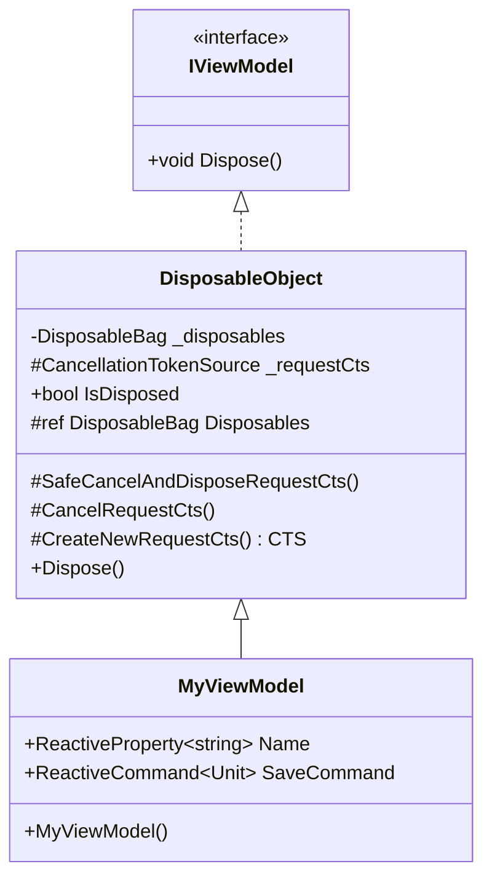
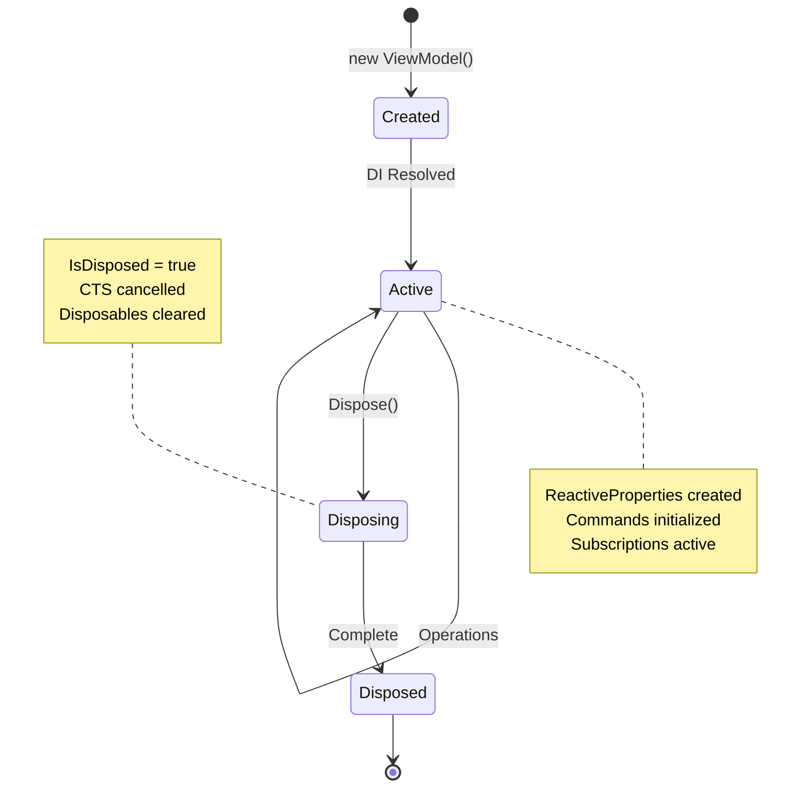

# ViewModel (DisposableObject)

Базовый класс для всех ViewModel в MVVM архитектуре.

---

## Назначение

`DisposableObject` — базовый класс, который обеспечивает:
- Управление lifecycle и очистку ресурсов
- Автоматическую отписку через DisposableBag
- Управление асинхронными операциями через CancellationToken
- Паттерн Dispose для предотвращения утечек памяти

---

## Определение класса

```csharp
public class DisposableObject : IViewModel
{
    private DisposableBag _disposables;
    protected CancellationTokenSource _requestCts;

    public bool IsDisposed { get; private set; }

    protected ref DisposableBag Disposables => ref _disposables;

    // CTS management
    protected void SafeCancelAndDisposeRequestCts();
    protected void CancelRequestCts();
    protected CancellationTokenSource CreateNewRequestCts();

    public virtual void Dispose();
}
```

---

## Диаграмма классов



---

## Lifecycle



---

## Публичный API

### Свойства

| Свойство | Тип | Описание |
|----------|-----|----------|
| `IsDisposed` | `bool` | Был ли вызван Dispose() |
| `Disposables` | `ref DisposableBag` | Bag для подписок (protected) |

### Методы

| Метод | Описание |
|-------|----------|
| `Dispose()` | Освобождение ресурсов |
| `CreateNewRequestCts()` | Создать новый CTS (protected) |
| `CancelRequestCts()` | Отменить текущий CTS (protected) |
| `SafeCancelAndDisposeRequestCts()` | Безопасная отмена и dispose CTS (protected) |

---

## Создание ViewModel

### Базовая структура

```csharp
public class HeroDetailViewModel : DisposableObject
{
    // ReactiveProperty для состояния
    public ReactiveProperty<string> HeroName { get; }
    public ReactiveProperty<int> Level { get; }
    public ReactiveProperty<float> Health { get; }
    public ReactiveProperty<bool> IsLoading { get; }

    // ReactiveCommand для действий
    public ReactiveCommand<Unit> LevelUpCommand { get; }
    public ReactiveCommand<Unit> HealCommand { get; }

    // Зависимости через DI
    private readonly IHeroService _heroService;
    private readonly IMediator _mediator;

    public HeroDetailViewModel(
        IHeroService heroService,
        IMediator mediator)
    {
        _heroService = heroService;
        _mediator = mediator;

        // Инициализация свойств
        HeroName = new ReactiveProperty<string>("");
        Level = new ReactiveProperty<int>(1);
        Health = new ReactiveProperty<float>(100f);
        IsLoading = new ReactiveProperty<bool>(false);

        // Добавляем в Disposables!
        HeroName.AddTo(ref Disposables);
        Level.AddTo(ref Disposables);
        Health.AddTo(ref Disposables);
        IsLoading.AddTo(ref Disposables);

        // Инициализация команд
        LevelUpCommand = new ReactiveCommand<Unit>(
            Level.Select(l => l < 100)); // canExecute
        LevelUpCommand.Subscribe(this, static (_, self) => self.OnLevelUp());
        LevelUpCommand.AddTo(ref Disposables);

        HealCommand = new ReactiveCommand<Unit>();
        HealCommand.Subscribe(this, static (_, self) => self.OnHeal());
        HealCommand.AddTo(ref Disposables);
    }

    private void OnLevelUp()
    {
        if (IsDisposed) return;
        Level.Value++;
    }

    private void OnHeal()
    {
        if (IsDisposed) return;
        Health.Value = 100f;
    }
}
```

---

## ReactiveProperty

```csharp
// Создание
public ReactiveProperty<string> Name { get; } = new("");

// Чтение значения
var currentName = Name.Value;

// Запись значения
Name.Value = "New Name";

// Подписка (в View)
Name.Subscribe(value => Debug.Log(value));

// Computed property (read-only)
public ReadOnlyReactiveProperty<string> DisplayName { get; }

DisplayName = Name
    .Select(n => $"Hero: {n}")
    .ToReadOnlyReactiveProperty();
DisplayName.AddTo(ref Disposables);
```

---

## ReactiveCommand

```csharp
// Простая команда
public ReactiveCommand<Unit> CloseCommand { get; }

CloseCommand = new ReactiveCommand<Unit>();
CloseCommand.Subscribe(_ => OnClose());
CloseCommand.AddTo(ref Disposables);

// Команда с canExecute
public ReactiveCommand<Unit> SaveCommand { get; }

SaveCommand = new ReactiveCommand<Unit>(
    CanSave.CombineLatest(IsLoading, (can, loading) => can && !loading));
SaveCommand.AddTo(ref Disposables);

// Асинхронная команда
SaveCommand.Subscribe(async _ => await SaveAsync());
```

---

## Управление CancellationToken

### CreateNewRequestCts

```csharp
public async UniTask LoadDataAsync()
{
    if (IsDisposed) return;

    // Отменяет предыдущий запрос, создаёт новый CTS
    var cts = CreateNewRequestCts();

    try
    {
        IsLoading.Value = true;
        var data = await _api.GetDataAsync(cts.Token);
        
        if (!cts.Token.IsCancellationRequested)
        {
            ProcessData(data);
        }
    }
    catch (OperationCanceledException)
    {
        // Запрос отменён — это нормально
    }
    finally
    {
        IsLoading.Value = false;
    }
}
```

### CancelRequestCts

```csharp
public void CancelCurrentOperation()
{
    CancelRequestCts(); // Только отмена, без dispose
}
```

### SafeCancelAndDisposeRequestCts

```csharp
public override void Dispose()
{
    if (IsDisposed) return;
    
    SafeCancelAndDisposeRequestCts(); // Безопасная очистка
    base.Dispose();
}
```

---

## Dispose паттерн

```csharp
public virtual void Dispose()
{
    if (IsDisposed) return;  // Idempotent
    IsDisposed = true;

    SafeCancelAndDisposeRequestCts();
    _disposables.Dispose();
}
```

### Проверка IsDisposed

```csharp
public void DoSomething()
{
    // Всегда проверяйте!
    if (IsDisposed) return;

    // Safe to proceed
    SomeProperty.Value = "new value";
}

public async UniTask LoadAsync()
{
    if (IsDisposed) return;

    var data = await _service.GetAsync();
    
    // Проверка после await!
    if (IsDisposed) return;

    ProcessData(data);
}
```

---

## Взаимодействие с сервисами

### Через DI

```csharp
public class InventoryViewModel : DisposableObject
{
    private readonly IInventoryService _inventoryService;
    private readonly IMediator _mediator;
    private readonly ILogger _logger;

    public InventoryViewModel(
        IInventoryService inventoryService,
        IMediator mediator,
        ILogger logger)
    {
        _inventoryService = inventoryService;
        _mediator = mediator;
        _logger = logger;

        Initialize();
    }
}
```

### Подписка на события

```csharp
private void Initialize()
{
    // Подписка на события сервиса
    _inventoryService.OnItemAdded
        .Subscribe(this, static (item, self) => self.HandleItemAdded(item))
        .AddTo(ref Disposables);

    // Подписка на уведомления
    _mediator.Subscribe<InventoryChangedNotification>(HandleInventoryChanged)
        .AddTo(ref Disposables);
}
```

---

## Computed Properties

```csharp
public class ShopItemViewModel : DisposableObject
{
    public ReactiveProperty<int> Price { get; } = new(100);
    public ReactiveProperty<int> Discount { get; } = new(0);
    public ReactiveProperty<int> PlayerGold { get; } = new(0);

    // Computed: финальная цена
    public ReadOnlyReactiveProperty<int> FinalPrice { get; }

    // Computed: может ли купить
    public ReadOnlyReactiveProperty<bool> CanAfford { get; }

    public ShopItemViewModel()
    {
        FinalPrice = Price
            .CombineLatest(Discount, (p, d) => p - (p * d / 100))
            .ToReadOnlyReactiveProperty();
        FinalPrice.AddTo(ref Disposables);

        CanAfford = FinalPrice
            .CombineLatest(PlayerGold, (price, gold) => gold >= price)
            .ToReadOnlyReactiveProperty();
        CanAfford.AddTo(ref Disposables);
    }
}
```

---

## Полный пример

```csharp
public class HeroesGridPanelViewModel : DisposableObject
{
    // State
    public ReactiveProperty<bool> IsLoading { get; }
    public ReactiveProperty<List<HeroCardData>> Heroes { get; }
    public ReactiveProperty<HeroCardData?> SelectedHero { get; }

    // Computed
    public ReadOnlyReactiveProperty<bool> HasSelection { get; }
    public ReadOnlyReactiveProperty<int> HeroCount { get; }

    // Commands
    public ReactiveCommand<HeroCardData> SelectHeroCommand { get; }
    public ReactiveCommand<Unit> ConfirmCommand { get; }
    public ReactiveCommand<Unit> RefreshCommand { get; }

    // Dependencies
    private readonly IHeroRepository _heroRepository;
    private readonly IMediator _mediator;

    public HeroesGridPanelViewModel(
        IHeroRepository heroRepository,
        IMediator mediator)
    {
        _heroRepository = heroRepository;
        _mediator = mediator;

        // Init state
        IsLoading = new ReactiveProperty<bool>(false);
        Heroes = new ReactiveProperty<List<HeroCardData>>(new());
        SelectedHero = new ReactiveProperty<HeroCardData?>(null);

        IsLoading.AddTo(ref Disposables);
        Heroes.AddTo(ref Disposables);
        SelectedHero.AddTo(ref Disposables);

        // Computed properties
        HasSelection = SelectedHero
            .Select(h => h.HasValue)
            .ToReadOnlyReactiveProperty();
        HasSelection.AddTo(ref Disposables);

        HeroCount = Heroes
            .Select(list => list.Count)
            .ToReadOnlyReactiveProperty();
        HeroCount.AddTo(ref Disposables);

        // Commands
        SelectHeroCommand = new ReactiveCommand<HeroCardData>();
        SelectHeroCommand
            .Subscribe(this, static (data, self) => self.SelectHero(data))
            .AddTo(ref Disposables);

        ConfirmCommand = new ReactiveCommand<Unit>(HasSelection);
        ConfirmCommand
            .Subscribe(this, static (_, self) => self.ConfirmSelection())
            .AddTo(ref Disposables);

        RefreshCommand = new ReactiveCommand<Unit>(
            IsLoading.Select(l => !l));
        RefreshCommand
            .Subscribe(this, static (_, self) => 
                self.LoadHeroesAsync().Forget())
            .AddTo(ref Disposables);
    }

    public async UniTask LoadHeroesAsync()
    {
        if (IsDisposed) return;

        var cts = CreateNewRequestCts();

        try
        {
            IsLoading.Value = true;

            var heroes = await _heroRepository.GetAllAsync(cts.Token);

            if (IsDisposed || cts.Token.IsCancellationRequested) 
                return;

            Heroes.Value = heroes
                .Select(h => new HeroCardData(h))
                .ToList();
        }
        catch (OperationCanceledException)
        {
            // Normal cancellation
        }
        catch (Exception ex)
        {
            Debug.LogError($"Failed to load heroes: {ex.Message}");
        }
        finally
        {
            if (!IsDisposed)
                IsLoading.Value = false;
        }
    }

    private void SelectHero(HeroCardData hero)
    {
        if (IsDisposed) return;
        SelectedHero.Value = hero;
    }

    private void ConfirmSelection()
    {
        if (IsDisposed || !SelectedHero.Value.HasValue) return;

        _mediator.Publish(new HeroSelectedNotification(SelectedHero.Value.Value));
    }

    public override void Dispose()
    {
        if (IsDisposed) return;
        
        SafeCancelAndDisposeRequestCts();
        base.Dispose();
    }
}
```

---

## Регистрация в DI

```csharp
// В InfrastructureBindings или ProjectInstaller
public static void AddViewModels(this ContainerBuilder builder)
{
    // Transient — новый экземпляр при каждом resolve
    builder.AddTransient<SettingsViewModel>();
    builder.AddTransient<HeroDetailViewModel>();
    builder.AddTransient<InventoryViewModel>();

    // Singleton — один экземпляр на всё приложение
    builder.AddSingleton<GlobalStateViewModel>();
}
```

---

## Best Practices

### ✅ DO

1. **Всегда AddTo(ref Disposables)** для ReactiveProperty и подписок
2. **Проверяй IsDisposed** перед операциями
3. **Используй CreateNewRequestCts()** для async операций
4. **Проверяй IsDisposed после await**
5. **Делай ViewModel тестируемым** — без Unity зависимостей

### ❌ DON'T

1. **Не храни ссылки на MonoBehaviour** в ViewModel
2. **Не вызывай Unity API** (кроме Debug.Log)
3. **Не создавай подписки без AddTo**
4. **Не игнорируй IsDisposed**
5. **Не забывай override Dispose** если есть дополнительные ресурсы

---

## См. также

- [BindableView.md](BindableView.md) — привязка к View
- [Lifecycle.md](Lifecycle.md) — полный жизненный цикл
- [ViewService.md](ViewService.md) — управление View
