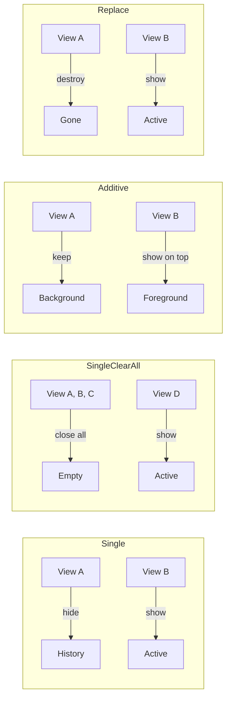
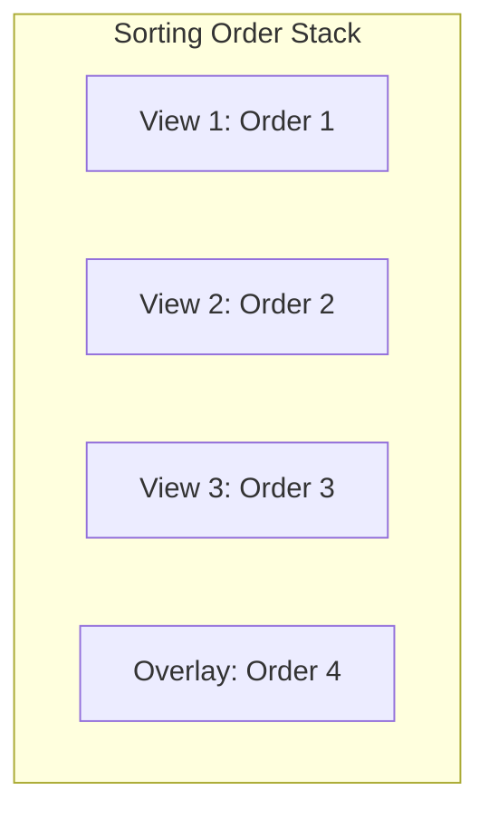
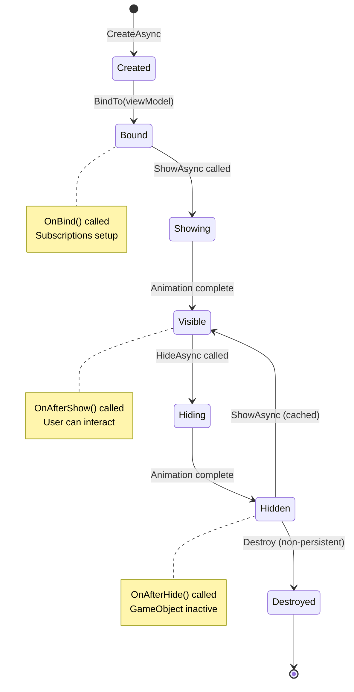
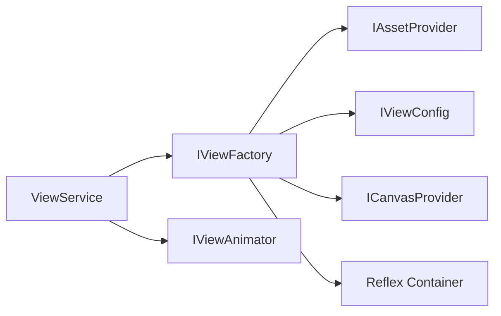

# ViewService

Центральный сервис управления View — показ, скрытие, навигация, кеширование.

---

## Назначение

`ViewService` — единая точка входа для:
- Показа и скрытия View
- Управления стеком навигации
- Кеширования View
- Управления sorting order
- Событий жизненного цикла

---

## Интерфейс IViewService

```csharp
public interface IViewService
{
    // Текущее состояние
    IView CurrentView { get; }
    IReadOnlyCollection<IView> ViewHistory { get; }
    IReadOnlyCollection<IView> ActiveViews { get; }

    // Показ View
    UniTask<IView> ShowAsync<TViewModel>(ViewShowParams showParams = null) 
        where TViewModel : DisposableObject;
    
    UniTask<TView> ShowAsync<TView, TViewModel>(bool hideCurrentView = true) 
        where TView : BindableView<TViewModel> 
        where TViewModel : DisposableObject;
    
    UniTask<TView> ShowAsync<TView, TViewModel>(ViewShowParams showParams) 
        where TView : BindableView<TViewModel> 
        where TViewModel : DisposableObject;

    // Скрытие View
    UniTask<bool> HideViewAsync<TViewModel>() where TViewModel : DisposableObject;
    UniTask HideAsync<TView>() where TView : IView;
    UniTask HideAsync(IView view);
    UniTask HideCurrentAsync();

    // Навигация
    UniTask GoBackAsync();
    UniTask GoToRootAsync();
    UniTask CloseAllNonPersistentAsync();
    void ClearHistory();

    // Утилиты
    TViewModel GetViewModel<TViewModel>() where TViewModel : DisposableObject;
    bool IsViewActive<TView>() where TView : IView;
    TView GetActiveView<TView>() where TView : IView;
    void ClearCache();

    // События
    event Action<IView> ViewShown;
    event Action<IView> ViewHidden;
}
```

---

## Режимы отображения (ViewDisplayMode)

```csharp
public enum ViewDisplayMode
{
    Single,         // Скрыть текущий, показать новый (с историей)
    SingleClearAll, // Закрыть ВСЕ, показать новый
    Additive,       // Показать поверх текущего
    Replace         // Заменить текущий (без истории)
}
```

### Диаграмма режимов



---

## Стили анимации (ViewTransitionStyle)

```csharp
[Flags]
public enum ViewTransitionStyle
{
    None       = 0,
    Fade       = 1 << 0,  // Alpha fade
    SlideUp    = 1 << 1,  // Снизу вверх
    SlideDown  = 1 << 2,  // Сверху вниз
    SlideLeft  = 1 << 3,  // Справа налево
    SlideRight = 1 << 4,  // Слева направо
    Scale      = 1 << 5,  // Scale 0 → 1
    Bounce     = 1 << 6   // Bounce easing
}
```

**Комбинации флагов:**
```csharp
// Fade + Slide снизу
ViewTransitionStyle.Fade | ViewTransitionStyle.SlideUp

// Scale с bounce эффектом
ViewTransitionStyle.Scale | ViewTransitionStyle.Bounce

// Slide справа с fade
ViewTransitionStyle.SlideLeft | ViewTransitionStyle.Fade
```

---

## ViewShowParams

Fluent API для настройки показа View:

```csharp
public class ViewShowParams
{
    // Свойства
    ViewDisplayMode DisplayMode { get; }
    ViewTransitionStyle TransitionStyle { get; }
    CanvasLayer? TargetCanvas { get; }
    Transform CustomParent { get; }
    Func<UniTask> OnShown { get; }
    Func<UniTask> OnHidden { get; }
    float? AnimationDuration { get; }

    // Fluent методы
    ViewShowParams SetDisplayMode(ViewDisplayMode mode);
    ViewShowParams SetTransition(ViewTransitionStyle style);
    ViewShowParams SetCanvas(CanvasLayer layer);
    ViewShowParams SetCustomParent(Transform parent);
    ViewShowParams SetOnShown(Func<UniTask> callback);
    ViewShowParams SetOnHidden(Func<UniTask> callback);
    ViewShowParams SetAnimationDuration(float duration);

    // Presets
    static ViewShowParams Default();
    static ViewShowParams Instant();
    static ViewShowParams Overlay();
}
```

---

## Примеры использования

### Базовый показ

```csharp
// Показать с автоматическим скрытием текущего
var view = await _viewService.ShowAsync<SettingsView, SettingsViewModel>();

// Показать без скрытия текущего
var view = await _viewService.ShowAsync<SettingsView, SettingsViewModel>(hideCurrentView: false);
```

### С параметрами

```csharp
// Модальное окно поверх
await _viewService.ShowAsync<ConfirmDialogView, ConfirmDialogViewModel>(
    new ViewShowParams()
        .SetDisplayMode(ViewDisplayMode.Additive)
        .SetTransition(ViewTransitionStyle.Fade | ViewTransitionStyle.Scale)
        .SetCanvas(CanvasLayer.Overlay)
        .SetAnimationDuration(0.3f)
);

// Главное меню (очистить всё)
await _viewService.ShowAsync<MainMenuView, MainMenuViewModel>(
    new ViewShowParams()
        .SetDisplayMode(ViewDisplayMode.SingleClearAll)
        .SetTransition(ViewTransitionStyle.Fade)
);

// Боковая панель
await _viewService.ShowAsync<SidePanelView, SidePanelViewModel>(
    new ViewShowParams()
        .SetDisplayMode(ViewDisplayMode.Additive)
        .SetTransition(ViewTransitionStyle.SlideLeft | ViewTransitionStyle.Fade)
        .SetOnShown(async () => await DoSomethingAfterShow())
);
```

### Скрытие

```csharp
// По типу ViewModel
await _viewService.HideViewAsync<SettingsViewModel>();

// По типу View
await _viewService.HideAsync<SettingsView>();

// Конкретный instance
await _viewService.HideAsync(view);

// Текущий View
await _viewService.HideCurrentAsync();

// Все не-persistent
await _viewService.CloseAllNonPersistentAsync();
```

### Навигация

```csharp
// Назад
await _viewService.GoBackAsync();

// В корень (закрыть всю историю)
await _viewService.GoToRootAsync();

// Очистить историю
_viewService.ClearHistory();
```

### Получение ViewModel

```csharp
// Получить ViewModel активного View
var settingsVm = _viewService.GetViewModel<SettingsViewModel>();
if (settingsVm != null)
{
    settingsVm.SomeProperty.Value = "new value";
}
```

**Реализация:**

```csharp
public TViewModel GetViewModel<TViewModel>() where TViewModel : DisposableObject
{
    var viewModelType = typeof(TViewModel);
    
    lock (_sync)
    {
        if (_viewCache.TryGetValue(viewModelType, out var view) && _activeViews.Contains(view))
        {
            return view.ViewModel as TViewModel;
        }
    }
    
    return null;
}
```

**Важно:** Метод возвращает ViewModel только если:
- View находится в кеше по типу ViewModel
- View присутствует в стеке активных View
- Возвращает `null` если View не активен или не найден

### Проверка состояния

```csharp
// Проверить активность
if (_viewService.IsViewActive<SettingsView>())
{
    var view = _viewService.GetActiveView<SettingsView>();
    // ...
}

// Подписка на события
_viewService.ViewShown += OnViewShown;
_viewService.ViewHidden += OnViewHidden;

private void OnViewShown(IView view)
{
    Debug.Log($"View shown: {view.GetType().Name}");
}
```

---

## Sorting Order Management

ViewService автоматически управляет sorting order:



- При показе View автоматически получает следующий order
- При скрытии order освобождается
- Overlay Views всегда сверху

---

## Lifecycle диаграмма



---

## Persistent Views

Views с `IsPersistent = true`:
- Не уничтожаются при скрытии
- Остаются в кеше
- Повторный показ без создания

```csharp
public class SettingsView : BindableView<SettingsViewModel>
{
    public override bool IsPersistent => true;
}
```

---

## Кеширование

```csharp
// View кешируется по типу
_viewCache[typeof(TView)] = view;

// Очистка кеша
_viewService.ClearCache();
```

**Важно:** `ClearCache()` вызывает `Unbind()` и `Destroy()` для всех кешированных View.

---

## Thread Safety

ViewService использует `lock` и `ConcurrentDictionary` для thread-safe операций:

```csharp
private readonly ConcurrentDictionary<Type, IView> _viewCache = new();
private readonly object _sync = new();

lock (_sync)
{
    _activeViews.Push(view);
}
```

---

## Зависимости



---

## См. также

- [ViewFactory.md](ViewFactory.md) — создание View
- [ViewAnimator.md](ViewAnimator.md) — анимации
- [BindableView.md](BindableView.md) — базовый класс View
