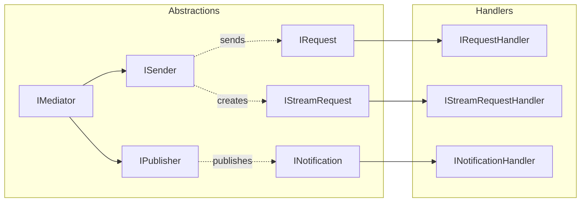

# Abstractions — Базовые интерфейсы

Все marker-интерфейсы и контракты, определяющие API системы Mediator.

**Namespace:** `Core.Infrastructure.Mediator.Abstractions`

---

## Обзор интерфейсов

| Интерфейс | Назначение |
|-----------|------------|
| `IMediator` | Главный фасад, объединяет ISender и IPublisher |
| `ISender` | Отправка requests (1:1) |
| `IPublisher` | Публикация notifications (1:N) |
| `IRequest<TResponse>` | Marker для request с ответом |
| `IRequest` | Marker для request без ответа (command) |
| `INotification` | Marker для notification |
| `IStreamRequest<TResponse>` | Marker для stream request |
| `Nothing` | Unit type для commands |

---

## IMediator

Главный интерфейс, объединяющий `ISender` и `IPublisher`. Это единственная зависимость, которую нужно инжектить в клиентский код.

```csharp
public interface IMediator : ISender, IPublisher
{
}
```

### Использование

```csharp
public class HeroViewModel : DisposableObject
{
    private readonly IMediator _mediator;

    public HeroViewModel(IMediator mediator)
    {
        _mediator = mediator;
    }

    public async UniTask LoadHeroAsync(string id, CancellationToken ct)
    {
        // Send request
        var hero = await _mediator.Send(new GetHeroQuery(id), ct);
        
        // Publish notification
        await _mediator.Publish(new HeroLoadedEvent(hero), ct);
    }
}
```

---

## ISender

Отправка requests к единственному handler.

```csharp
public interface ISender
{
    /// <summary>
    /// Send a request to a single handler.
    /// </summary>
    UniTask<TResponse> Send<TResponse>(
        IRequest<TResponse> request,
        CancellationToken cancellationToken = default);

    /// <summary>
    /// Send a request without response (command).
    /// </summary>
    UniTask Send(
        IRequest request,
        CancellationToken cancellationToken = default);

    /// <summary>
    /// Create a stream of responses.
    /// </summary>
    IUniTaskAsyncEnumerable<TResponse> CreateStream<TResponse>(
        IStreamRequest<TResponse> request,
        CancellationToken cancellationToken = default);
}
```

### Методы

| Метод | Описание | Возврат |
|-------|----------|---------|
| `Send<TResponse>` | Request с ответом | `UniTask<TResponse>` |
| `Send` | Request без ответа | `UniTask` |
| `CreateStream<TResponse>` | Streaming request | `IUniTaskAsyncEnumerable<TResponse>` |

### Примеры

```csharp
// Query с ответом
var hero = await _mediator.Send(new GetHeroQuery("123"), ct);

// Command без ответа
await _mediator.Send(new SaveSettingsCommand(settings), ct);

// Stream
await foreach (var progress in _mediator.CreateStream(new LoadAssetsRequest(paths), ct))
{
    _progressBar.Value = progress;
}
```

---

## IPublisher

Публикация notifications нескольким handlers.

```csharp
public interface IPublisher
{
    UniTask Publish<TNotification>(
        TNotification notification,
        CancellationToken cancellationToken = default)
        where TNotification : INotification;

    Observable<TNotification> CreateNotificationObservable<TNotification>()
        where TNotification : INotification;
}
```

### Методы

| Метод | Описание |
|-------|----------|
| `Publish<T>` | Публикует notification всем зарегистрированным handlers |
| `CreateNotificationObservable<T>` | Создаёт R3 Observable для подписки на notifications |

### Примеры

```csharp
// Публикация
await _mediator.Publish(new HeroSelectedEvent(heroId), ct);

// Observable подписка (R3)
_mediator.CreateNotificationObservable<HeroSelectedEvent>()
    .Subscribe(e => Debug.Log($"Hero selected: {e.HeroId}"))
    .AddTo(_disposables);
```

---

## IRequest<TResponse>

Marker-интерфейс для requests с ответом. Реализуется как `readonly struct`.

```csharp
public interface IRequest<out TResponse>
{
}
```

### Пример Query

```csharp
public readonly struct GetHeroQuery : IRequest<Hero>
{
    public readonly string HeroId;
    
    public GetHeroQuery(string heroId) => HeroId = heroId;
}

public readonly struct GetAllHeroesQuery : IRequest<IReadOnlyList<Hero>>
{
}
```

### Пример Command с результатом

```csharp
public readonly struct CreateOrderCommand : IRequest<OrderId>
{
    public readonly OrderData Data;
    
    public CreateOrderCommand(OrderData data) => Data = data;
}
```

---

## IRequest (без ответа)

Marker-интерфейс для commands без ответа. Наследует от `IRequest<Nothing>`.

```csharp
public interface IRequest : IRequest<Nothing>
{
}
```

### Пример

```csharp
public readonly struct SaveSettingsCommand : IRequest
{
    public readonly Settings Settings;
    
    public SaveSettingsCommand(Settings settings) => Settings = settings;
}

public readonly struct DeleteHeroCommand : IRequest
{
    public readonly string HeroId;
    
    public DeleteHeroCommand(string heroId) => HeroId = heroId;
}
```

---

## INotification

Marker-интерфейс для notifications (events). Один notification может обрабатываться несколькими handlers.

```csharp
public interface INotification
{
}
```

### Пример

```csharp
public readonly struct HeroSelectedEvent : INotification
{
    public readonly string HeroId;
    public readonly HeroesGridMode SourceMode;
    
    public HeroSelectedEvent(string heroId, HeroesGridMode mode)
    {
        HeroId = heroId;
        SourceMode = mode;
    }
}

public readonly struct GameStateChangedEvent : INotification
{
    public readonly GameState OldState;
    public readonly GameState NewState;
    
    public GameStateChangedEvent(GameState oldState, GameState newState)
    {
        OldState = oldState;
        NewState = newState;
    }
}
```

---

## IStreamRequest<TResponse>

Marker-интерфейс для streaming requests. Возвращает последовательность значений.

```csharp
public interface IStreamRequest<out TResponse>
{
}
```

### Пример — Прогресс загрузки

```csharp
public readonly struct LoadAssetsRequest : IStreamRequest<float>
{
    public readonly string[] Paths;
    
    public LoadAssetsRequest(string[] paths) => Paths = paths;
}

// Использование
await foreach (var progress in _mediator.CreateStream(new LoadAssetsRequest(paths), ct))
{
    _loadingBar.Progress = progress; // 0.0 → 1.0
}
```

### Пример — Pagination

```csharp
public readonly struct GetHeroesPagedRequest : IStreamRequest<Hero>
{
    public readonly int PageSize;
    
    public GetHeroesPagedRequest(int pageSize = 20) => PageSize = pageSize;
}

// Использование
await foreach (var hero in _mediator.CreateStream(new GetHeroesPagedRequest(50), ct))
{
    _heroes.Add(hero);
}
```

---

## Nothing

Unit type для commands без ответа. Аналог `void`, но может использоваться как generic parameter.

```csharp
public readonly struct Nothing : IEquatable<Nothing>, IComparable<Nothing>
{
    public static readonly Nothing Value = new();
    public static readonly UniTask<Nothing> Task = UniTask.FromResult(Value);

    public override int GetHashCode() => 0;
    public override bool Equals(object obj) => obj is Nothing;
    public bool Equals(Nothing other) => true;
    public int CompareTo(Nothing other) => 0;
    public override string ToString() => "()";
    
    public static bool operator ==(Nothing left, Nothing right) => true;
    public static bool operator !=(Nothing left, Nothing right) => false;
}
```

### Использование в Handler

```csharp
public class SaveSettingsHandler : IRequestHandler<SaveSettingsCommand>
{
    public async UniTask<Nothing> Handle(SaveSettingsCommand request, CancellationToken ct)
    {
        await SaveAsync(request.Settings, ct);
        return Nothing.Value; // Возвращаем Nothing
    }
}
```

---

## Best Practices

### ✅ Используй `readonly struct`

```csharp
// ✅ Правильно — readonly struct
public readonly struct GetHeroQuery : IRequest<Hero>
{
    public readonly string HeroId;
    public GetHeroQuery(string heroId) => HeroId = heroId;
}

// ❌ Неправильно — class (лишние аллокации)
public class GetHeroQuery : IRequest<Hero>
{
    public string HeroId { get; }
}
```

### ✅ Используй `readonly` поля

```csharp
// ✅ Правильно — immutable
public readonly struct OrderCommand : IRequest
{
    public readonly OrderData Data;
    public OrderCommand(OrderData data) => Data = data;
}

// ❌ Неправильно — mutable
public struct OrderCommand : IRequest
{
    public OrderData Data { get; set; }
}
```

### ✅ Группируй related requests

```
Requests/
├── Heroes/
│   ├── GetHeroQuery.cs
│   ├── GetAllHeroesQuery.cs
│   ├── SaveHeroCommand.cs
│   └── DeleteHeroCommand.cs
├── Orders/
│   ├── CreateOrderCommand.cs
│   └── GetOrderQuery.cs
└── Settings/
    └── SaveSettingsCommand.cs
```

### ✅ Naming Conventions

| Тип | Паттерн | Примеры |
|-----|---------|---------|
| Query | `Get*Query`, `Load*Query` | `GetHeroQuery`, `LoadSettingsQuery` |
| Command | `*Command` | `SaveHeroCommand`, `CreateOrderCommand` |
| Event | `*Event`, `*Notification` | `HeroSelectedEvent`, `OrderCreatedNotification` |
| Stream | `*Request` | `LoadAssetsRequest`, `GetPagedItemsRequest` |

---

## Связи с другими компонентами



---

## См. также

- [Handlers.md](./Handlers.md) — реализация handlers
- [Registration.md](./Registration.md) — регистрация в DI
- [Extensions.md](./Extensions.md) — helper methods
