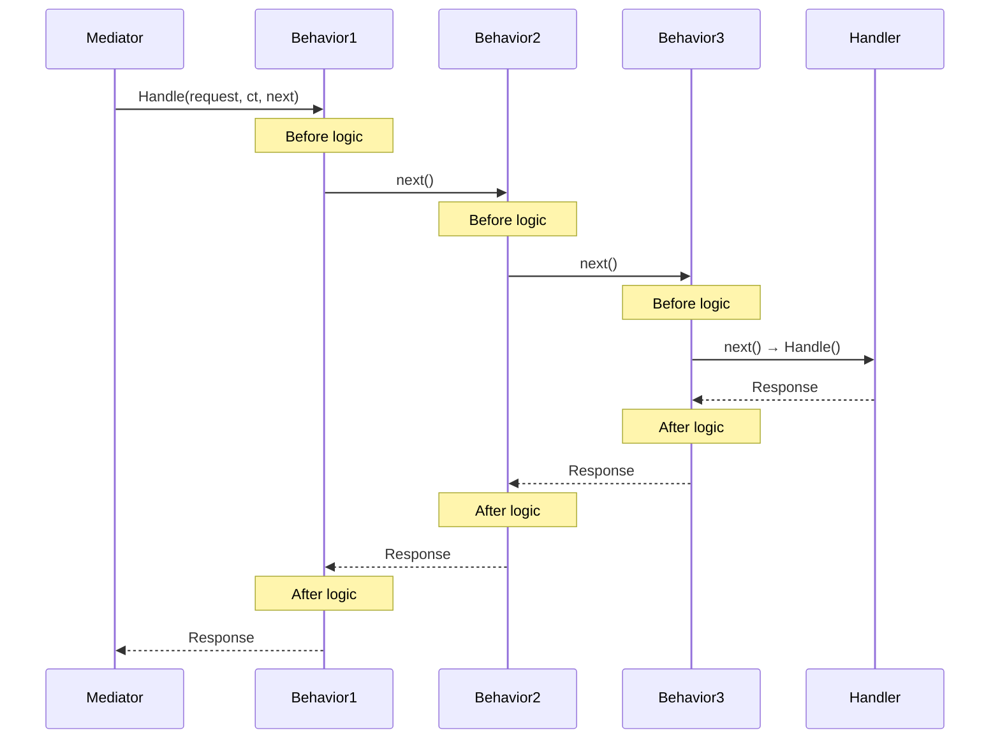

# Pipeline — Поведения и процессоры

Pipeline behaviors позволяют добавлять cross-cutting concerns (логирование, валидация, кеширование) без модификации handlers.

**Namespace:** `Core.Infrastructure.Mediator.Pipeline`

---

## Обзор интерфейсов

| Интерфейс | Назначение |
|-----------|------------|
| `IPipelineBehavior<TRequest, TResponse>` | Оборачивает выполнение request |
| `IStreamPipelineBehavior<TRequest, TResponse>` | Оборачивает выполнение stream request |
| `IRequestPreProcessor<TRequest>` | Выполняется ДО handler |
| `IRequestPostProcessor<TRequest, TResponse>` | Выполняется ПОСЛЕ handler |
| `RequestHandlerDelegate<TResponse>` | Делегат следующего шага в pipeline |
| `StreamHandlerDelegate<TResponse>` | Делегат следующего шага для stream |

---

## Как работает Pipeline



### Порядок выполнения

Behaviors выполняются в **обратном порядке** регистрации:

```csharp
cfg.AddBehavior<LoggingBehavior<,>>();    // 1
cfg.AddBehavior<ValidationBehavior<,>>(); // 2
cfg.AddBehavior<ExceptionBehavior<,>>();  // 3

// Результат: Logging → Validation → Exception → Handler → Exception → Validation → Logging
```

---

## IPipelineBehavior<TRequest, TResponse>

Основной интерфейс для pipeline behaviors.

```csharp
public interface IPipelineBehavior<in TRequest, TResponse>
    where TRequest : IRequest<TResponse>
{
    UniTask<TResponse> Handle(
        TRequest request,
        CancellationToken cancellationToken,
        RequestHandlerDelegate<TResponse> next);
}
```

### Пример — Logging Behavior

```csharp
public class LoggingBehavior<TRequest, TResponse> : IPipelineBehavior<TRequest, TResponse>
    where TRequest : IRequest<TResponse>
{
    private readonly ILogger _logger;

    public LoggingBehavior(ILogger logger)
    {
        _logger = logger;
    }

    public async UniTask<TResponse> Handle(
        TRequest request,
        CancellationToken ct,
        RequestHandlerDelegate<TResponse> next)
    {
        var requestName = typeof(TRequest).Name;
        
        _logger.Debug($"[Mediator] Handling {requestName}");
        var stopwatch = Stopwatch.StartNew();
        
        try
        {
            var response = await next();
            
            stopwatch.Stop();
            _logger.Debug($"[Mediator] Handled {requestName} in {stopwatch.ElapsedMilliseconds}ms");
            
            return response;
        }
        catch (Exception ex)
        {
            stopwatch.Stop();
            _logger.Error($"[Mediator] {requestName} failed after {stopwatch.ElapsedMilliseconds}ms: {ex.Message}");
            throw;
        }
    }
}
```

### Пример — Validation Behavior

```csharp
public interface IValidatable
{
    ValidationResult Validate();
}

public class ValidationBehavior<TRequest, TResponse> : IPipelineBehavior<TRequest, TResponse>
    where TRequest : IRequest<TResponse>, IValidatable
{
    public async UniTask<TResponse> Handle(
        TRequest request,
        CancellationToken ct,
        RequestHandlerDelegate<TResponse> next)
    {
        var result = request.Validate();
        
        if (!result.IsValid)
        {
            throw new ValidationException(result.Errors);
        }

        return await next();
    }
}
```

### Пример — Exception Handling Behavior

```csharp
public class ExceptionHandlingBehavior<TRequest, TResponse> : IPipelineBehavior<TRequest, TResponse>
    where TRequest : IRequest<TResponse>
{
    private readonly IErrorReporter _errorReporter;

    public ExceptionHandlingBehavior(IErrorReporter errorReporter)
    {
        _errorReporter = errorReporter;
    }

    public async UniTask<TResponse> Handle(
        TRequest request,
        CancellationToken ct,
        RequestHandlerDelegate<TResponse> next)
    {
        try
        {
            return await next();
        }
        catch (OperationCanceledException)
        {
            throw; // Не логируем cancellation
        }
        catch (ValidationException)
        {
            throw; // Не логируем валидацию
        }
        catch (Exception ex)
        {
            _errorReporter.Report(ex, new
            {
                RequestType = typeof(TRequest).Name,
                Request = request
            });
            throw;
        }
    }
}
```

### Пример — Caching Behavior

```csharp
public interface ICacheable
{
    string CacheKey { get; }
    TimeSpan CacheDuration { get; }
}

public class CachingBehavior<TRequest, TResponse> : IPipelineBehavior<TRequest, TResponse>
    where TRequest : IRequest<TResponse>, ICacheable
{
    private readonly ICache _cache;

    public CachingBehavior(ICache cache)
    {
        _cache = cache;
    }

    public async UniTask<TResponse> Handle(
        TRequest request,
        CancellationToken ct,
        RequestHandlerDelegate<TResponse> next)
    {
        var key = request.CacheKey;
        
        if (_cache.TryGet<TResponse>(key, out var cached))
        {
            return cached;
        }

        var response = await next();
        _cache.Set(key, response, request.CacheDuration);
        
        return response;
    }
}
```

### Пример — Retry Behavior

```csharp
public interface IRetryable
{
    int MaxRetries { get; }
    TimeSpan RetryDelay { get; }
}

public class RetryBehavior<TRequest, TResponse> : IPipelineBehavior<TRequest, TResponse>
    where TRequest : IRequest<TResponse>, IRetryable
{
    private readonly ILogger _logger;

    public RetryBehavior(ILogger logger)
    {
        _logger = logger;
    }

    public async UniTask<TResponse> Handle(
        TRequest request,
        CancellationToken ct,
        RequestHandlerDelegate<TResponse> next)
    {
        int attempts = 0;
        
        while (true)
        {
            try
            {
                return await next();
            }
            catch (OperationCanceledException)
            {
                throw;
            }
            catch (Exception ex) when (++attempts < request.MaxRetries)
            {
                _logger.Warning($"Retry {attempts}/{request.MaxRetries} for {typeof(TRequest).Name}: {ex.Message}");
                
                var delay = TimeSpan.FromMilliseconds(
                    request.RetryDelay.TotalMilliseconds * Math.Pow(2, attempts - 1));
                
                await UniTask.Delay(delay, cancellationToken: ct);
            }
        }
    }
}
```

### Пример — Performance Monitoring

```csharp
public class PerformanceBehavior<TRequest, TResponse> : IPipelineBehavior<TRequest, TResponse>
    where TRequest : IRequest<TResponse>
{
    private const float SlowRequestThresholdMs = 500f;
    private readonly IMetrics _metrics;

    public PerformanceBehavior(IMetrics metrics)
    {
        _metrics = metrics;
    }

    public async UniTask<TResponse> Handle(
        TRequest request,
        CancellationToken ct,
        RequestHandlerDelegate<TResponse> next)
    {
        var sw = Stopwatch.StartNew();
        
        try
        {
            return await next();
        }
        finally
        {
            sw.Stop();
            var requestName = typeof(TRequest).Name;
            
            _metrics.RecordTiming($"mediator.{requestName}", sw.ElapsedMilliseconds);
            
            if (sw.ElapsedMilliseconds > SlowRequestThresholdMs)
            {
                Debug.LogWarning($"[Mediator] Slow request: {requestName} took {sw.ElapsedMilliseconds}ms");
            }
        }
    }
}
```

---

## IStreamPipelineBehavior<TRequest, TResponse>

Pipeline behavior для stream requests.

```csharp
public delegate IUniTaskAsyncEnumerable<TResponse> StreamHandlerDelegate<out TResponse>();

public interface IStreamPipelineBehavior<in TRequest, TResponse>
    where TRequest : IStreamRequest<TResponse>
{
    IUniTaskAsyncEnumerable<TResponse> Handle(
        TRequest request,
        CancellationToken cancellationToken,
        StreamHandlerDelegate<TResponse> next);
}
```

### Пример — Stream Logging

```csharp
public class StreamLoggingBehavior<TRequest, TResponse> : IStreamPipelineBehavior<TRequest, TResponse>
    where TRequest : IStreamRequest<TResponse>
{
    private readonly ILogger _logger;

    public StreamLoggingBehavior(ILogger logger)
    {
        _logger = logger;
    }

    public async IUniTaskAsyncEnumerable<TResponse> Handle(
        TRequest request,
        [EnumeratorCancellation] CancellationToken ct,
        StreamHandlerDelegate<TResponse> next)
    {
        var requestName = typeof(TRequest).Name;
        _logger.Debug($"[Mediator] Starting stream: {requestName}");
        
        int count = 0;
        
        await foreach (var item in next().WithCancellation(ct))
        {
            count++;
            yield return item;
        }
        
        _logger.Debug($"[Mediator] Completed stream: {requestName}, yielded {count} items");
    }
}
```

---

## IRequestPreProcessor<TRequest>

Выполняется **перед** handler.

```csharp
public interface IRequestPreProcessor<in TRequest>
    where TRequest : notnull
{
    UniTask Process(TRequest request, CancellationToken cancellationToken);
}
```

### Пример

```csharp
public class AuditPreProcessor<TRequest> : IRequestPreProcessor<TRequest>
    where TRequest : notnull
{
    private readonly IAuditService _audit;
    private readonly ICurrentUser _currentUser;

    public AuditPreProcessor(IAuditService audit, ICurrentUser currentUser)
    {
        _audit = audit;
        _currentUser = currentUser;
    }

    public UniTask Process(TRequest request, CancellationToken ct)
    {
        _audit.Log(new AuditEntry
        {
            UserId = _currentUser.Id,
            Action = typeof(TRequest).Name,
            Timestamp = DateTime.UtcNow,
            Data = JsonSerializer.Serialize(request)
        });
        
        return UniTask.CompletedTask;
    }
}
```

---

## IRequestPostProcessor<TRequest, TResponse>

Выполняется **после** handler.

```csharp
public interface IRequestPostProcessor<in TRequest, in TResponse>
    where TRequest : notnull
{
    UniTask Process(TRequest request, TResponse response, CancellationToken cancellationToken);
}
```

### Пример

```csharp
public class MetricsPostProcessor<TRequest, TResponse> : IRequestPostProcessor<TRequest, TResponse>
    where TRequest : notnull
{
    private readonly IMetrics _metrics;

    public MetricsPostProcessor(IMetrics metrics)
    {
        _metrics = metrics;
    }

    public UniTask Process(TRequest request, TResponse response, CancellationToken ct)
    {
        _metrics.Increment($"mediator.{typeof(TRequest).Name}.success");
        return UniTask.CompletedTask;
    }
}
```

---

## RequestHandlerDelegate<TResponse>

Делегат, представляющий следующий шаг в pipeline.

```csharp
public delegate UniTask<TResponse> RequestHandlerDelegate<TResponse>();
```

### Использование в Behavior

```csharp
public async UniTask<TResponse> Handle(
    TRequest request,
    CancellationToken ct,
    RequestHandlerDelegate<TResponse> next)
{
    // Before
    DoSomethingBefore();
    
    // Вызов следующего шага
    var response = await next();
    
    // After
    DoSomethingAfter(response);
    
    return response;
}
```

---

## Регистрация

```csharp
builder.AddMediator(cfg =>
{
    // Pipeline behaviors (порядок важен!)
    cfg.AddBehavior<LoggingBehavior<,>>();
    cfg.AddBehavior<ValidationBehavior<,>>();
    cfg.AddBehavior<CachingBehavior<,>>();
    cfg.AddBehavior<ExceptionHandlingBehavior<,>>();
    
    // Pre/Post processors
    cfg.AddPreProcessor<MyRequest, AuditPreProcessor<MyRequest>>();
    cfg.AddPostProcessor<MyRequest, MyResponse, MetricsPostProcessor<MyRequest, MyResponse>>();
    
    // Handlers
    cfg.AddHandler<MyRequest, MyResponse, MyRequestHandler>();
});
```

---

## Типизированные Behaviors

### Behavior для конкретного типа request

```csharp
public class SpecificRequestBehavior : IPipelineBehavior<GetHeroQuery, Hero>
{
    public async UniTask<Hero> Handle(
        GetHeroQuery request,
        CancellationToken ct,
        RequestHandlerDelegate<Hero> next)
    {
        // Логика только для GetHeroQuery
        return await next();
    }
}
```

### Behavior с constraint

```csharp
public class AuthorizationBehavior<TRequest, TResponse> : IPipelineBehavior<TRequest, TResponse>
    where TRequest : IRequest<TResponse>, IAuthorizedRequest
{
    private readonly IAuthService _auth;

    public AuthorizationBehavior(IAuthService auth)
    {
        _auth = auth;
    }

    public async UniTask<TResponse> Handle(
        TRequest request,
        CancellationToken ct,
        RequestHandlerDelegate<TResponse> next)
    {
        if (!await _auth.HasPermission(request.RequiredPermission, ct))
        {
            throw new UnauthorizedException($"Missing permission: {request.RequiredPermission}");
        }

        return await next();
    }
}
```

---

## Внутренняя реализация

Цепочка behaviors строится в `RequestHandlerWrapperImpl`:

```csharp
private static async UniTask<TResponse> ExecutePipeline(
    TRequest request,
    IRequestHandler<TRequest, TResponse> handler,
    IReadOnlyList<IPipelineBehavior<TRequest, TResponse>> behaviors,
    CancellationToken cancellationToken)
{
    // Начинаем с handler
    RequestHandlerDelegate<TResponse> pipeline = () => handler.Handle(request, cancellationToken);

    // Оборачиваем behaviors в обратном порядке
    for (var i = behaviors.Count - 1; i >= 0; i--)
    {
        var behavior = behaviors[i];
        var next = pipeline;
        pipeline = () => behavior.Handle(request, cancellationToken, next);
    }

    return await pipeline();
}
```

---

## Best Practices

### ✅ Behaviors должны быть stateless

```csharp
// ✅ Правильно — stateless
public class LoggingBehavior<TRequest, TResponse> : IPipelineBehavior<TRequest, TResponse>
{
    private readonly ILogger _logger; // Только readonly dependencies
}

// ❌ Неправильно — stateful
public class BadBehavior<TRequest, TResponse> : IPipelineBehavior<TRequest, TResponse>
{
    private int _counter; // Состояние между вызовами
}
```

### ✅ Всегда вызывай `next()`

```csharp
// ✅ Правильно
public async UniTask<TResponse> Handle(...)
{
    if (ShouldSkip(request))
        return default; // OK — осознанный skip
    
    return await next(); // Обязательно!
}

// ❌ Неправильно — забыли вызвать next()
public async UniTask<TResponse> Handle(...)
{
    DoSomething();
    // next() не вызван — handler никогда не выполнится!
}
```

### ✅ Не модифицируй request

```csharp
// ✅ Правильно — request readonly
public async UniTask<TResponse> Handle(TRequest request, ...)
{
    _logger.Log(request);
    return await next();
}

// ❌ Неправильно — модификация request
public async UniTask<TResponse> Handle(TRequest request, ...)
{
    request.SomeField = "modified"; // Плохая идея!
    return await next();
}
```

### ✅ Правильный порядок регистрации

```csharp
// Типичный порядок:
cfg.AddBehavior<LoggingBehavior<,>>();      // 1. Logging (внешний)
cfg.AddBehavior<AuthorizationBehavior<,>>(); // 2. Authorization
cfg.AddBehavior<ValidationBehavior<,>>();    // 3. Validation
cfg.AddBehavior<CachingBehavior<,>>();       // 4. Caching
cfg.AddBehavior<ExceptionBehavior<,>>();     // 5. Exception handling (внутренний)
```

### ✅ Используй constraints для типизированных behaviors

```csharp
// ✅ Правильно — behavior только для IValidatable requests
public class ValidationBehavior<TRequest, TResponse> : IPipelineBehavior<TRequest, TResponse>
    where TRequest : IRequest<TResponse>, IValidatable

// ❌ Неправильно — проверка в runtime
public class ValidationBehavior<TRequest, TResponse> : IPipelineBehavior<TRequest, TResponse>
{
    public async UniTask<TResponse> Handle(...)
    {
        if (request is IValidatable validatable) // Runtime check
        {
            validatable.Validate();
        }
        return await next();
    }
}
```

---

## См. также

- [Handlers.md](./Handlers.md) — handlers
- [Registration.md](./Registration.md) — регистрация behaviors
- [Extensions.md](./Extensions.md) — helper methods
