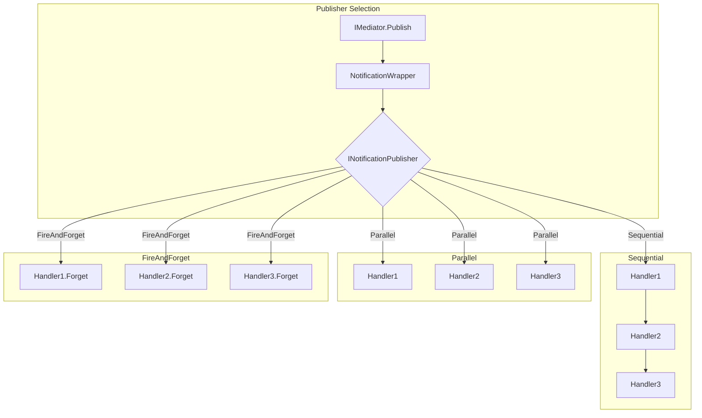
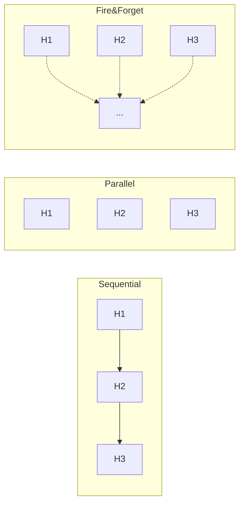

# Publishing — Стратегии публикации notifications

Notification publishers определяют, как notification доставляется нескольким handlers.

**Namespace:** `Core.Infrastructure.Mediator.Publishing`

---

## Обзор

| Класс | Стратегия | Ожидание | Обработка ошибок |
|-------|-----------|----------|------------------|
| `SequentialPublisher` | Последовательно | Да | Агрегация в `AggregateException` |
| `ParallelPublisher` | Параллельно | Да | Первая ошибка прерывает |
| `FireAndForgetPublisher` | Fire-and-forget | Нет | Логирование |

---

## Как это работает



---

## INotificationPublisher

Базовый интерфейс для всех стратегий публикации.

```csharp
public interface INotificationPublisher
{
    UniTask Publish(
        IReadOnlyList<NotificationHandlerExecutor> handlerExecutors,
        INotification notification,
        CancellationToken cancellationToken);
}
```

### NotificationHandlerExecutor

Делегат-обёртка для вызова handler:

```csharp
public delegate UniTask NotificationHandlerExecutor();
```

---

## SequentialPublisher (default)

Выполняет handlers **последовательно**. Если один handler выбросил исключение, остальные всё равно выполнятся.

```csharp
public sealed class SequentialPublisher : INotificationPublisher
{
    public async UniTask Publish(
        IReadOnlyList<NotificationHandlerExecutor> handlerExecutors,
        INotification notification,
        CancellationToken cancellationToken)
    {
        List<Exception> exceptions = null;

        foreach (var executor in handlerExecutors)
        {
            cancellationToken.ThrowIfCancellationRequested();

            try
            {
                await executor();
            }
            catch (OperationCanceledException)
            {
                throw;
            }
            catch (Exception ex)
            {
                exceptions ??= new List<Exception>();
                exceptions.Add(ex);
            }
        }

        if (exceptions is { Count: > 0 })
        {
            throw new AggregateException(
                $"One or more notification handlers for {notification.GetType().Name} failed",
                exceptions);
        }
    }
}
```

### Когда использовать

| ✅ Подходит | ❌ Не подходит |
|-------------|----------------|
| Порядок важен | Независимые handlers |
| Гарантия выполнения всех | Нужна максимальная скорость |
| Есть зависимости между handlers | Один долгий handler |

### Пример

```csharp
builder.AddMediator(cfg =>
{
    cfg.UseNotificationPublisher<SequentialPublisher>(); // default
    
    cfg.AddNotificationHandler<OrderCreatedEvent, UpdateInventoryHandler>();
    cfg.AddNotificationHandler<OrderCreatedEvent, SendEmailHandler>();
    cfg.AddNotificationHandler<OrderCreatedEvent, NotifyWarehouseHandler>();
});

// Порядок выполнения:
// 1. UpdateInventoryHandler
// 2. SendEmailHandler  
// 3. NotifyWarehouseHandler
// Если один упал — остальные всё равно выполнятся
```

### Обработка ошибок

```csharp
try
{
    await _mediator.Publish(new OrderCreatedEvent(order), ct);
}
catch (AggregateException ex)
{
    foreach (var innerEx in ex.InnerExceptions)
    {
        _logger.Error($"Handler failed: {innerEx.Message}");
    }
    // Решить, что делать с частичным успехом
}
```

---

## ParallelPublisher

Выполняет все handlers **параллельно** через `UniTask.WhenAll`.

```csharp
public sealed class ParallelPublisher : INotificationPublisher
{
    public async UniTask Publish(
        IReadOnlyList<NotificationHandlerExecutor> handlerExecutors,
        INotification notification,
        CancellationToken cancellationToken)
    {
        if (handlerExecutors.Count == 0)
            return;

        var tasks = new UniTask[handlerExecutors.Count];
        for (var i = 0; i < handlerExecutors.Count; i++)
        {
            tasks[i] = handlerExecutors[i]();
        }

        await UniTask.WhenAll(tasks);
    }
}
```

### Когда использовать

| ✅ Подходит | ❌ Не подходит |
|-------------|----------------|
| Handlers независимы | Порядок важен |
| Нужна скорость | Есть зависимости |
| I/O-bound операции | Shared state |

### Пример

```csharp
builder.AddMediator(cfg =>
{
    cfg.UseNotificationPublisher<ParallelPublisher>();
    
    cfg.AddNotificationHandler<UserCreatedEvent, SendWelcomeEmailHandler>();
    cfg.AddNotificationHandler<UserCreatedEvent, CreateDefaultSettingsHandler>();
    cfg.AddNotificationHandler<UserCreatedEvent, NotifyAdminsHandler>();
});

// Все три handler выполняются одновременно
```

### Визуализация

```
                    ┌─────────────────┐
                    │  UserCreated    │
                    └────────┬────────┘
                             │
          ┌──────────────────┼──────────────────┐
          │                  │                  │
          ▼                  ▼                  ▼
   ┌────────────┐     ┌────────────┐     ┌────────────┐
   │  Email     │     │  Settings  │     │  Admins    │
   │  Handler   │     │  Handler   │     │  Handler   │
   └────────────┘     └────────────┘     └────────────┘
          │                  │                  │
          └──────────────────┼──────────────────┘
                             │
                             ▼
                        All Done
```

---

## FireAndForgetPublisher

Запускает handlers и **не ждёт** завершения. Ошибки логируются.

```csharp
public sealed class FireAndForgetPublisher : INotificationPublisher
{
    public UniTask Publish(
        IReadOnlyList<NotificationHandlerExecutor> handlerExecutors,
        INotification notification,
        CancellationToken cancellationToken)
    {
        var notificationName = notification.GetType().Name;

        foreach (var executor in handlerExecutors)
        {
            ExecuteAsync(executor, notificationName).Forget();
        }

        return UniTask.CompletedTask;
    }

    private static async UniTaskVoid ExecuteAsync(
        NotificationHandlerExecutor executor, 
        string notificationName)
    {
        try
        {
            await executor();
        }
        catch (Exception ex)
        {
            Debug.LogError($"[Mediator] Fire-and-forget handler for {notificationName} failed: {ex.Message}");
        }
    }
}
```

### Когда использовать

| ✅ Подходит | ❌ Не подходит |
|-------------|----------------|
| Analytics | Критичные операции |
| Некритичные уведомления | Нужна гарантия выполнения |
| Background tasks | Нужен результат |

### Пример

```csharp
builder.AddMediator(cfg =>
{
    cfg.UseNotificationPublisher<FireAndForgetPublisher>();
    
    cfg.AddNotificationHandler<ButtonClickedEvent, AnalyticsHandler>();
    cfg.AddNotificationHandler<ButtonClickedEvent, TelemetryHandler>();
});

// Публикация не блокирует вызывающий код
await _mediator.Publish(new ButtonClickedEvent("buy_button")); // Мгновенно возвращается
```

### ⚠️ Предупреждения

1. **Нет гарантий выполнения** — handler может не завершиться
2. **Ошибки только в логах** — нельзя обработать программно
3. **CancellationToken игнорируется** — handlers продолжают работу

---

## Сравнение стратегий



| Характеристика | Sequential | Parallel | FireAndForget |
|----------------|------------|----------|---------------|
| Порядок | Гарантирован | Не гарантирован | Не гарантирован |
| Ожидание | Да | Да | Нет |
| Ошибки | AggregateException | Первая ошибка | Логирование |
| Скорость | Медленнее | Быстрее | Мгновенно |
| Cancellation | Поддержка | Поддержка | Игнорируется |

---

## Выбор стратегии по use case

| Use Case | Рекомендация |
|----------|--------------|
| Обновление UI | `Sequential` |
| Email + SMS уведомления | `Parallel` |
| Analytics | `FireAndForget` |
| Синхронизация данных | `Sequential` |
| Логирование | `FireAndForget` |
| Критичные операции | `Sequential` |
| Фоновые задачи | `FireAndForget` |

---

## Комбинирование стратегий

### Через Extension Method

```csharp
public static class MediatorExtensions
{
    public static void PublishFireAndForget<TNotification>(
        this IMediator mediator,
        TNotification notification)
        where TNotification : INotification
    {
        mediator.Publish(notification, CancellationToken.None).Forget();
    }
}

// Использование
_mediator.PublishFireAndForget(new AnalyticsEvent("click"));
await _mediator.Publish(new CriticalEvent(data), ct); // Ждём
```

### Два Mediator'а с разными стратегиями

```csharp
public class CompositePublisher : INotificationPublisher
{
    private readonly SequentialPublisher _sequential = new();
    private readonly FireAndForgetPublisher _fireAndForget = new();

    public async UniTask Publish(
        IReadOnlyList<NotificationHandlerExecutor> handlers,
        INotification notification,
        CancellationToken ct)
    {
        if (notification is IFireAndForget)
        {
            await _fireAndForget.Publish(handlers, notification, ct);
        }
        else
        {
            await _sequential.Publish(handlers, notification, ct);
        }
    }
}

// Marker interface
public interface IFireAndForget { }

// Usage
public readonly struct AnalyticsEvent : INotification, IFireAndForget
{
    public readonly string EventName;
}
```

---

## Создание своего Publisher

```csharp
public class RetryPublisher : INotificationPublisher
{
    private readonly int _maxRetries = 3;
    private readonly TimeSpan _delay = TimeSpan.FromSeconds(1);

    public async UniTask Publish(
        IReadOnlyList<NotificationHandlerExecutor> handlerExecutors,
        INotification notification,
        CancellationToken cancellationToken)
    {
        foreach (var executor in handlerExecutors)
        {
            await ExecuteWithRetry(executor, cancellationToken);
        }
    }

    private async UniTask ExecuteWithRetry(
        NotificationHandlerExecutor executor,
        CancellationToken ct)
    {
        for (int attempt = 1; attempt <= _maxRetries; attempt++)
        {
            try
            {
                await executor();
                return;
            }
            catch (OperationCanceledException)
            {
                throw;
            }
            catch when (attempt < _maxRetries)
            {
                await UniTask.Delay(_delay, cancellationToken: ct);
            }
        }
    }
}

// Регистрация
cfg.UseNotificationPublisher<RetryPublisher>();
```

---

## Best Practices

### ✅ Выбирай правильную стратегию

```csharp
// ✅ Analytics — fire and forget
cfg.UseNotificationPublisher<FireAndForgetPublisher>();
cfg.AddNotificationHandler<ClickEvent, AnalyticsHandler>();

// ✅ Критичные события — sequential
cfg.UseNotificationPublisher<SequentialPublisher>();
cfg.AddNotificationHandler<OrderCreatedEvent, InventoryHandler>();
```

### ✅ Используй extension для fire-and-forget

```csharp
// Вместо глобальной FireAndForgetPublisher
_mediator.PublishFireAndForget(new AnalyticsEvent("click"));
```

### ✅ Обрабатывай AggregateException

```csharp
try
{
    await _mediator.Publish(notification, ct);
}
catch (AggregateException ex)
{
    _logger.Error($"{ex.InnerExceptions.Count} handlers failed");
    // Можно продолжить или прервать
}
```

### ❌ Не используй FireAndForget для критичных операций

```csharp
// ❌ Неправильно — можем потерять инвентарь
cfg.UseNotificationPublisher<FireAndForgetPublisher>();
cfg.AddNotificationHandler<OrderCreatedEvent, UpdateInventoryHandler>();

// ✅ Правильно
cfg.UseNotificationPublisher<SequentialPublisher>();
```

---

## См. также

- [Abstractions.md](./Abstractions.md) — IPublisher, INotification
- [Handlers.md](./Handlers.md) — INotificationHandler
- [Extensions.md](./Extensions.md) — PublishFireAndForget extension
