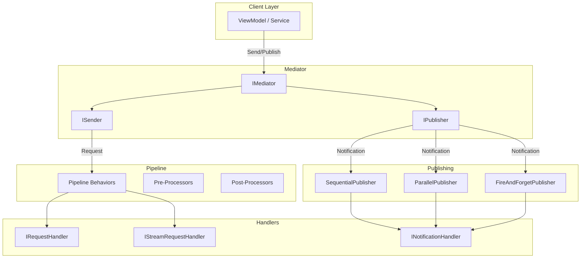
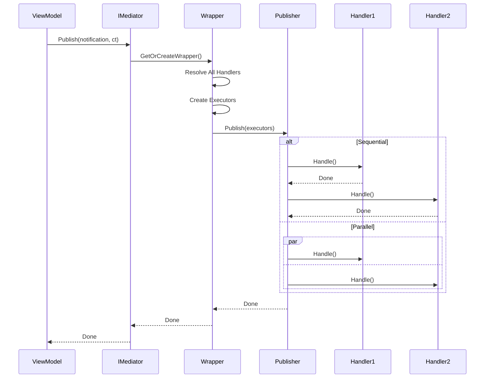

# Mediator Core — Обзор системы

MediatR-подобная реализация паттерна Mediator для Unity с поддержкой **UniTask**, **Reflex DI**, и **R3 Observables**.

## Содержание документации

| Файл | Описание |
|------|----------|
| [Abstractions.md](./Abstractions.md) | Базовые интерфейсы (IRequest, INotification, IStreamRequest) |
| [Handlers.md](./Handlers.md) | Типы handlers и их создание |
| [Pipeline.md](./Pipeline.md) | Pipeline behaviors, pre/post processors |
| [Publishing.md](./Publishing.md) | Стратегии публикации notifications |
| [Registration.md](./Registration.md) | DI регистрация, MediatorBuilder |
| [Extensions.md](./Extensions.md) | Extension methods |
| [Exceptions.md](./Exceptions.md) | MediatorException, HandlerNotFoundException |
| [Attributes.md](./Attributes.md) | GenerateViewCommandsAttribute |

---

## Что такое Mediator?

**Mediator** — паттерн, обеспечивающий **loose coupling** между компонентами приложения. Вместо прямых вызовов сервисов, компоненты отправляют **Request** или **Notification** через единую точку — `IMediator`.

### Зачем нужен?

| Преимущество | Описание |
|--------------|----------|
| **Decoupling** | ViewModel не знает о конкретных сервисах |
| **Single Responsibility** | Каждый Handler делает одну вещь |
| **Cross-cutting concerns** | Логирование, валидация, кеширование через Pipeline |
| **Testability** | Легко мокать `IMediator` |
| **Предсказуемый flow** | Единообразная обработка запросов |

---

## Архитектура



---

## Request Flow

```mermaid
sequenceDiagram
    participant VM as ViewModel
    participant M as IMediator
    participant W as Wrapper
    participant B as Behaviors
    participant H as Handler
    
    VM->>M: Send(request, ct)
    M->>W: GetOrCreateWrapper()
    W->>W: Resolve Handler
    W->>W: Resolve Behaviors
    
    alt Has Behaviors
        W->>B: Execute Pipeline
        B->>B: Behavior1.Handle()
        B->>B: Behavior2.Handle()
        B->>H: Handler.Handle()
        H-->>B: Response
        B-->>W: Response
    else No Behaviors
        W->>H: Handler.Handle()
        H-->>W: Response
    end
    
    W-->>M: Response
    M-->>VM: Response
```



---

## Notification Flow



---

## Структура файлов

```
Mediator/
├── Abstractions/              # Marker interfaces
│   ├── IMediator.cs           # ISender + IPublisher
│   ├── IRequest.cs            # Request markers
│   ├── IStreamRequest.cs      # Stream request marker
│   ├── INotification.cs       # Notification marker
│   ├── ISender.cs             # Отправка requests
│   ├── IPublisher.cs          # Публикация notifications
│   └── Nothing.cs             # Unit type для commands
│
├── Handlers/                  # Handler interfaces
│   ├── IRequestHandler.cs     # Обработка requests
│   ├── INotificationHandler.cs # Обработка notifications
│   └── IStreamRequestHandler.cs # Обработка streams
│
├── Implementation/            # Core implementation
│   ├── Mediator.cs            # Основная реализация
│   └── Wrappers/              # Internal wrappers
│       ├── RequestHandlerWrapper.cs
│       ├── RequestHandlerWrapperImpl.cs
│       ├── NotificationHandlerWrapper.cs
│       └── StreamRequestHandlerWrapper.cs
│
├── Pipeline/                  # Pipeline extensibility
│   ├── IPipelineBehavior.cs   # Основной интерфейс pipeline
│   ├── IRequestPreProcessor.cs # Pre-processing
│   ├── IRequestPostProcessor.cs # Post-processing
│   ├── IStreamPipelineBehavior.cs # Pipeline для streams
│   └── RequestHandlerDelegate.cs # Делегат для цепочки
│
├── Publishing/                # Notification strategies
│   ├── INotificationPublisher.cs # Интерфейс стратегии
│   ├── SequentialPublisher.cs # Последовательная публикация
│   ├── ParallelPublisher.cs   # Параллельная публикация
│   ├── FireAndForgetPublisher.cs # Fire-and-forget
│   └── NotificationHandlerExecutor.cs # Делегат исполнителя
│
├── Registration/              # DI integration
│   ├── MediatorBuilder.cs     # Fluent builder
│   ├── HandlerRegistry.cs     # Реестр handlers
│   ├── HandlerDescriptor.cs   # Описание handler
│   ├── IHandlerRegistry.cs    # Интерфейс реестра
│   ├── ServiceLifetime.cs     # Enum lifetime
│   └── Extensions/
│       └── MediatorReflexExtensions.cs # Extension для Reflex
│
├── Extensions/                # Helper extensions
│   └── MediatorExtensions.cs  # Timeout, FireAndForget, etc.
│
├── Exceptions/                # Кастомные исключения
│   ├── MediatorException.cs   # Базовое исключение
│   └── HandlerNotFoundException.cs # Handler не найден
│
├── Attributes/                # Атрибуты для кодогенерации
│   └── GenerateViewCommandsAttribute.cs # Генерация view commands
│
└── docs/                      # 📚 Документация
    ├── README.md              # Этот файл
    ├── Abstractions.md
    ├── Handlers.md
    ├── Pipeline.md
    ├── Publishing.md
    ├── Registration.md
    ├── Extensions.md
    ├── Exceptions.md
    └── Attributes.md
```

---

## Quick Start

### 1. Регистрация в Installer

```csharp
public class GameInstaller : MonoBehaviour, IInstaller
{
    public void InstallBindings(ContainerBuilder builder)
    {
        builder.AddMediator(cfg =>
        {
            cfg.UseNotificationPublisher<SequentialPublisher>();
            cfg.AddHandler<GetHeroQuery, Hero, GetHeroQueryHandler>();
            cfg.AddNotificationHandler<HeroSelectedEvent, HeroSelectedHandler>();
        });
    }
}
```

### 2. Создание Request

```csharp
public readonly struct GetHeroQuery : IRequest<Hero>
{
    public readonly string HeroId;
    public GetHeroQuery(string heroId) => HeroId = heroId;
}
```

### 3. Создание Handler

```csharp
public class GetHeroQueryHandler : IRequestHandler<GetHeroQuery, Hero>
{
    private readonly IHeroRepository _repository;

    public GetHeroQueryHandler(IHeroRepository repository)
    {
        _repository = repository;
    }

    public async UniTask<Hero> Handle(GetHeroQuery request, CancellationToken ct)
    {
        return await _repository.GetByIdAsync(request.HeroId, ct);
    }
}
```

### 4. Использование

```csharp
public class HeroViewModel : DisposableObject
{
    private readonly IMediator _mediator;

    public HeroViewModel(IMediator mediator)
    {
        _mediator = mediator;
    }

    public async UniTask LoadHeroAsync(string heroId, CancellationToken ct)
    {
        var hero = await _mediator.Send(new GetHeroQuery(heroId), ct);
    }
}
```

---

## Ключевые концепции

### Request vs Notification vs Stream

| Тип | Соотношение | Возврат | Использование |
|-----|-------------|---------|---------------|
| `IRequest<T>` | 1:1 | `TResponse` | Query/Command с результатом |
| `IRequest` | 1:1 | `Nothing` | Command без результата |
| `INotification` | 1:N | — | Events, Pub/Sub |
| `IStreamRequest<T>` | 1:1 | `IUniTaskAsyncEnumerable<T>` | Progress, Pagination |

### Naming Conventions

| Тип | Суффикс | Пример |
|-----|---------|--------|
| Query | `Query` | `GetHeroQuery`, `LoadSettingsQuery` |
| Command | `Command` | `SaveHeroCommand`, `DeleteItemCommand` |
| Notification | `Event` / `Notification` | `HeroSelectedEvent`, `OrderCompletedNotification` |
| Handler | `Handler` | `GetHeroQueryHandler`, `SaveHeroCommandHandler` |

---

## Связанные документы

- [Abstractions.md](./Abstractions.md) — подробно о всех интерфейсах
- [Handlers.md](./Handlers.md) — как создавать handlers
- [Pipeline.md](./Pipeline.md) — cross-cutting concerns
- [Publishing.md](./Publishing.md) — стратегии публикации
- [Registration.md](./Registration.md) — DI регистрация
- [Extensions.md](./Extensions.md) — helper методы
- [Exceptions.md](./Exceptions.md) — обработка исключений
- [Attributes.md](./Attributes.md) — кодогенерация

---

**Namespace:** `Core.Infrastructure.Mediator`  
**Dependencies:** UniTask, Reflex, R3
