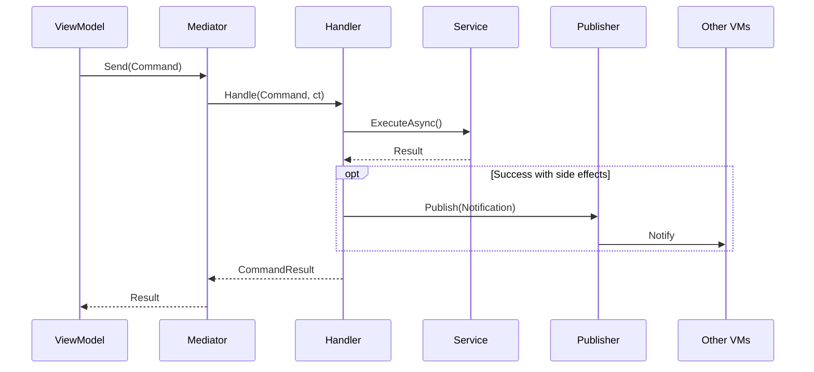

# Commands — Каталог

## Обзор

Commands — запросы на изменение состояния. Возвращают результат операции (успех/ошибка).

## Каталог Commands

| Command | Параметры | Response | Handler | Используется в |
|---------|-----------|----------|---------|----------------|
| `CreateChatCommand` | CharacterId, GreetingId, PromptId, ModelId, PersonaId, MaxTokens | `CreateChatResult` | `CreateChatHandler` | ChatViewModel |
| `SendChatMessageCommand` | ChatId, CharacterId, MessageText, params... | `SendChatMessageResult` | `SendChatMessageHandler` | ChatViewModel |
| `DeleteChatCommand` | ChatId | `bool` | `DeleteChatHandler` | ChatViewModel |
| `SetChatContextCommand` | ChatId | `Nothing` | `SetChatContextHandler` | ChatViewModel |
| `RenderUiComponentsCommand` | Components, Containers, ChatId | `Nothing` | `RenderUiComponentsHandler` | ChatViewModel |
| `ClearUiComponentsCommand` | Placement? | `Nothing` | `ClearUiComponentsHandler` | ChatViewModel |
| `DisposeProceduralUiCommand` | — | `Nothing` | `DisposeProceduralUiHandler` | ChatViewModel |
| `ExecuteWorkflowCommand` | WorkflowId, Payload | `ExecuteWorkflowResult` | `ExecuteWorkflowHandler` | ChatViewModel |
| `LoginCommand` | Email, Password, RememberMe | `AuthResult` | `LoginHandler` | LoginViewModel |
| `LogoutCommand` | — | `Nothing` | `LogoutHandler` | — |
| `NavigateCommand` | State | `Nothing` | `NavigateHandler` | Все ViewModels |
| `ShowViewCommand<T>` | ShowParams | `bool` | `ShowViewHandler<T>` | — |
| `HideViewCommand<T>` | Animate | `bool` | `HideViewHandler<T>` | — |
| `OpenSettingsCommand` | — | `bool` | `OpenSettingsHandler` | MainViewModel |
| `SavePrefsCommand<T>` | Key, Value | `Nothing` | `SavePrefsHandler<T>` | Различные |
| `ReleaseImageCommand` | Image | `Nothing` | `ReleaseImageHandler` | ImageGenViewModel |
| `GenerateImageCommand` | Prompt, Attachments, History, Settings | `GenerateImageResult` | `GenerateImageHandler` | ImageGenViewModel |
| `RemoveBackgroundCommand` | SourceImage, AutoTrim, Padding | `RemoveBackgroundResult` | `RemoveBackgroundHandler` | ImageGenViewModel |
| `SaveImageCommand` | Image, DefaultFilename, Title | `SaveImageResult` | `SaveImageHandler` | ImageGenViewModel |
| `ExecuteWorkflowUiActionCommand` | WorkflowId, ActionPayload, StorageContext | `StandaloneUiResult` | `ExecuteWorkflowUiActionHandler` | StandaloneWorkflowViewModel |
| `CreateElementRequest<T,D>` | Container, Data, OnClick | `TElement` | `CreateElementHandler<T,D>` | Views |
| `DestroyElementRequest` | Element | `Nothing` | `DestroyElementHandler` | Views |
| `ClearContainerRequest` | Container | `Nothing` | `ClearContainerHandler` | Views |
| `ReconcileElementsRequest<T,D>` | Container, NewData, OnClick | `Nothing` | `ReconcileElementsHandler<T,D>` | Views |

---

## Chat Commands

### CreateChatCommand

Создание нового чата с персонажем.

```csharp
// Commands/Chat/CreateChatCommand.cs
public readonly struct CreateChatCommand : IRequest<CreateChatResult>
{
    public readonly string CharacterId;
    public readonly string GreetingId;
    public readonly string PromptId;
    public readonly string ModelId;
    public readonly string PersonaId;
    public readonly int MaxTokens;

    public CreateChatCommand(
        string characterId, string greetingId, string promptId,
        string modelId, string personaId, int maxTokens)
    {
        CharacterId = characterId;
        GreetingId = greetingId;
        PromptId = promptId;
        ModelId = modelId;
        PersonaId = personaId;
        MaxTokens = maxTokens;
    }
}

public readonly struct CreateChatResult
{
    public readonly bool IsSuccess;
    public readonly string ChatId;
    public readonly string ErrorMessage;

    public static CreateChatResult Success(string chatId) => 
        new CreateChatResult(true, chatId, null);
    public static CreateChatResult Failure(string errorMessage) => 
        new CreateChatResult(false, null, errorMessage);
}
```

**Handler:** `CreateChatHandler`
```csharp
public async UniTask<CreateChatResult> Handle(CreateChatCommand command, CancellationToken ct)
{
    var dto = new CreateChatRequestDto
    {
        CharacterId = command.CharacterId,
        GreetingId = command.GreetingId,
        PromptId = command.PromptId,
        ModelId = command.ModelId,
        PersonaId = command.PersonaId,
        IsEncrypted = false,
        MaxTokens = command.MaxTokens
    };

    var chat = await _chatService.CreateChatAsync(dto, ct);
    
    if (chat == null)
        return CreateChatResult.Failure("Chat creation failed");
    
    return CreateChatResult.Success(chat.Id);
}
```

**Использование:**
```csharp
var createResult = await _mediator.Send(
    new CreateChatCommand(CharacterId, GreetingId, PromptId, ModelId, personaId, MaxTokens), ct);

if (!createResult.IsSuccess)
{
    UpdateStatus($"Error: {createResult.ErrorMessage}", isError: true);
    return;
}
```

---

### SendChatMessageCommand

Отправка сообщения в чат.

```csharp
// Commands/Chat/SendChatMessageCommand.cs
public readonly struct SendChatMessageCommand : IRequest<SendChatMessageResult>
{
    public readonly string ChatId;
    public readonly string CharacterId;
    public readonly string MessageText;
    public readonly string ParentMessageId;
    public readonly string ModelId;
    public readonly float Temperature;
    public readonly float TopP;
    public readonly int TopK;
    public readonly int MaxTokens;
    public readonly int TotalTokens;
    public readonly float PresencePenalty;
    public readonly float FrequencyPenalty;
    // ...
}

public readonly struct SendChatMessageResult
{
    public readonly bool IsSuccess;
    public readonly MessageModel Message;
    public readonly string ErrorMessage;

    public static SendChatMessageResult Success(MessageModel message) => 
        new SendChatMessageResult(true, message, null);
    public static SendChatMessageResult Failure(string errorMessage) => 
        new SendChatMessageResult(false, null, errorMessage);
}
```

---

### DeleteChatCommand

Удаление чата.

```csharp
// Commands/Chat/DeleteChatCommand.cs
public readonly struct DeleteChatCommand : IRequest<bool>
{
    public readonly string ChatId;

    public DeleteChatCommand(string chatId)
    {
        ChatId = chatId;
    }
}
```

**Handler:** `DeleteChatHandler`
```csharp
public async UniTask<bool> Handle(DeleteChatCommand command, CancellationToken ct)
{
    var success = await _chatService.DeleteChatAsync(command.ChatId, ct);
    
    if (success)
        _logger.Info("[DeleteChatHandler] Chat deleted: {0}", command.ChatId);
    
    return success;
}
```

---

### ExecuteWorkflowCommand

Выполнение workflow.

```csharp
// Commands/Chat/ExecuteWorkflowCommand.cs
public readonly struct ExecuteWorkflowCommand : IRequest<ExecuteWorkflowResult>
{
    public readonly string WorkflowId;
    public readonly Dictionary<string, object> Payload;

    public ExecuteWorkflowCommand(string workflowId, Dictionary<string, object> payload = null)
    {
        WorkflowId = workflowId;
        Payload = payload ?? new Dictionary<string, object>();
    }
}

public readonly struct ExecuteWorkflowResult
{
    public readonly bool IsSuccess;
    public readonly WorkflowExecutionResult Result;
    public readonly string ErrorMessage;

    public static ExecuteWorkflowResult Success(WorkflowExecutionResult result) => 
        new ExecuteWorkflowResult(true, result, null);
    public static ExecuteWorkflowResult Failure(string errorMessage) => 
        new ExecuteWorkflowResult(false, null, errorMessage);
}
```

---

## Auth Commands

### LoginCommand

Авторизация пользователя.

```csharp
// Commands/Auth/LoginCommand.cs
public readonly struct LoginCommand : IRequest<AuthResult>
{
    public readonly string Email;
    public readonly string Password;
    public readonly bool RememberMe;

    public LoginCommand(string email, string password, bool rememberMe = false)
    {
        Email = email;
        Password = password;
        RememberMe = rememberMe;
    }
}

public readonly struct AuthResult
{
    public readonly bool IsSuccess;
    public readonly string Token;
    public readonly string Error;

    public static AuthResult Success(string token) => new AuthResult(true, token);
    public static AuthResult Failure(string error) => new AuthResult(false, error: error);
}
```

**Handler:** `LoginHandler`
```csharp
public async UniTask<AuthResult> Handle(LoginCommand request, CancellationToken ct)
{
    if (string.IsNullOrWhiteSpace(request.Email) || string.IsNullOrWhiteSpace(request.Password))
        return AuthResult.Failure("Email and password are required");

    var signInResult = await _authService.SignInEmailAsync(
        request.Email, request.Password, request.RememberMe, ct);

    if (!signInResult)
        return AuthResult.Failure("Sign-in failed");

    if (request.RememberMe)
    {
        _prefsService.Save(AuthPrefsKey, new LoginAuthPrefs { ... });
    }

    // Публикация notification
    await _publisher.Publish(new UserLoggedInNotification(request.Email, token), ct);

    return AuthResult.Success(token);
}
```

---

### LogoutCommand

Выход из аккаунта.

```csharp
// Commands/Auth/LogoutCommand.cs
public readonly struct LogoutCommand : IRequest<Nothing>
{
}
```

**Handler:** `LogoutHandler`
```csharp
public async UniTask<Nothing> Handle(LogoutCommand request, CancellationToken ct)
{
    _prefsService.Delete(AuthPrefsKey);
    await _publisher.Publish(new UserLoggedOutNotification(), ct);
    return Nothing.Value;
}
```

---

## Navigation Commands

### NavigateCommand

Навигация между экранами.

```csharp
// Commands/Common/NavigateCommand.cs
public readonly struct NavigateCommand : IRequest<Nothing>
{
    public readonly StateEnum State;

    public NavigateCommand(StateEnum state)
    {
        State = state;
    }
}

public static class Navigate
{
    public static NavigateCommand To(StateEnum state) => new NavigateCommand(state);
    public static NavigateCommand ToLogin() => new NavigateCommand(StateEnum.Login);
    public static NavigateCommand ToMain() => new NavigateCommand(StateEnum.Main);
    public static NavigateCommand ToChat() => new NavigateCommand(StateEnum.Chat);
    public static NavigateCommand ToImageGen() => new NavigateCommand(StateEnum.ImageGen);
    public static NavigateCommand ToMenuSelection() => new NavigateCommand(StateEnum.MenuSelection);
}
```

**Использование:**
```csharp
await _mediator.Send(Navigate.ToMenuSelection());
await _mediator.Send(Navigate.ToChat());
await _mediator.Send(Navigate.To(StateEnum.Main));
```

---

## ImageGen Commands

### GenerateImageCommand

Генерация изображения через AI.

```csharp
// Commands/ImageGen/GenerateImageCommand.cs
public readonly struct GenerateImageCommand : IRequest<GenerateImageResult>
{
    public readonly string Prompt;
    public readonly IReadOnlyList<IImageHandle> Attachments;
    public readonly IReadOnlyList<ImageGenMessage> History;
    public readonly ImageGenSettings Settings;
}

public readonly struct GenerateImageResult
{
    public readonly bool IsSuccess;
    public readonly string TextResponse;
    public readonly IImageHandle GeneratedImage;
    public readonly string ImageThoughtSignature;
    public readonly string TextThoughtSignature;
    public readonly string ErrorMessage;

    public bool HasImage => GeneratedImage != null;
}
```

---

### RemoveBackgroundCommand

Удаление фона с изображения.

```csharp
// Commands/ImageGen/RemoveBackgroundCommand.cs
public readonly struct RemoveBackgroundCommand : IRequest<RemoveBackgroundResult>
{
    public readonly IImageHandle SourceImage;
    public readonly bool AutoTrim;
    public readonly int Padding;
}

public readonly struct RemoveBackgroundResult
{
    public readonly bool Success;
    public readonly IImageHandle ProcessedImage;
    public readonly string Error;

    public static RemoveBackgroundResult Succeeded(IImageHandle image) => new(true, image);
    public static RemoveBackgroundResult Failed(string error) => new(false, error: error);
    public static RemoveBackgroundResult Unavailable() => new(false, error: "Service unavailable");
}
```

---

## Element Commands

### CreateElementRequest<TElement, TData>

Создание UI элемента.

```csharp
// Commands/Elements/CreateElementRequest.cs
public readonly struct CreateElementRequest<TElement, TData> : IRequest<TElement>
    where TElement : MonoBehaviour, IBindableElement<TData>
    where TData : struct, IElementData
{
    public readonly Transform Container;
    public readonly TData Data;
    public readonly Action<TData> OnClick;
}
```

### ReconcileElementsRequest<TElement, TData>

Reconciliation списка элементов (как React).

```csharp
// Commands/Elements/ReconcileElementsRequest.cs
public readonly struct ReconcileElementsRequest<TElement, TData> : IRequest<Nothing>
    where TElement : MonoBehaviour, IBindableElement<TData>
    where TData : struct, IElementData, IEquatable<TData>
{
    public readonly Transform Container;
    public readonly IReadOnlyList<TData> NewData;
    public readonly Action<TData> OnClick;
}
```

---

## Диаграмма Command Flow



## Result Pattern

Все Commands возвращают Result struct с паттерном:

```csharp
public readonly struct XxxResult
{
    public readonly bool IsSuccess;
    public readonly TData Data;         // при успехе
    public readonly string ErrorMessage; // при ошибке

    public static XxxResult Success(TData data) => new(true, data, null);
    public static XxxResult Failure(string error) => new(false, default, error);
}
```

## Best Practices

1. **Result pattern** — всегда возвращать структуру с IsSuccess
2. **Immutable structs** — readonly struct для Commands
3. **Validation в Handler** — проверять входные данные
4. **Logging** — логировать успехи и ошибки
5. **Side effects через Notifications** — если нужно уведомить другие ViewModels
