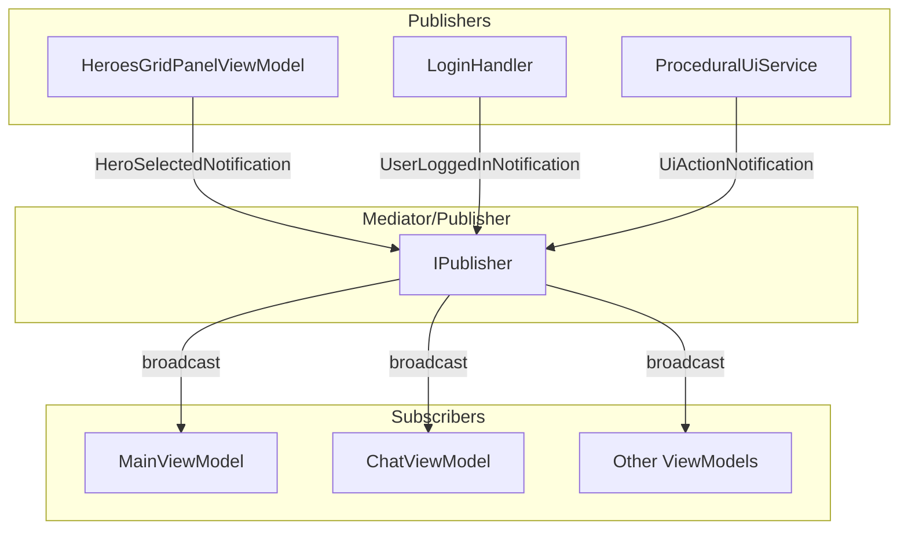

# Notifications — Pub/Sub между ViewModels

## Обзор

Notifications — broadcast-сообщения для коммуникации между ViewModels без прямых зависимостей.

## Каталог Notifications

| Notification | Поля | Publisher | Subscribers |
|--------------|------|-----------|-------------|
| `HeroSelectedNotification` | HeroId, SourceMode | HeroesGridPanelViewModel | MainViewModel |
| `EmbeddedPanelStateChangedNotification` | ViewModelType, IsVisible | EmbeddedPanelHost | — |
| `UserLoggedInNotification` | Email, Token | LoginHandler | — |
| `UserLoggedOutNotification` | — | LogoutHandler | — |
| `UiActionNotification` | Event | ProceduralUiService | ChatViewModel |
| `UiErrorNotification` | Event | ProceduralUiService | ChatViewModel |
| `SendMessageNotification` | Message | ProceduralUI buttons | ChatViewModel |
| `InsertTextNotification` | Text | ProceduralUI | ChatViewModel |
| `WorkflowTriggeredNotification` | WorkflowId | WorkflowService | ChatViewModel |

---

## Core Notifications

### HeroSelectedNotification

Уведомление о выборе героя.

```csharp
// Notifications/HeroSelectedNotification.cs
public readonly struct HeroSelectedNotification : INotification
{
    public readonly string HeroId;
    public readonly HeroesGridMode SourceMode;

    public HeroSelectedNotification(string heroId, HeroesGridMode mode)
    {
        HeroId = heroId;
        SourceMode = mode;
    }
}
```

**Publisher:** `HeroesGridPanelViewModel`
```csharp
// При клике на героя
await _publisher.Publish(new HeroSelectedNotification(heroId, _mode));
```

**Subscriber:** `MainViewModel`
```csharp
public class MainViewModel : DisposableObject,
    INotificationHandler<HeroSelectedNotification>
{
    public async UniTask Handle(HeroSelectedNotification notification, CancellationToken ct)
    {
        _model.SelectHero(notification.HeroId);

        if (notification.SourceMode == HeroesGridMode.Upgrades)
        {
            await _mediator.Send(new ShowEmbeddedViewRequest<HeroDetailPanelViewModel>(
                new HeroDetailContext(notification.HeroId)), ct);
        }
    }
}
```

---

### EmbeddedPanelStateChangedNotification

Уведомление об изменении состояния embedded панели.

```csharp
// Notifications/EmbeddedPanelStateChangedNotification.cs
public readonly struct EmbeddedPanelStateChangedNotification : INotification
{
    public readonly Type ViewModelType;
    public readonly bool IsVisible;

    public EmbeddedPanelStateChangedNotification(Type vmType, bool isVisible)
    {
        ViewModelType = vmType;
        IsVisible = isVisible;
    }
}
```

---

## Auth Notifications

### UserLoggedInNotification

Уведомление об успешном логине.

```csharp
// Notifications/Auth/UserLoggedInNotification.cs
public readonly struct UserLoggedInNotification : INotification
{
    public readonly string Email;
    public readonly string Token;

    public UserLoggedInNotification(string email, string token)
    {
        Email = email;
        Token = token;
    }
}
```

**Publisher:** `LoginHandler`
```csharp
await _publisher.Publish(
    new UserLoggedInNotification(request.Email, token), ct);
```

---

### UserLoggedOutNotification

Уведомление о выходе из аккаунта.

```csharp
// Notifications/Auth/UserLoggedOutNotification.cs
public readonly struct UserLoggedOutNotification : INotification
{
}
```

**Publisher:** `LogoutHandler`
```csharp
await _publisher.Publish(new UserLoggedOutNotification(), ct);
```

---

## Chat Notifications

### UiActionNotification

Уведомление о действии в процедурном UI.

```csharp
// Notifications/Chat/UiActionNotification.cs
public readonly struct UiActionNotification : INotification
{
    public readonly UiActionEvent Event;

    public UiActionNotification(UiActionEvent evt)
    {
        Event = evt;
    }
}
```

**Subscriber:** `ChatViewModel`
```csharp
_mediator.CreateNotificationObservable<UiActionNotification>()
    .Subscribe(this, static (n, self) => self.OnProceduralUiAction(n.Event))
    .AddTo(ref Disposables);

private void OnProceduralUiAction(UiActionEvent evt)
{
    switch (evt.ActionType)
    {
        case UiActionType.TriggerWorkflow:
            if (!string.IsNullOrEmpty(evt.WorkflowId))
            {
                TriggerUiActionAsync(new ChatUiActionRequest
                {
                    WorkflowId = evt.WorkflowId,
                    Metadata = evt.Metadata
                }).Forget();
            }
            break;

        case UiActionType.SendMessage:
            OnUiSendMessage(evt.Payload ?? evt.Value);
            break;

        case UiActionType.InsertText:
            OnUiInsertText(evt.Payload ?? evt.Value);
            break;
    }
}
```

---

### UiErrorNotification

Уведомление об ошибке в процедурном UI.

```csharp
// Notifications/Chat/UiErrorNotification.cs
public readonly struct UiErrorNotification : INotification
{
    public readonly UiErrorEvent Event;

    public UiErrorNotification(UiErrorEvent evt)
    {
        Event = evt;
    }
}
```

**Subscriber:** `ChatViewModel`
```csharp
_mediator.CreateNotificationObservable<UiErrorNotification>()
    .Subscribe(this, static (n, self) => self.OnProceduralUiError(n.Event))
    .AddTo(ref Disposables);

private void OnProceduralUiError(UiErrorEvent evt)
{
    UpdateStatus($"UI Error: {evt.Message}", isError: true);
}
```

---

### SendMessageNotification

Уведомление на отправку сообщения (от UI кнопок).

```csharp
// Notifications/Chat/SendMessageNotification.cs
public readonly struct SendMessageNotification : INotification
{
    public readonly string Message;

    public SendMessageNotification(string message)
    {
        Message = message;
    }
}
```

**Subscriber:** `ChatViewModel`
```csharp
_mediator.CreateNotificationObservable<SendMessageNotification>()
    .Subscribe(this, static (n, self) => self.OnUiSendMessage(n.Message))
    .AddTo(ref Disposables);

private void OnUiSendMessage(string message)
{
    if (string.IsNullOrWhiteSpace(message)) return;
    SendMessageAsync(message).Forget();
}
```

---

### InsertTextNotification

Уведомление на вставку текста в input.

```csharp
// Notifications/Chat/InsertTextNotification.cs
public readonly struct InsertTextNotification : INotification
{
    public readonly string Text;

    public InsertTextNotification(string text)
    {
        Text = text;
    }
}
```

**Subscriber:** `ChatViewModel`
```csharp
_mediator.CreateNotificationObservable<InsertTextNotification>()
    .Subscribe(this, static (n, self) => self.OnUiInsertText(n.Text))
    .AddTo(ref Disposables);

private void OnUiInsertText(string text)
{
    InputMessage.Value = text ?? string.Empty;
}
```

---

### WorkflowTriggeredNotification

Уведомление о запуске workflow.

```csharp
// Notifications/Chat/WorkflowTriggeredNotification.cs
public readonly struct WorkflowTriggeredNotification : INotification
{
    public readonly string WorkflowId;

    public WorkflowTriggeredNotification(string workflowId)
    {
        WorkflowId = workflowId;
    }
}
```

**Subscriber:** `ChatViewModel`
```csharp
_mediator.CreateNotificationObservable<WorkflowTriggeredNotification>()
    .Subscribe(this, static (_, self) => self.RefreshUiExtensionsAsync().Forget())
    .AddTo(ref Disposables);
```

---

## Подписка на Notifications

### Через INotificationHandler (interface)

```csharp
public class MainViewModel : DisposableObject,
    INotificationHandler<HeroSelectedNotification>
{
    public async UniTask Handle(HeroSelectedNotification notification, CancellationToken ct)
    {
        // Обработка notification
    }
}
```

### Через Observable (reactive)

```csharp
// В конструкторе
_mediator.CreateNotificationObservable<SomeNotification>()
    .Subscribe(this, static (n, self) => self.HandleNotification(n))
    .AddTo(ref Disposables);
```

---

## Публикация Notifications

### Из Handler через IPublisher

```csharp
public sealed class LoginHandler : IRequestHandler<LoginCommand, AuthResult>
{
    private readonly IPublisher _publisher;

    public async UniTask<AuthResult> Handle(LoginCommand request, CancellationToken ct)
    {
        // ... логика
        
        await _publisher.Publish(
            new UserLoggedInNotification(request.Email, token), ct);
        
        return AuthResult.Success(token);
    }
}
```

### Из ViewModel через IPublisher (inject)

```csharp
public class SomeViewModel : DisposableObject
{
    private readonly IPublisher _publisher;

    private async void OnSomeAction()
    {
        await _publisher.Publish(new SomeNotification(...));
    }
}
```

---

## Диаграмма Pub/Sub



---

## Best Practices

1. **readonly struct** — Notifications должны быть immutable
2. **Минимум данных** — только необходимые поля
3. **AddTo(Disposables)** — всегда добавлять подписки в Disposables
4. **static lambda** — использовать `static (n, self) => ...` для избежания замыканий
5. **Не блокировать** — обработка должна быть быстрой или async
6. **Логирование** — логировать важные notifications в publisher

## Когда использовать Notifications

| Сценарий | Используй |
|----------|-----------|
| Один-к-одному коммуникация | Command/Query |
| Broadcast событие | Notification |
| UI обновление от другого ViewModel | Notification |
| Результат операции | Command Result |
| Глобальное состояние изменилось | Notification |
