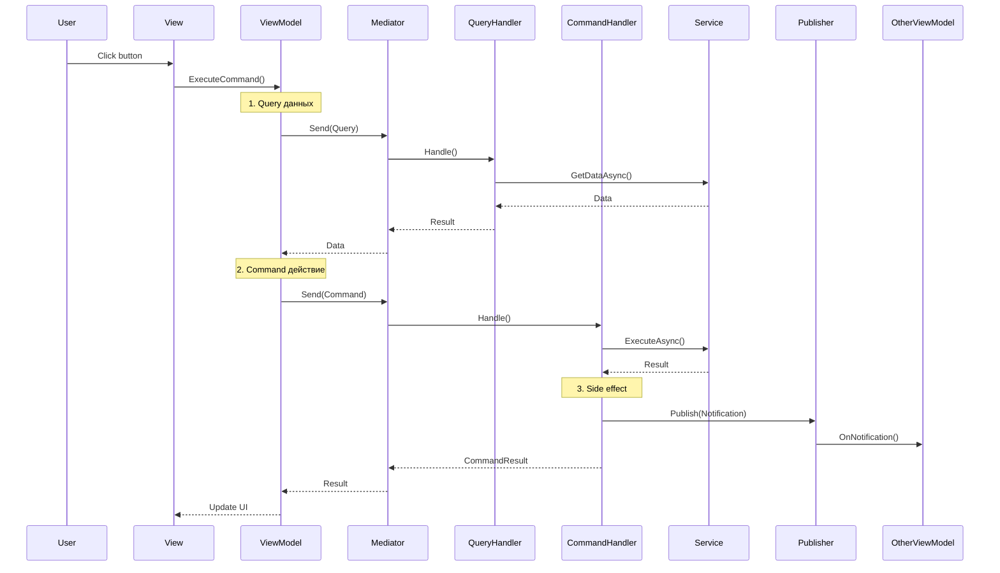

# Patterns — Best Practices

## Обзор

Этот документ описывает типичные паттерны использования Mediator в MVVM слое.

---

## 1. Result Pattern

Все Commands возвращают Result struct:

```csharp
public readonly struct CreateChatResult
{
    public readonly bool IsSuccess;
    public readonly string ChatId;
    public readonly string ErrorMessage;

    private CreateChatResult(bool isSuccess, string chatId, string errorMessage)
    {
        IsSuccess = isSuccess;
        ChatId = chatId;
        ErrorMessage = errorMessage;
    }

    public static CreateChatResult Success(string chatId) =>
        new CreateChatResult(true, chatId, null);

    public static CreateChatResult Failure(string errorMessage) =>
        new CreateChatResult(false, null, errorMessage);
}
```

**Использование:**
```csharp
var result = await _mediator.Send(new CreateChatCommand(...), ct);

if (!result.IsSuccess)
{
    UpdateStatus($"Error: {result.ErrorMessage}", isError: true);
    return;
}

// Используем result.ChatId
```

---

## 2. Static Lambda в Subscribe

Для избежания allocations от замыканий:

```csharp
// ✅ Правильно — static lambda с self
_mediator.CreateNotificationObservable<UiActionNotification>()
    .Subscribe(this, static (n, self) => self.OnProceduralUiAction(n.Event))
    .AddTo(ref Disposables);

// ❌ Неправильно — замыкание на this
_mediator.CreateNotificationObservable<UiActionNotification>()
    .Subscribe(n => OnProceduralUiAction(n.Event))  // Captures 'this'
    .AddTo(ref Disposables);
```

---

## 3. Request Cancellation

Паттерн отмены предыдущих запросов:

```csharp
public class ChatViewModel : DisposableObject
{
    private CancellationTokenSource _requestCts;

    private CancellationTokenSource CreateNewRequestCts()
    {
        _requestCts?.Cancel();
        _requestCts?.Dispose();
        _requestCts = new CancellationTokenSource();
        return _requestCts;
    }

    private async UniTask ExecuteRequest(Func<CancellationToken, UniTask> requestAction)
    {
        var cts = CreateNewRequestCts();
        _model.IsLoading = true;

        try
        {
            await requestAction(cts.Token);
        }
        catch (OperationCanceledException)
        {
            UpdateStatus("Request cancelled");
        }
        catch (Exception ex)
        {
            UpdateStatus($"Error: {ex.Message}", isError: true);
        }
        finally
        {
            _model.IsLoading = false;
        }
    }
}
```

---

## 4. Navigation Helper

Static class для типобезопасной навигации:

```csharp
// Определение
public static class Navigate
{
    public static NavigateCommand To(StateEnum state) => new NavigateCommand(state);
    public static NavigateCommand ToLogin() => new NavigateCommand(StateEnum.Login);
    public static NavigateCommand ToMain() => new NavigateCommand(StateEnum.Main);
    public static NavigateCommand ToChat() => new NavigateCommand(StateEnum.Chat);
    public static NavigateCommand ToImageGen() => new NavigateCommand(StateEnum.ImageGen);
    public static NavigateCommand ToMenuSelection() => new NavigateCommand(StateEnum.MenuSelection);
}

// Использование
await _mediator.Send(Navigate.ToMenuSelection());
await _mediator.Send(Navigate.ToChat());
```

---

## 5. View Request Pattern

Типизированные requests для показа/скрытия views:

```csharp
// Show view
public readonly struct ShowViewRequest<TView, TViewModel> : IRequest<bool>
    where TView : BindableView<TViewModel>
    where TViewModel : DisposableObject
{
}

// Hide view
public readonly struct HideViewRequest<TView, TViewModel> : IRequest<bool>
    where TView : BindableView<TViewModel>
    where TViewModel : DisposableObject
{
}

// Embedded view с контекстом
public readonly struct ShowEmbeddedViewRequest<TViewModel> : IRequest<bool>
    where TViewModel : DisposableObject
{
    public readonly IViewContext Context;

    public ShowEmbeddedViewRequest(IViewContext context = null)
    {
        Context = context ?? EmptyContext.Instance;
    }
}

// Использование
await _mediator.Send(new ShowViewRequest<SettingsView, SettingsViewModel>());
await _mediator.Send(new HideViewRequest<SettingsView, SettingsViewModel>());
await _mediator.Send(new ShowEmbeddedViewRequest<HeroDetailPanelViewModel>(
    new HeroDetailContext(heroId)));
```

---

## 6. Handler с Side Effects

Когда handler должен уведомить другие части системы:

```csharp
public sealed class LoginHandler : IRequestHandler<LoginCommand, AuthResult>
{
    private readonly IAuthService _authService;
    private readonly IPublisher _publisher;  // Для notifications

    public async UniTask<AuthResult> Handle(LoginCommand request, CancellationToken ct)
    {
        // 1. Основная логика
        var signInResult = await _authService.SignInEmailAsync(...);
        
        if (!signInResult)
            return AuthResult.Failure("Sign-in failed");

        // 2. Side effect — уведомление других ViewModels
        await _publisher.Publish(
            new UserLoggedInNotification(request.Email, token), ct);

        return AuthResult.Success(token);
    }
}
```

---

## 7. INotificationHandler в ViewModel

ViewModel может реализовать INotificationHandler:

```csharp
public class MainViewModel : DisposableObject,
    INotificationHandler<HeroSelectedNotification>
{
    private readonly IMediator _mediator;

    public async UniTask Handle(HeroSelectedNotification notification, CancellationToken ct)
    {
        _model.SelectHero(notification.HeroId);

        if (notification.SourceMode == HeroesGridMode.Upgrades)
        {
            await _mediator.Send(new ShowEmbeddedViewRequest<HeroDetailPanelViewModel>(
                new HeroDetailContext(notification.HeroId)), ct);
        }
    }
}
```

---

## 8. Подписка на Notifications в конструкторе

```csharp
public ChatViewModel(IChatModel model, IMediator mediator)
{
    _model = model;
    _mediator = mediator;

    // Все подписки в отдельном методе
    SubscribeToNotifications();
    
    // Инициализация
    InitializeAsync().Forget();
}

private void SubscribeToNotifications()
{
    _mediator.CreateNotificationObservable<UiActionNotification>()
        .Subscribe(this, static (n, self) => self.OnProceduralUiAction(n.Event))
        .AddTo(ref Disposables);

    _mediator.CreateNotificationObservable<UiErrorNotification>()
        .Subscribe(this, static (n, self) => self.OnProceduralUiError(n.Event))
        .AddTo(ref Disposables);

    _mediator.CreateNotificationObservable<SendMessageNotification>()
        .Subscribe(this, static (n, self) => self.OnUiSendMessage(n.Message))
        .AddTo(ref Disposables);
}
```

---

## 9. Generic Handlers

Для общих операций используй generic handlers:

```csharp
// Handler
public sealed class GetConfigHandler<TConfig> : IRequestHandler<GetConfigQuery<TConfig>, TConfig>
    where TConfig : ConfigBase
{
    private readonly IConfigProvider _configProvider;

    public UniTask<TConfig> Handle(GetConfigQuery<TConfig> query, CancellationToken ct)
    {
        var config = _configProvider.GetConfig<TConfig>();
        return UniTask.FromResult(config);
    }
}

// Использование
var settings = await _mediator.Send(new GetConfigQuery<DesignSystemSettings>());
var audioConfig = await _mediator.Send(new GetConfigQuery<AudioConfig>());
```

---

## 10. Error Handling в Handler

```csharp
public async UniTask<TResult> Handle(TCommand command, CancellationToken ct)
{
    try
    {
        // Основная логика
        var result = await _service.DoSomethingAsync(ct);
        
        if (result == null)
        {
            _logger.Error("[Handler] Operation failed - null response");
            return TResult.Failure("Operation failed");
        }
        
        _logger.Info("[Handler] Operation successful");
        return TResult.Success(result);
    }
    catch (OperationCanceledException)
    {
        throw; // ВАЖНО: пробрасывать, не ловить!
    }
    catch (Exception ex)
    {
        _logger.Error(ex, "[Handler] Unexpected error");
        return TResult.Failure(ex.Message);
    }
}
```

---

## 11. Chaining Commands

Последовательное выполнение команд:

```csharp
private async UniTaskVoid RunWorkflowAsync()
{
    await ExecuteRequest(async ct =>
    {
        // 1. Загрузка персонажа
        UpdateStatus("Loading character...");
        var character = await _mediator.Send(new GetCharacterQuery(userSlug, slug), ct);
        if (character == null) return;

        // 2. Получение персоны
        UpdateStatus("Getting user persona...");
        var personas = await _mediator.Send(new GetUserPersonasQuery(), ct);
        var personaId = personas?.FirstOrDefault()?.Id;

        // 3. Создание чата
        UpdateStatus("Creating chat...");
        var createResult = await _mediator.Send(
            new CreateChatCommand(characterId, greetingId, promptId, modelId, personaId, maxTokens), ct);
        if (!createResult.IsSuccess) return;

        // 4. Получение истории
        var history = await _mediator.Send(new GetChatHistoryQuery(createResult.ChatId), ct);

        // 5. Получение UI extensions
        UpdateStatus("Loading UI extensions...");
        var extensions = await _mediator.Send(new GetChatExtensionsQuery(createResult.ChatId), ct);

        // 6. Установка контекста
        await _mediator.Send(new SetChatContextCommand(createResult.ChatId), ct);

        UpdateStatus("Success!");
    });
}
```

---

## 12. Dispose Pattern

```csharp
public override void Dispose()
{
    // Отправить cleanup command
    _mediator.Send(new DisposeProceduralUiCommand()).Forget();
    
    // Базовый dispose (очистит Disposables)
    base.Dispose();
}
```

---

## Диаграмма типичного flow



---

## Checklist для нового Request

- [ ] Создать readonly struct для Request
- [ ] Определить Response type (или Nothing)
- [ ] Создать Result struct если нужен (IsSuccess pattern)
- [ ] Создать Handler class
- [ ] Inject необходимые services
- [ ] Добавить logging
- [ ] Обработать OperationCanceledException
- [ ] Зарегистрировать handler в DI
- [ ] Написать unit test
