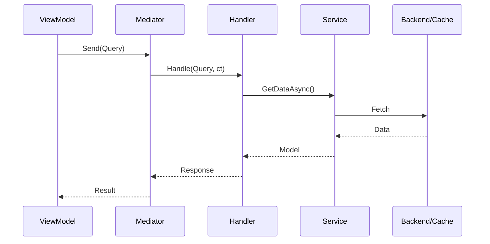

# Queries — Каталог

## Обзор

Queries — read-only запросы для получения данных. Возвращают данные, не изменяют состояние.

## Каталог Queries

| Query | Request | Response | Handler | Используется в |
|-------|---------|----------|---------|----------------|
| `GetCharacterQuery` | `UserSlug`, `CharacterSlug` | `CharacterModel` | `GetCharacterHandler` | ChatViewModel |
| `GetChatHistoryQuery` | `ChatId` | `ChatModel` | `GetChatHistoryHandler` | ChatViewModel |
| `GetChatExtensionsQuery` | `ChatId` | `UiExtensionsModel` | `GetChatExtensionsHandler` | ChatViewModel |
| `GetUserPersonasQuery` | — | `List<ChatPersonaDto>` | `GetUserPersonasHandler` | ChatViewModel |
| `GetStoredCredentialsQuery` | — | `StoredCredentials` | `GetStoredCredentialsHandler` | LoginViewModel |
| `OpenImageFileQuery` | `Title`, `Filter` | `FileDialogResult` | `OpenImageFileHandler` | ImageGenViewModel |
| `GetConfigQuery<T>` | — | `TConfig` | `GetConfigHandler<T>` | ChatViewModel |
| `LoadPrefsQuery<T>` | `Key`, `DefaultValue` | `T` | `LoadPrefsHandler<T>` | Различные |
| `ConfirmDialogQuery` | `Title`, `Message`, `ConfirmText`, `CancelText` | `bool` | `ConfirmDialogHandler` | Различные |
| `GetWorkflowUiQuery` | `WorkflowId`, `StorageContext` | `StandaloneUiResult` | `GetWorkflowUiHandler` | StandaloneWorkflowViewModel |
| `GetWorkflowsQuery` | `Page`, `PageSize` | `List<WorkflowModel>` | `GetWorkflowsHandler` | NetworkSandboxViewModel |
| `LoadImageQuery` | `FilePath` | `LoadImageResult` | `LoadImageHandler` | ImageGenViewModel |
| `OpenImagePickerQuery` | `Title`, `Filter` | `OpenImagePickerResult` | `OpenImagePickerHandler` | ImageGenViewModel |

---

## Chat Queries

### GetCharacterQuery

Получение информации о персонаже по slug.

```csharp
// Queries/Chat/GetCharacterQuery.cs
public readonly struct GetCharacterQuery : IRequest<CharacterModel>
{
    public readonly string UserSlug;
    public readonly string CharacterSlug;

    public GetCharacterQuery(string userSlug, string characterSlug)
    {
        UserSlug = userSlug;
        CharacterSlug = characterSlug;
    }
}
```

**Handler:** `GetCharacterHandler`
```csharp
public async UniTask<CharacterModel> Handle(GetCharacterQuery query, CancellationToken ct)
{
    return await _characterService.GetCharacterBySlugAsync(query.UserSlug, query.CharacterSlug, ct);
}
```

**Использование:**
```csharp
// ChatViewModel.cs
var character = await _mediator.Send(
    new GetCharacterQuery(CharacterUserSlug, CharacterSlug), ct);
```

---

### GetChatHistoryQuery

Получение истории чата.

```csharp
// Queries/Chat/GetChatHistoryQuery.cs
public readonly struct GetChatHistoryQuery : IRequest<ChatModel>
{
    public readonly string ChatId;

    public GetChatHistoryQuery(string chatId)
    {
        ChatId = chatId;
    }
}
```

**Handler:** `GetChatHistoryHandler`
```csharp
public async UniTask<ChatModel> Handle(GetChatHistoryQuery query, CancellationToken ct)
{
    return await _chatService.GetChatHistoryAsync(query.ChatId, ct);
}
```

**Использование:**
```csharp
var chatHistory = await _mediator.Send(new GetChatHistoryQuery(chatId), ct);
if (chatHistory?.Messages != null)
{
    _model.ChatMessages = new List<ChatMessage>(chatHistory.Messages);
}
```

---

### GetChatExtensionsQuery

Получение UI extensions для чата (процедурный UI).

```csharp
// Queries/Chat/GetChatExtensionsQuery.cs
public readonly struct GetChatExtensionsQuery : IRequest<UiExtensionsModel>
{
    public readonly string ChatId;

    public GetChatExtensionsQuery(string chatId)
    {
        ChatId = chatId;
    }
}
```

**Handler:** `GetChatExtensionsHandler`
```csharp
public async UniTask<UiExtensionsModel> Handle(GetChatExtensionsQuery query, CancellationToken ct)
{
    return await _chatService.GetChatExtensionsUiAsync(query.ChatId, ct);
}
```

---

### GetUserPersonasQuery

Получение списка персон пользователя.

```csharp
// Queries/Chat/GetUserPersonasQuery.cs
public readonly struct GetUserPersonasQuery : IRequest<List<ChatPersonaDto>>
{
}
```

**Handler:** `GetUserPersonasHandler`
```csharp
public async UniTask<List<ChatPersonaDto>> Handle(GetUserPersonasQuery query, CancellationToken ct)
{
    var personas = await _chatService.GetMyPersonasAsync(ct);
    return personas ?? new List<ChatPersonaDto>();
}
```

---

## Auth Queries

### GetStoredCredentialsQuery

Получение сохранённых учётных данных.

```csharp
// Queries/Auth/GetStoredCredentialsQuery.cs
public readonly struct GetStoredCredentialsQuery : IRequest<StoredCredentials>
{
}

public readonly struct StoredCredentials
{
    public readonly string Email;
    public readonly string Password;
    public readonly bool RememberMe;
    public readonly bool HasCredentials;

    public static StoredCredentials Empty => new StoredCredentials(null, null, false);
}
```

**Handler:** `GetStoredCredentialsHandler`
```csharp
public UniTask<StoredCredentials> Handle(GetStoredCredentialsQuery request, CancellationToken ct)
{
    var stored = _prefsService.Load<LoginAuthPrefs>(AuthPrefsKey);
    
    if (stored == null || string.IsNullOrEmpty(stored.Email))
        return UniTask.FromResult(StoredCredentials.Empty);
    
    return UniTask.FromResult(new StoredCredentials(stored.Email, stored.Password, stored.RememberMe));
}
```

---

## Common Queries

### GetConfigQuery<T>

Получение конфигурации по типу.

```csharp
// Queries/Common/GetConfigQuery.cs
public readonly struct GetConfigQuery<TConfig> : IRequest<TConfig>
    where TConfig : class
{
}
```

**Использование:**
```csharp
DesignSystemSettings = await _mediator.Send(new GetConfigQuery<DesignSystemSettings>());
```

---

### LoadPrefsQuery<T>

Загрузка данных из PlayerPrefs.

```csharp
// Queries/Common/LoadPrefsQuery.cs
public readonly struct LoadPrefsQuery<T> : IRequest<T>
    where T : class
{
    public readonly string Key;
    public readonly T DefaultValue;

    public LoadPrefsQuery(string key, T defaultValue = null)
    {
        Key = key;
        DefaultValue = defaultValue;
    }
}
```

---

### ConfirmDialogQuery

Показ диалога подтверждения.

```csharp
// Queries/Common/ConfirmDialogQuery.cs
public readonly struct ConfirmDialogQuery : IRequest<bool>
{
    public readonly string Title;
    public readonly string Message;
    public readonly string ConfirmText;
    public readonly string CancelText;

    public ConfirmDialogQuery(string title, string message, 
        string confirmText = "OK", string cancelText = "Cancel")
    {
        Title = title;
        Message = message;
        ConfirmText = confirmText;
        CancelText = cancelText;
    }
}
```

---

## ImageGen Queries

### LoadImageQuery

Загрузка изображения из файла.

```csharp
// Queries/ImageGen/LoadImageQuery.cs
public readonly struct LoadImageQuery : IRequest<LoadImageResult>
{
    public readonly string FilePath;

    public LoadImageQuery(string filePath)
    {
        FilePath = filePath;
    }
}

public readonly struct LoadImageResult
{
    public readonly bool Success;
    public readonly IImageHandle Image;
    public readonly string Error;

    public static LoadImageResult Loaded(IImageHandle image) => new(true, image, null);
    public static LoadImageResult Failed(string error) => new(false, null, error);
}
```

---

### OpenImagePickerQuery

Открытие диалога выбора изображения.

```csharp
// Queries/ImageGen/OpenImagePickerQuery.cs
public readonly struct OpenImagePickerQuery : IRequest<OpenImagePickerResult>
{
    public readonly string Title;
    public readonly string Filter;

    public OpenImagePickerQuery(string title = "Select Image", string filter = "png,jpg,jpeg,webp")
    {
        Title = title;
        Filter = filter;
    }
}

public readonly struct OpenImagePickerResult
{
    public readonly bool Success;
    public readonly IImageHandle Image;
    public readonly string Error;

    public static OpenImagePickerResult Loaded(IImageHandle image) => new(true, image, null);
    public static OpenImagePickerResult Cancelled() => new(false, null, null);
    public static OpenImagePickerResult Failed(string error) => new(false, null, error);
}
```

---

## Workflow Queries

### GetWorkflowUiQuery

Получение UI для workflow.

```csharp
// Queries/Workflow/GetWorkflowUiQuery.cs
public readonly struct GetWorkflowUiQuery : IRequest<StandaloneUiResult>
{
    public readonly string WorkflowId;
    public readonly StorageContext StorageContext;

    public GetWorkflowUiQuery(string workflowId, StorageContext storageContext)
    {
        WorkflowId = workflowId;
        StorageContext = storageContext;
    }
}
```

---

### GetWorkflowsQuery

Получение списка workflows с пагинацией.

```csharp
// Queries/Workflow/GetWorkflowsQuery.cs
public readonly struct GetWorkflowsQuery : IRequest<List<WorkflowModel>>
{
    public readonly int Page;
    public readonly int PageSize;

    public GetWorkflowsQuery(int page = 1, int pageSize = 100)
    {
        Page = page;
        PageSize = pageSize;
    }
}
```

---

## Диаграмма Query Flow



## Best Practices

1. **Queries не изменяют состояние** — только чтение данных
2. **readonly struct** — для производительности
3. **CancellationToken** — всегда передавать для отмены
4. **Null checks** — в handlers проверять результаты сервисов
5. **Logging** — логировать ошибки в handlers
