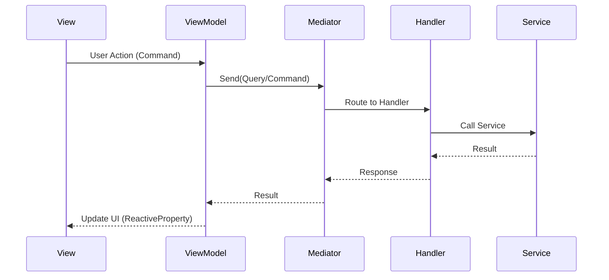
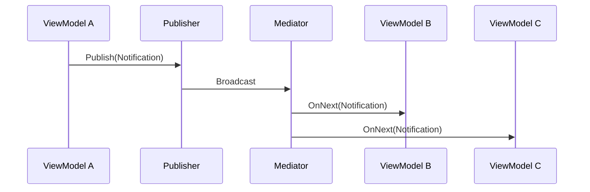

# MVVM + Mediator Integration

## Обзор архитектуры

MVVM слой в EndlessAdventure использует **Mediator паттерн** для коммуникации между компонентами. Это обеспечивает:

- **Слабую связанность** — ViewModels не знают о Handlers напрямую
- **Тестируемость** — легко мокать IMediator в unit-тестах
- **Единую точку входа** — все запросы идут через Mediator
- **Pub/Sub** — Notifications для broadcast-сообщений между ViewModels

## Структура

```
MVVM/
├── Views/               # BindableView<TViewModel> — UI компоненты
│   └── docs/Views/README.md — Каталог всех Views
├── ViewModels/          # DisposableObject — UI логика, используют IMediator
│   └── docs/ViewModels/README.md — Каталог всех ViewModels
├── Models/              # IModel реализации — состояние UI
│   └── docs/Models/README.md — Каталог всех Models
├── Elements/            # BindableElement<TData> — переиспользуемые UI элементы
│   └── docs/Elements/README.md — Каталог всех Elements
├── Components/          # UI компоненты (кнопки, слайдеры и т.д.)
└── docs/                # Эта документация

⚠️ ВАЖНО: Commands, Queries, Handlers, Notifications, Requests
   ПЕРЕЕХАЛИ в Application слой!
   См. /Core/Application/
```

## Основные компоненты

### IMediator

```csharp
public interface IMediator
{
    // Отправить Query/Command и получить результат
    UniTask<TResponse> Send<TResponse>(IRequest<TResponse> request, CancellationToken ct = default);
    
    // Отправить Command без результата
    UniTask<Nothing> Send(IRequest request, CancellationToken ct = default);
    
    // Создать Observable для Notifications
    Observable<TNotification> CreateNotificationObservable<TNotification>() 
        where TNotification : INotification;
}
```

### IPublisher

```csharp
public interface IPublisher
{
    // Опубликовать Notification
    UniTask Publish<TNotification>(TNotification notification, CancellationToken ct = default)
        where TNotification : INotification;
}
```

## Диаграмма взаимодействия



## Pub/Sub через Notifications



## Типы запросов

| Тип | Интерфейс | Назначение |
|-----|-----------|------------|
| Query | `IRequest<TResponse>` | Получение данных (read-only) |
| Command | `IRequest<TResult>` | Изменение состояния |
| Command (void) | `IRequest` | Действие без результата |
| Notification | `INotification` | Broadcast событие |

## Документация по разделам

### MVVM Layer
- **[Views/README.md](Views/README.md)** — Каталог всех Views с биндингами
- **[ViewModels/README.md](ViewModels/README.md)** — Каталог всех ViewModels
- **[Models/README.md](Models/README.md)** — Каталог всех Models
- **[Elements/README.md](Elements/README.md)** — Переиспользуемые UI элементы
- [ViewModelMediator.md](ViewModelMediator.md) — Как ViewModels используют Mediator
- [Patterns.md](Patterns.md) — Best practices и типичные паттерны
- [MainView.md](MainView.md) — Подробное описание главного экрана

### View Details
- [Views/ChatView.md](Views/ChatView.md) — AI чат с персонажами
- [Views/NetworkSandboxView.md](Views/NetworkSandboxView.md) — Тестовый экран Workflow API
- [Views/SettingsView.md](Views/SettingsView.md) — Настройки игры

### Application docs (Commands/Queries/Handlers переехали!)
- [Application/README.md](../../Application/docs/README.md) — Application Layer
- [Commands.md](Commands.md) — Все Commands
- [Queries.md](Queries.md) — Все Queries
- [Handlers.md](Handlers.md) — Все Handlers
- [Notifications.md](Notifications.md) — Все Notifications

## Quick Start

### Создание Query

```csharp
// 1. Определить Query
public readonly struct GetHeroQuery : IRequest<HeroModel>
{
    public readonly string HeroId;
    public GetHeroQuery(string heroId) => HeroId = heroId;
}

// 2. Создать Handler
public sealed class GetHeroHandler : IRequestHandler<GetHeroQuery, HeroModel>
{
    private readonly IHeroService _heroService;
    
    public GetHeroHandler(IHeroService heroService) => _heroService = heroService;
    
    public async UniTask<HeroModel> Handle(GetHeroQuery query, CancellationToken ct)
    {
        return await _heroService.GetHeroAsync(query.HeroId, ct);
    }
}

// 3. Использовать в ViewModel
var hero = await _mediator.Send(new GetHeroQuery("hero_001"));
```

### Подписка на Notification

```csharp
// В конструкторе ViewModel
_mediator.CreateNotificationObservable<HeroSelectedNotification>()
    .Subscribe(n => OnHeroSelected(n.HeroId))
    .AddTo(ref Disposables);
```

## Регистрация Handlers

Handlers регистрируются в DI-контейнере через `ViewHandlerRegistration`:

```csharp
// Registration/ViewHandlerRegistration.cs
builder.Register<GetCharacterHandler>(Lifetime.Transient).AsImplementedInterfaces();
builder.Register<CreateChatHandler>(Lifetime.Transient).AsImplementedInterfaces();
// ...
```

## См. также

- [Core.Infrastructure.Mediator](../../Infrastructure/Mediator/) — базовая реализация Mediator
- [AGENTS.md](../AGENTS.md) — MVVM conventions и guidelines
