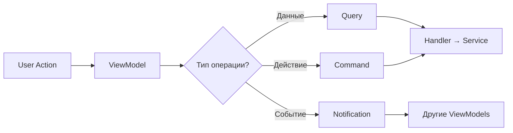
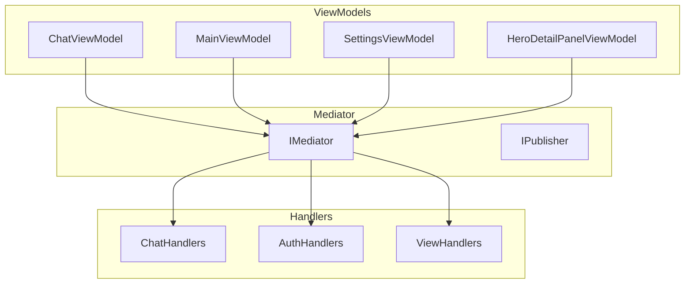

# ViewModel ↔ Mediator Integration

## Обзор

Каждый ViewModel получает `IMediator` через конструктор и использует его для:
1. Отправки Commands (действия)
2. Выполнения Queries (получение данных)
3. Подписки на Notifications (события от других ViewModels)

## Инъекция IMediator

```csharp
[GenerateViewCommands]
public class ChatViewModel : DisposableObject
{
    private readonly IMediator _mediator;

    public ChatViewModel(IChatModel model, IMediator mediator)
    {
        _model = model ?? throw new ArgumentNullException(nameof(model));
        _mediator = mediator ?? throw new ArgumentNullException(nameof(mediator));
        
        // Подписки на notifications
        SubscribeToNotifications();
    }
}
```

## Использование в ViewModels

### 1. Отправка Query

```csharp
// ChatViewModel.cs — получение персонажа
var character = await _mediator.Send(new GetCharacterQuery(userSlug, characterSlug), ct);

// ChatViewModel.cs — получение истории чата
var chatHistory = await _mediator.Send(new GetChatHistoryQuery(chatId), ct);

// ChatViewModel.cs — получение UI extensions
var uiExtensions = await _mediator.Send(new GetChatExtensionsQuery(chatId), ct);
```

### 2. Отправка Command

```csharp
// ChatViewModel.cs — создание чата
var createResult = await _mediator.Send(
    new CreateChatCommand(characterId, greetingId, promptId, modelId, personaId, maxTokens), ct);

// ChatViewModel.cs — отправка сообщения
var sendResult = await _mediator.Send(new SendChatMessageCommand(
    chatId, characterId, messageText, parentMessageId,
    modelId, temperature, topP, topK, maxTokens), ct);

// ChatViewModel.cs — навигация
await _mediator.Send(Navigate.ToMenuSelection());
```

### 3. Подписка на Notifications

```csharp
private void SubscribeToNotifications()
{
    // UI Action от процедурного UI
    _mediator.CreateNotificationObservable<UiActionNotification>()
        .Subscribe(this, static (n, self) => self.OnProceduralUiAction(n.Event))
        .AddTo(ref Disposables);

    // Ошибки UI
    _mediator.CreateNotificationObservable<UiErrorNotification>()
        .Subscribe(this, static (n, self) => self.OnProceduralUiError(n.Event))
        .AddTo(ref Disposables);

    // Отправка сообщения из UI
    _mediator.CreateNotificationObservable<SendMessageNotification>()
        .Subscribe(this, static (n, self) => self.OnUiSendMessage(n.Message))
        .AddTo(ref Disposables);

    // Вставка текста в input
    _mediator.CreateNotificationObservable<InsertTextNotification>()
        .Subscribe(this, static (n, self) => self.OnUiInsertText(n.Text))
        .AddTo(ref Disposables);

    // Workflow triggered
    _mediator.CreateNotificationObservable<WorkflowTriggeredNotification>()
        .Subscribe(this, static (_, self) => self.RefreshUiExtensionsAsync().Forget())
        .AddTo(ref Disposables);
}
```

## Примеры ViewModels

### HeroDetailPanelViewModel

**Использует Mediator для:**
- Скрытия embedded view при закрытии панели

```csharp
private async void OnCloseAsync()
{
    IsVisible.Value = false;
    await _mediator.Send(new HideEmbeddedViewRequest<HeroDetailPanelViewModel>());
}
```

### ChatViewModel

**Самый активный пользователь Mediator:**

| Операция | Mediator Call |
|----------|---------------|
| Получить персонажа | `Send(GetCharacterQuery)` |
| Получить персоны | `Send(GetUserPersonasQuery)` |
| Создать чат | `Send(CreateChatCommand)` |
| Получить историю | `Send(GetChatHistoryQuery)` |
| Получить UI extensions | `Send(GetChatExtensionsQuery)` |
| Установить контекст | `Send(SetChatContextCommand)` |
| Отправить сообщение | `Send(SendChatMessageCommand)` |
| Удалить чат | `Send(DeleteChatCommand)` |
| Выполнить workflow | `Send(ExecuteWorkflowCommand)` |
| Рендер UI | `Send(RenderUiComponentsCommand)` |
| Получить конфиг | `Send(GetConfigQuery<DesignSystemSettings>)` |
| Навигация | `Send(Navigate.ToMenuSelection())` |
| Очистка UI | `Send(DisposeProceduralUiCommand)` |

### MainViewModel

**Реализует INotificationHandler:**

```csharp
public class MainViewModel : DisposableObject,
    INotificationHandler<HeroSelectedNotification>
{
    public async UniTask Handle(HeroSelectedNotification notification, CancellationToken ct)
    {
        _model.SelectHero(notification.HeroId);

        if (notification.SourceMode == HeroesGridMode.Upgrades)
        {
            await _mediator.Send(new ShowEmbeddedViewRequest<HeroDetailPanelViewModel>(
                new HeroDetailContext(notification.HeroId)), ct);
        }
    }
}
```

**Использует Mediator для показа views:**

```csharp
private async UniTaskVoid OnOpenSettingsAsync()
{
    await _mediator.Send(new ShowViewRequest<SettingsView, SettingsViewModel>());
}

private async UniTaskVoid OnOpenHeroesGridAsync(HeroesGridMode mode)
{
    await _mediator.Send(new ShowEmbeddedViewRequest<HeroesGridPanelViewModel>(
        new HeroesGridContext(mode)));
}
```

### SettingsViewModel

**Использует Mediator для скрытия view:**

```csharp
private async void Close()
{
    _model.IsVisible = false;
    await _mediator.Send(new HideViewRequest<SettingsView, SettingsViewModel>());
}

private async void Cancel()
{
    _model.LoadFromPlayerPrefs();
    _model.IsVisible = false;
    await _mediator.Send(new HideViewRequest<SettingsView, SettingsViewModel>());
}
```

## Паттерн использования



## Статический helper Navigate

Для навигации используется статический класс `Navigate`:

```csharp
// Commands/Common/NavigateCommand.cs
public static class Navigate
{
    public static NavigateCommand To(StateEnum state) => new NavigateCommand(state);
    public static NavigateCommand ToLogin() => new NavigateCommand(StateEnum.Login);
    public static NavigateCommand ToMain() => new NavigateCommand(StateEnum.Main);
    public static NavigateCommand ToChat() => new NavigateCommand(StateEnum.Chat);
    public static NavigateCommand ToImageGen() => new NavigateCommand(StateEnum.ImageGen);
    public static NavigateCommand ToMenuSelection() => new NavigateCommand(StateEnum.MenuSelection);
}

// Использование
await _mediator.Send(Navigate.ToMenuSelection());
```

## Диаграмма зависимостей



## Рекомендации

1. **Всегда инжектить IMediator** — не создавать вручную
2. **Использовать CancellationToken** — для отмены операций
3. **Подписки AddTo(Disposables)** — для автоматической очистки
4. **static lambda** — для избежания замыканий в Subscribe
5. **Проверять результат** — Commands возвращают Result с IsSuccess
