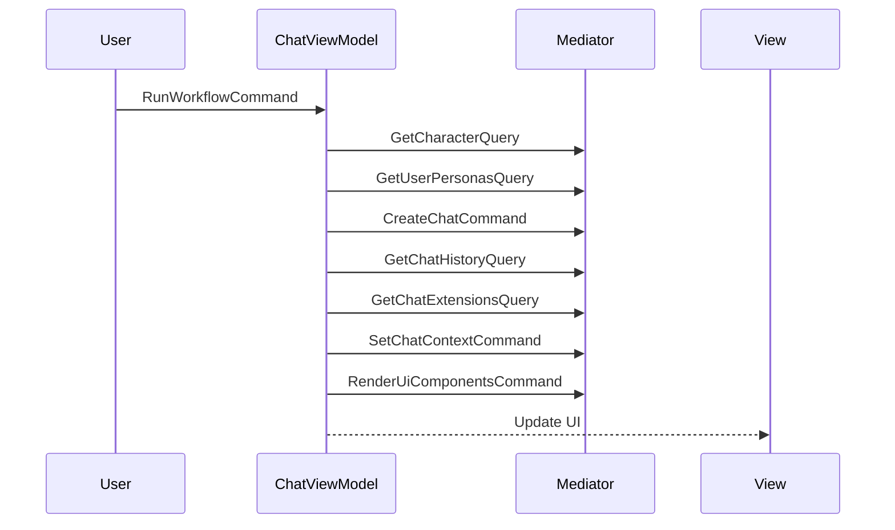
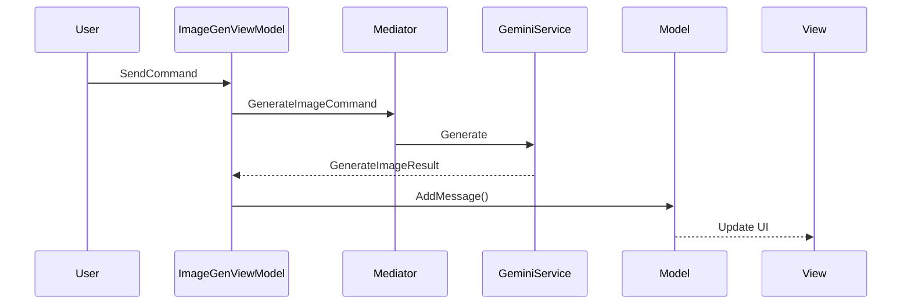
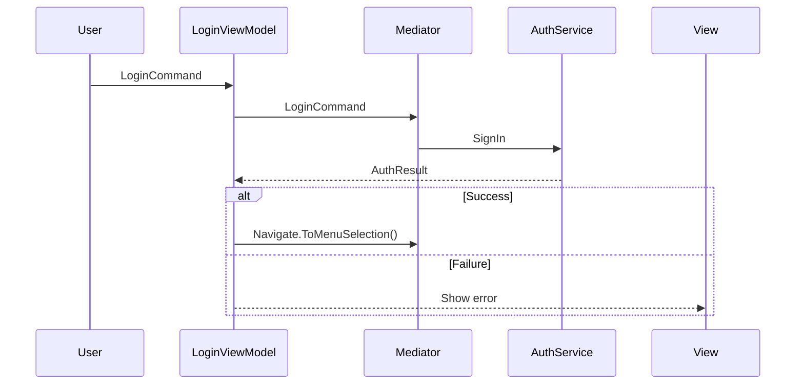

# ViewModels — UI Logic Layer

## Обзор

ViewModels — UI логика слой между Views и Models. Содержат:
- **ReactiveProperty<T>** для data binding
- **ReactiveCommand<T>** для user actions
- **IMediator** для Commands/Queries
- Подписки на **Notifications**

Все ViewModels наследуются от `DisposableObject` и используют `[GenerateViewCommands]` attribute для code generation.

## Базовый класс

```csharp
public class DisposableObject : IViewModel
{
    public bool IsDisposed { get; }
    
    protected ref DisposableBag Disposables { get; }
    
    protected void SafeCancelAndDisposeRequestCts() { ... }
    protected void CancelRequestCts() { ... }
    protected CancellationTokenSource CreateNewRequestCts() { ... }
    
    public virtual void Dispose()
    {
        if (IsDisposed) return;
        IsDisposed = true;
        SafeCancelAndDisposeRequestCts();
        _disposables.Dispose();
    }
}
```

## Инъекция зависимостей

```csharp
[GenerateViewCommands]
public class ExampleViewModel : DisposableObject
{
    private readonly IExampleModel _model;
    private readonly IMediator _mediator;
    private readonly ILogger _logger;

    public ExampleViewModel(IExampleModel model, IMediator mediator, ILogger logger)
    {
        _model = model;
        _mediator = mediator;
        _logger = logger;
        
        // Properties
        SomeProp = new ReactiveProperty<T>(_model.InitialValue);
        
        // Event subscriptions
        _model.SomeValueChanged += value => SomeProp.Value = value;
        
        // Commands
        SomeCommand = new ReactiveCommand<T>(OnSomeAction);
        SomeCommand.AddTo(ref Disposables);
    }
}
```

---

## Каталог ViewModels

| ViewModel | Model | Описание |
|-----------|-------|----------|
| `ChatViewModel` | `IChatModel` | AI чат с персонажами |
| `HealingPanelViewModel` | `IHealingPanelModel` | Панель лечения героев |
| `HeroDetailPanelViewModel` | — | Детали героя (без model) |
| `HeroesGridPanelViewModel` | `IHeroesGridPanelModel` | Грид с карточками героев |
| `ImageGenViewModel` | `IImageGenModel` | Генерация изображений |
| `LoginViewModel` | `ILoginModel` | Авторизация |
| `MainViewModel` | `IMainModel` | Главный экран |
| `MenuSelectionViewModel` | `IMenuSelectionModel` | Меню выбора направления |
| `NetworkSandboxViewModel` | `INetworkSandboxModel` | Тестовый экран Workflow API |
| `PerformanceTestViewModel` | `IPerformanceTestModel` | Тестирование производительности |
| `SettingsViewModel` | `ISettingsModel` | Настройки игры |
| `StandaloneWorkflowViewModel` | `IStandaloneWorkflowModel` | Standalone workflow |
| `TrainingPanelViewModel` | `ITrainingPanelModel` | Панель тренировки героев |
| `UIConstructorViewModel` | `IUIConstructorModel` | Конструктор UI элементов |

---

## ChatViewModel

**Путь:** `ViewModels/Chat/ChatViewModel.cs`  
**Model:** `IChatModel`  
**View:** `ChatView`

Самый сложный ViewModel — управляет AI чатом, Procedural UI, workflow triggers.

### Properties

```csharp
public ReactiveProperty<string> StatusText { get; }
public ReactiveProperty<string> ResponseText { get; }
public ReactiveProperty<bool> IsLoading { get; }
public ReactiveProperty<CharacterModel> Character { get; }
public ReactiveProperty<string> CurrentChatId { get; }
public ReactiveProperty<UiExtensionsModel> UiExtensions { get; }
public ReactiveProperty<List<ChatMessage>> ChatMessages { get; }
public ReactiveProperty<string> InputMessage { get; }
public DesignSystemSettings DesignSystemSettings { get; set; }
```

### Commands

```csharp
public ReactiveCommand<Unit> RunWorkflowCommand { get; }
public ReactiveCommand<string> SendMessageCommand { get; }
public ReactiveCommand<Unit> DeleteChatCommand { get; }
public ReactiveCommand<ChatUiActionRequest> TriggerUiActionCommand { get; }
public ReactiveCommand<Unit> GoBackCommand { get; }
```

### Notifications (подписки)

- `UiActionNotification` → `OnProceduralUiAction()`
- `UiErrorNotification` → `OnProceduralUiError()`
- `SendMessageNotification` → `OnUiSendMessage()`
- `InsertTextNotification` → `OnUiInsertText()`
- `WorkflowTriggeredNotification` → `RefreshUiExtensionsAsync()`

### Workflow



---

## HealingPanelViewModel

**Путь:** `ViewModels/HealingPanel/HealingPanelViewModel.cs`  
**Model:** `IHealingPanelModel`  
**View:** `HealingPanelView`

Управляет панелью лечения героев. Реализует `IContextApplicable` для передачи контекста при открытии.

### Properties

```csharp
public ReactiveProperty<string> Title { get; }
public ReactiveProperty<IReadOnlyList<ServiceRowData>> Rows { get; }
public ReactiveProperty<string> SelectedSlotId { get; }
public ReactiveProperty<bool> IsVisible { get; }
```

### Commands

```csharp
public ReactiveCommand<string> SlotClickedCommand { get; }
public ReactiveCommand<string> RemoveHeroCommand { get; }
public ReactiveCommand<Unit> CloseCommand { get; }
```

### Context

```csharp
public void ApplyContext(IViewContext context)
{
    if (context is HealingContext ctx)
        Initialize(ctx.PreselectedHeroId);
}
```

### Slot Actions

| Slot State | Action |
|------------|--------|
| `Empty` | Выбрать слот |
| `Occupied` | Выбрать слот (показать детали) |
| `Locked` | Разблокировать слот |

---

## HeroDetailPanelViewModel

**Путь:** `ViewModels/HeroDetailPanel/HeroDetailPanelViewModel.cs`  
**Model:** —  
**View:** `HeroDetailPanelView`

Отображает детали героя. **НЕ использует Model** — работает напрямую с переданным контекстом.

### Properties

```csharp
public ReactiveProperty<string> HeroId { get; }
public ReactiveProperty<bool> IsVisible { get; }
```

### Commands

```csharp
public ReactiveCommand<Unit> CloseCommand { get; }
```

### Context

```csharp
public void ApplyContext(IViewContext context)
{
    if (context is HeroDetailContext ctx)
    {
        HeroId.Value = ctx.HeroId;
        IsVisible.Value = true;
    }
}
```

---

## HeroesGridPanelViewModel

**Путь:** `ViewModels/HeroesGridPanel/HeroesGridPanelViewModel.cs`  
**Model:** `IHeroesGridPanelModel`  
**View:** `HeroesGridPanelView`

Управляет гридом с карточками героев. Поддерживает 3 вкладки и 3 режима.

### Properties

```csharp
public ReactiveProperty<IReadOnlyList<HeroCardData>> CurrentHeroes { get; }
public ReactiveProperty<HeroesGridTab> CurrentTab { get; }
public ReactiveProperty<HeroesGridMode> CurrentMode { get; }
public ReactiveProperty<string> SelectedHeroId { get; }
public ReactiveProperty<bool> IsVisible { get; }
```

### Commands

```csharp
public ReactiveCommand<HeroesGridTab> SelectTabCommand { get; }
public ReactiveCommand<string> SelectHeroCommand { get; }
public ReactiveCommand<Unit> CloseCommand { get; }
```

### Modes

| Mode | Действие при выборе героя |
|------|---------------------------|
| `TeamManagement` | Открыть `HeroDetailPanel` |
| `Healing` | Автоматически назначить героя на лечение |
| `Upgrades` | Открыть `TrainingPanel` |

### Transition Style

```csharp
public ViewTransitionStyle TransitionStyle => 
    ViewTransitionStyle.SlideLeft | ViewTransitionStyle.Fade;
```

### Notification

При выборе героя публикует:
```csharp
await _mediator.Publish(new HeroSelectedNotification(heroId, CurrentMode.Value));
```

---

## ImageGenViewModel

**Путь:** `ViewModels/ImageGen/ImageGenViewModel.cs`  
**Model:** `IImageGenModel`  
**View:** `ImageGenView`

Управляет генерацией изображений через Gemini API.

### Properties

```csharp
public ReactiveProperty<List<ImageGenMessage>> Messages { get; }
public ReactiveProperty<ImageGenSettings> SelectedSettings { get; }
public ReactiveProperty<List<IImageHandle>> PendingAttachments { get; }
public ReactiveProperty<bool> IsGenerating { get; }
public ReactiveProperty<string> StatusText { get; }
public ReactiveProperty<string> InputText { get; }
```

### Commands

```csharp
public ReactiveCommand<string> SendCommand { get; }
public ReactiveCommand<Unit> ClearChatCommand { get; }
public ReactiveCommand<IImageHandle> DownloadImageCommand { get; }
public ReactiveCommand<IImageHandle> RemoveBackgroundCommand { get; }
public ReactiveCommand<IImageHandle> RemoveAttachmentCommand { get; }
public ReactiveCommand<Unit> AddImageFromFileCommand { get; }
public ReactiveCommand<Unit> GoBackCommand { get; }
```

### Workflow: Генерация изображения



---

## LoginViewModel

**Путь:** `ViewModels/Login/LoginViewModel.cs`  
**Model:** `ILoginModel`  
**View:** `LoginView`

Управляет авторизацией.

### Properties

```csharp
public ReactiveProperty<string> Email { get; }
public ReactiveProperty<string> Password { get; }
public ReactiveProperty<bool> RememberMe { get; }
public ReactiveProperty<string> StatusText { get; }
public ReactiveProperty<bool> IsLoading { get; }
public ReactiveProperty<bool> IsAuthorized { get; }
```

### Commands

```csharp
public ReactiveCommand<Unit> LoginCommand { get; }
public ReactiveCommand<Unit> SkipLoginCommand { get; }
```

### Workflow



---

## MainViewModel

**Путь:** `ViewModels/Main/MainViewModel.cs`  
**Model:** `IMainModel`  
**View:** `MainView`

Главный экран игры. Реализует `INotificationHandler<HeroSelectedNotification>`.

### Properties

```csharp
public ReactiveProperty<IReadOnlyList<HeroSlotData>> Heroes { get; }
public ReactiveProperty<IReadOnlyList<StatRowData>> Stats { get; }
public ReactiveProperty<IReadOnlyList<ResourceData>> Resources { get; }
public ReactiveProperty<string> SelectedHeroId { get; }
```

### Commands

```csharp
public ReactiveCommand<string> SelectHeroCommand { get; }
public ReactiveCommand<Unit> StartAdventureCommand { get; }
public ReactiveCommand<Unit> OpenSettingsCommand { get; }
public ReactiveCommand<HeroesGridMode> OpenHeroesGridCommand { get; }
```

### Notification Handler

```csharp
public async UniTask Handle(HeroSelectedNotification notification, CancellationToken ct)
{
    _model.SelectHero(notification.HeroId);

    if (notification.SourceMode == HeroesGridMode.Upgrades)
    {
        await _mediator.Send(new ShowEmbeddedViewRequest<HeroDetailPanelViewModel>(
            new HeroDetailContext(notification.HeroId)), ct);
    }
}
```

---

## MenuSelectionViewModel

**Путь:** `ViewModels/MenuSelection/MenuSelectionViewModel.cs`  
**Model:** `IMenuSelectionModel`  
**View:** `MenuSelectionView`

Меню выбора направления (Main/Chat/ImageGen/NetworkSandbox/PerformanceTest).

### Properties

```csharp
public ReactiveProperty<string> StatusText { get; }
```

### Commands

```csharp
public ReactiveCommand<StateEnum> NavigateToCommand { get; }
```

### Навигация

```csharp
await _mediator.Send(Navigate.To(state));
```

---

## NetworkSandboxViewModel

**Путь:** `ViewModels/NetworkSandbox/NetworkSandboxViewModel.cs`  
**Model:** `INetworkSandboxModel`  
**View:** `NetworkSandboxView`

Тестовый экран для Workflow API.

### Properties

```csharp
public ReactiveProperty<string> WorkflowId { get; }
public ReactiveProperty<string> ResponseText { get; }
public ReactiveProperty<string> StatusText { get; }
public ReactiveProperty<bool> IsLoading { get; }
public ReactiveProperty<WorkflowModel> CurrentWorkflow { get; }
```

### Commands

```csharp
public ReactiveCommand<Unit> GetWorkflowCommand { get; }
public ReactiveCommand<Unit> GetWorkflowsCommand { get; }
public ReactiveCommand<Unit> GetMyWorkflowsCommand { get; }
public ReactiveCommand<Unit> GetEntrypointsCommand { get; }
public ReactiveCommand<Unit> GetWorkflowEntrypointsCommand { get; }
public ReactiveCommand<Unit> GetHelperCommand { get; }
public ReactiveCommand<Unit> ClearResponseCommand { get; }
public ReactiveCommand<Unit> OpenPerformanceTestCommand { get; }
```

---

## PerformanceTestViewModel

**Путь:** `ViewModels/PerformanceTest/PerformanceTestViewModel.cs`  
**Model:** `IPerformanceTestModel`  
**View:** `PerformanceTestView`

Тестирование производительности чата с метриками.

### Properties

```csharp
public ReactiveProperty<List<CharacterModel>> AvailableCharacters { get; }
public ReactiveProperty<int> SelectedCharacterIndex { get; }
public ReactiveProperty<List<PerformanceMetrics>> Metrics { get; }
public ReactiveProperty<PerformanceStatistics> Statistics { get; }
public ReactiveProperty<bool> IsRunning { get; }
public ReactiveProperty<string> StatusText { get; }
public ReactiveProperty<string> GreetingMessage { get; }
public ReactiveProperty<string> ResponseMessage { get; }
public ReactiveProperty<List<ChatMessage>> ChatMessages { get; }
```

### Commands

```csharp
public ReactiveCommand<Unit> RunTestGreetingCommand { get; }
public ReactiveCommand<Unit> RunTestSingleMessageCommand { get; }
public ReactiveCommand<Unit> RunTestMultipleMessagesCommand { get; }
public ReactiveCommand<Unit> ClearMetricsCommand { get; }
public ReactiveCommand<Unit> GoBackCommand { get; }
```

---

## SettingsViewModel

**Путь:** `ViewModels/Settings/SettingsViewModel.cs`  
**Model:** `ISettingsModel`  
**View:** `SettingsView`

Настройки игры с 5 вкладками.

### Properties

```csharp
public ReactiveProperty<bool> IsVisible { get; }
public ReactiveProperty<SettingsTab> CurrentTab { get; }

// Audio
public ReactiveProperty<float> MasterVolume { get; }
public ReactiveProperty<float> MusicVolume { get; }
public ReactiveProperty<float> SfxVolume { get; }
public ReactiveProperty<bool> IsMuteAll { get; }
// ... и т.д.

// Video
public ReactiveProperty<int> ResolutionIndex { get; }
public ReactiveProperty<QualityPreset> Quality { get; }
// ...

// Display, Controls, Game...
```

### Commands

```csharp
public ReactiveCommand<Unit> ToggleCommand { get; }
public ReactiveCommand<Unit> CloseCommand { get; }
public ReactiveCommand<Unit> ApplyCommand { get; }
public ReactiveCommand<Unit> ResetCommand { get; }
public ReactiveCommand<Unit> CancelCommand { get; }
public ReactiveCommand<SettingsTab> SelectTabCommand { get; }
public ReactiveCommand<Unit> NextTabCommand { get; }
public ReactiveCommand<Unit> PreviousTabCommand { get; }
```

---

## StandaloneWorkflowViewModel

**Путь:** `ViewModels/StandaloneWorkflow/StandaloneWorkflowViewModel.cs`  
**Model:** `IStandaloneWorkflowModel`  
**View:** `StandaloneWorkflowView`

Standalone workflow UI.

### Properties

```csharp
public ReactiveProperty<string> SelectedWorkflowId { get; }
public ReactiveProperty<List<WorkflowListItem>> AvailableWorkflows { get; }
public ReactiveProperty<bool> IsLoading { get; }
public ReactiveProperty<string> StatusText { get; }
public ReactiveProperty<string> ErrorText { get; }
public ReactiveProperty<StorageContextType> StorageType { get; }
public ReactiveProperty<string> SessionId { get; }
```

### Commands

```csharp
public ReactiveCommand<Unit> LoadWorkflowsCommand { get; }
public ReactiveCommand<string> SelectWorkflowCommand { get; }
public ReactiveCommand<Unit> ExecuteWorkflowCommand { get; }
public ReactiveCommand<Unit> GoBackCommand { get; }
```

---

## TrainingPanelViewModel

**Путь:** `ViewModels/TrainingPanel/TrainingPanelViewModel.cs`  
**Model:** `ITrainingPanelModel`  
**View:** `TrainingPanelView`

Панель тренировки героев. Структура аналогична `HealingPanelViewModel`.

### Properties

```csharp
public ReactiveProperty<string> Title { get; }
public ReactiveProperty<IReadOnlyList<ServiceRowData>> Rows { get; }
public ReactiveProperty<string> SelectedSlotId { get; }
public ReactiveProperty<bool> IsVisible { get; }
```

### Commands

Аналогичны `HealingPanelViewModel`.

---

## UIConstructorViewModel

**Путь:** `ViewModels/UIConstructor/UIConstructorViewModel.cs`  
**Model:** `IUIConstructorModel`  
**View:** `UIConstructorView`

Конструктор UI элементов через AI.

### Properties

```csharp
public ReactiveProperty<UIElementType> SelectedElementType { get; }
public ReactiveProperty<List<UIPromptBlock>> Blocks { get; }
public ReactiveProperty<UIStylePreset> SelectedStylePreset { get; }
public ReactiveProperty<ImageGenSettings> ImageSettings { get; }
public ReactiveProperty<bool> RemoveBackground { get; }
public ReactiveProperty<bool> IsGenerating { get; }
public ReactiveProperty<string> StatusText { get; }
public ReactiveProperty<IImageHandle> PreviewImage { get; }
```

### Commands

```csharp
public ReactiveCommand<UIElementType> SelectElementTypeCommand { get; }
public ReactiveCommand<UIStylePreset> ApplyStylePresetCommand { get; }
public ReactiveCommand<Unit> GenerateCommand { get; }
public ReactiveCommand<Unit> ResetCommand { get; }
public ReactiveCommand<Unit> GoBackCommand { get; }
```

---

## Best Practices

1. **[GenerateViewCommands]** — используй для code generation
2. **AddTo(ref Disposables)** — добавляй все subscriptions
3. **static lambda** — избегай замыканий: `(n, self) => self.Method()`
4. **IMediator** — всегда inject через конструктор
5. **Model events → ReactiveProperty** — синхронизируй через события
6. **CancellationToken** — передавай в Mediator.Send()
7. **Dispose** — не забывай `base.Dispose()` и очистку resources

---

## См. также

- [Models/README.md](../Models/README.md) — Model classes
- [ViewModelMediator.md](../ViewModelMediator.md) — Использование Mediator
- [Patterns.md](../Patterns.md) — Best practices
