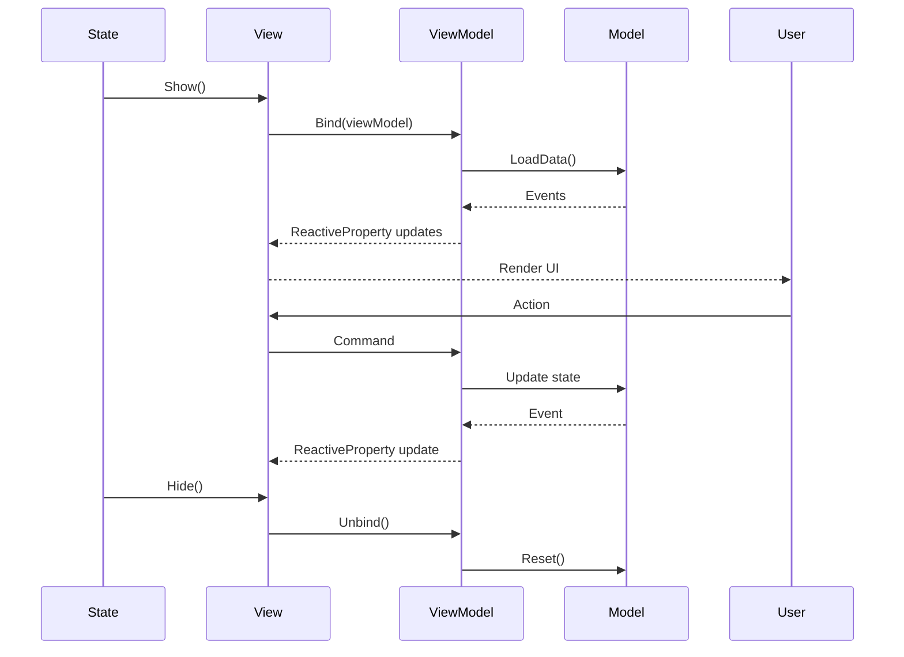

# Views — UI Components

## Обзор

Views — Unity MonoBehaviour компоненты, которые биндятся к ViewModels через `BindableView<TViewModel>`. Содержат UI элементы (кнопки, текст, слайдеры) и биндинги к ReactiveProperty.

## Базовый класс

```csharp
public abstract class BindableView<TViewModel> : MonoBehaviour, IView, IShowable, IHideable, IUnbindable
    where TViewModel : DisposableObject
{
    public TViewModel ViewModel { get; }
    public bool IsVisible { get; protected set; }
    public virtual bool IsPersistent { get; }
    
    public IDisposable BindTo(TViewModel viewModel) { ... }
    public Observable<TViewModel> ObserveViewModel(bool includeCurrent = true) { ... }
    
    protected abstract void OnBind(ref DisposableBag disposables);
    
    public virtual void Unbind() { ... }
    public virtual UniTask ShowAsync() { ... }
    public virtual UniTask HideAsync() { ... }
    
    protected virtual UniTask OnBeforeShow() => UniTask.CompletedTask;
    protected virtual UniTask OnAfterShow() => UniTask.CompletedTask;
    protected virtual UniTask OnBeforeHide() => UniTask.CompletedTask;
    protected virtual UniTask OnAfterHide() => UniTask.CompletedTask;
    protected virtual UniTask PlayShowAnimation() { ... }
    protected virtual UniTask PlayHideAnimation() { ... }
}
```

## Типы Views

| Категория | Описание |
|-----------|----------|
| **Screen Views** | Полноэкранные Views (Login, Main, Chat и т.д.) |
| **Embedded Views** | Встроенные панели (HeroesGrid, HealingPanel и т.д.) |
| **Modal Views** | Модальные окна (Settings) |

---

## Каталог Views

| View | ViewModel | Тип | Описание |
|------|-----------|-----|----------|
| `LoginView` | `LoginViewModel` | Screen | Экран авторизации |
| `MenuSelectionView` | `MenuSelectionViewModel` | Screen | Меню выбора направления |
| `MainView` | `MainViewModel` | Screen | Главный экран игры |
| `ChatView` | `ChatViewModel` | Screen | AI чат с персонажами [📄](ChatView.md) |
| `ImageGenView` | `ImageGenViewModel` | Screen | Генерация изображений |
| `NetworkSandboxView` | `NetworkSandboxViewModel` | Screen | Тестовый экран Workflow API [📄](NetworkSandboxView.md) |
| `PerformanceTestView` | `PerformanceTestViewModel` | Screen | Тестирование производительности |
| `StandaloneWorkflowView` | `StandaloneWorkflowViewModel` | Screen | Standalone workflow |
| `UIConstructorView` | `UIConstructorViewModel` | Screen | Конструктор UI элементов |
| `SettingsView` | `SettingsViewModel` | Modal | Настройки игры [📄](SettingsView.md) |
| `HeroesGridPanelView` | `HeroesGridPanelViewModel` | Embedded | Грид с карточками героев |
| `HeroDetailPanelView` | `HeroDetailPanelViewModel` | Embedded | Детали героя |
| `HealingPanelView` | `HealingPanelViewModel` | Embedded | Панель лечения |
| `TrainingPanelView` | `TrainingPanelViewModel` | Embedded | Панель тренировки |

---

## Screen Views

### LoginView

**Path:** `Views/Login/LoginView.cs`  
**ViewModel:** `LoginViewModel`

Экран авторизации с вводом email/password.

#### UI Elements

| Field | Type | Binding |
|-------|------|---------|
| `_emailInput` | `TMP_InputField` | `ViewModel.Email` (two-way) |
| `_passwordInput` | `TMP_InputField` | `ViewModel.Password` (two-way) |
| `_rememberMeToggle` | `Toggle` | `ViewModel.RememberMe` (two-way) |
| `_statusText` | `TMP_Text` | `ViewModel.StatusText` |
| `_loginButton` | `Button` | `ViewModel.LoginCommand` |
| `_skipButton` | `Button` | `ViewModel.SkipLoginCommand` |

#### Button States

```csharp
// Login button enabled when:
// - NOT loading
// - email is not empty
// - password is not empty
ViewModel.IsLoading
    .CombineLatest(ViewModel.Email, ViewModel.Password, ...)
    .Subscribe(...)
```

---

### MenuSelectionView

**Path:** `Views/MenuSelection/MenuSelectionView.cs`  
**ViewModel:** `MenuSelectionViewModel`

Меню выбора направления с кнопками навигации.

#### UI Elements

| Field | Type | Target |
|-------|------|--------|
| `_mainButton` | `Button` | Navigate to Main |
| `_chatButton` | `Button` | Navigate to Chat |
| `_imageGenButton` | `Button` | Navigate to ImageGen |
| `_networkSandboxButton` | `Button` | Navigate to NetworkSandbox |
| `_performanceTestButton` | `Button` | Navigate to PerformanceTest |
| `_uiConstructorButton` | `Button` | Navigate to UIConstructor |
| `_statusText` | `TMP_Text` | `ViewModel.StatusText` |

---

### MainView

**Path:** `Views/Main/MainView.cs`  
**ViewModel:** `MainViewModel`

Главный экран игры. См. подробное описание в [MainView.md](../MainView.md).

#### Containers

| Field | Type | Content |
|-------|------|---------|
| `_heroSlotsContainer` | `Transform` | HeroSlotElements |
| `_statsContainer` | `Transform` | StatRowElements |
| `_resourcesContainer` | `Transform` | ResourceItemElements |
| `_embeddedPanelsContainer` | `Transform` | Embedded panels |

#### Buttons

| Field | Type | Command |
|-------|------|---------|
| `_startAdventureButton` | `Button` | `ViewModel.StartAdventureCommand` |
| `_upgradesButton` | `Button` | Open HeroesGrid (Upgrades mode) |
| `_healingButton` | `Button` | Open HeroesGrid (Healing mode) |
| `_teamManagementButton` | `Button` | Open HeroesGrid (TeamManagement mode) |
| `_settingsButton` | `Button` | `ViewModel.OpenSettingsCommand` |

**IsPersistent:** `true`

---

### ChatView

**Path:** `Views/Chat/ChatView.cs`  
**ViewModel:** `ChatViewModel`

AI чат с персонажами. См. подробное описание в [ChatView.md](ChatView.md).

#### Key Features

- Динамический рендеринг сообщений
- Procedural UI containers
- Auto-scroll к последнему сообщению
- Загрузка аватара персонажа
- Workflow triggers

---

### ImageGenView

**Path:** `Views/ImageGen/ImageGenView.cs`  
**ViewModel:** `ImageGenViewModel`

Генерация изображений через Gemini API.

#### UI Elements

| Field | Type | Binding |
|-------|------|---------|
| `_inputField` | `TMP_InputField` | `ViewModel.InputText` |
| `_sendButton` | `Button` | `ViewModel.SendCommand` |
| `_messagesContainer` | `Transform` | Rendered messages |
| `_attachmentsContainer` | `Transform` | Pending attachments |
| `_statusText` | `TMP_Text` | `ViewModel.StatusText` |
| `_settingsPanel` | `GameObject` | ImageGenSettings UI |

#### Features

- История сообщений с изображениями
- До 14 вложений
- Удаление фона (background removal)
- Сохранение изображений
- Настройки генерации (aspect ratio, creativity и т.д.)

---

### NetworkSandboxView

**Path:** `Views/NetworkSandbox/NetworkSandboxView.cs`  
**ViewModel:** `NetworkSandboxViewModel`

Тестовый экран Workflow API. См. подробное описание в [NetworkSandboxView.md](NetworkSandboxView.md).

#### Key Features

- Загрузка workflows
- Визуализация графа нодов
- Тестирование entrypoints
- Workflow helper

---

### PerformanceTestView

**Path:** `Views/PerformanceTest/PerformanceTestView.cs`  
**ViewModel:** `PerformanceTestViewModel`

Тестирование производительности чата с метриками.

#### UI Elements

| Field | Type | Binding |
|-------|------|---------|
| `_characterDropdown` | `TMP_Dropdown` | `ViewModel.SelectedCharacterIndex` |
| `_runTestGreetingButton` | `Button` | Test greeting |
| `_runTestSingleButton` | `Button` | Test single message |
| `_runTestMultipleButton` | `Button` | Test multiple messages |
| `_metricsContainer` | `Transform` | Metrics list |
| `_statisticsPanel` | `GameObject` | Stats (avg, min, max) |
| `_statusText` | `TMP_Text` | `ViewModel.StatusText` |

#### Metrics Display

| Metric | Description |
|--------|-------------|
| Request Time | Время запроса (ms) |
| Token Count | Количество токенов |
| Success | Успех/Ошибка |
| Timestamp | Время запроса |

---

### StandaloneWorkflowView

**Path:** `Views/StandaloneWorkflow/StandaloneWorkflowView.cs`  
**ViewModel:** `StandaloneWorkflowViewModel`

Standalone workflow UI с интерактивными элементами.

#### UI Elements

| Field | Type | Binding |
|-------|------|---------|
| `_workflowDropdown` | `TMP_Dropdown` | `ViewModel.SelectedWorkflowId` |
| `_storageTypeDropdown` | `TMP_Dropdown` | `ViewModel.StorageType` |
| `_sessionIdInput` | `TMP_InputField` | `ViewModel.SessionId` |
| `_executeButton` | `Button` | `ViewModel.ExecuteWorkflowCommand` |
| `_uiContainer` | `Transform` | Rendered workflow UI |
| `_statusText` | `TMP_Text` | `ViewModel.StatusText` |
| `_errorText` | `TMP_Text` | `ViewModel.ErrorText` |

---

### UIConstructorView

**Path:** `Views/UIConstructor/UIConstructorView.cs`  
**ViewModel:** `UIConstructorViewModel`

Конструктор UI элементов через AI.

#### UI Elements

| Field | Type | Binding |
|-------|------|---------|
| `_elementTypeDropdown` | `TMP_Dropdown` | `ViewModel.SelectedElementType` |
| `_stylePresetDropdown` | `TMP_Dropdown` | `ViewModel.SelectedStylePreset` |
| `_blocksContainer` | `Transform` | Prompt blocks |
| `_previewImage` | `RawImage` | `ViewModel.PreviewImage` |
| `_generateButton` | `Button` | `ViewModel.GenerateCommand` |
| `_removeBackgroundToggle` | `Toggle` | `ViewModel.RemoveBackground` |

#### Prompt Blocks

Динамически создаются из `ViewModel.Blocks`:

- `UIPromptBlockCardView` — контейнер блока
- `UIPromptFieldView` — базовый класс для полей
  - `UIPromptFieldTextView` — текстовое поле
  - `UIPromptFieldCheckboxView` — checkbox
  - `UIPromptFieldColorView` — color picker
  - `UIPromptFieldDropdownView` — dropdown
  - `UIPromptFieldSliderView` — slider

---

## Modal Views

### SettingsView

**Path:** `Views/Settings/SettingsView.cs`  
**ViewModel:** `SettingsViewModel`

Модальное окно настроек. См. подробное описание в [SettingsView.md](SettingsView.md).

#### Features

- 5 вкладок: Audio, Video, Display, Controls, Game
- Keyboard navigation (Q/E для табов, Escape для закрытия)
- Сохранение в PlayerPrefs
- Reset to defaults

**IsPersistent:** `true`

---

## Embedded Views

### HeroesGridPanelView

**Path:** `Views/HeroesGridPanel/HeroesGridPanelView.cs`  
**ViewModel:** `HeroesGridPanelViewModel`

Грид с карточками героев.

#### UI Elements

| Field | Type | Binding |
|-------|------|---------|
| `_myHeroesTab` | `Toggle` | Tab selection |
| `_shopTab` | `Toggle` | Tab selection |
| `_deadHeroesTab` | `Toggle` | Tab selection |
| `_heroCardsContainer` | `Transform` | Hero cards |
| `_closeButton` | `Button` | `ViewModel.CloseCommand` |

#### Transition

```csharp
public ViewTransitionStyle TransitionStyle => 
    ViewTransitionStyle.SlideLeft | ViewTransitionStyle.Fade;
```

---

### HeroDetailPanelView

**Path:** `Views/HeroDetailPanel/HeroDetailPanelView.cs`  
**ViewModel:** `HeroDetailPanelViewModel`

Панель с деталями героя.

#### UI Elements

| Field | Type | Content |
|-------|------|---------|
| `_heroNameText` | `TMP_Text` | Имя героя |
| `_heroClassText` | `TMP_Text` | Класс |
| `_heroLevelText` | `TMP_Text` | Уровень |
| `_statsContainer` | `Transform` | Характеристики |
| `_abilitiesContainer` | `Transform` | Способности (AbilityCardElements) |
| `_equipmentContainer` | `Transform` | Экипировка (EquipmentSlotElements) |
| `_closeButton` | `Button` | `ViewModel.CloseCommand` |

---

### HealingPanelView

**Path:** `Views/HealingPanel/HealingPanelView.cs`  
**ViewModel:** `HealingPanelViewModel`

Панель лечения героев с сетью слотов 3x3.

#### UI Elements

| Field | Type | Binding |
|-------|------|---------|
| `_titleText` | `TMP_Text` | `ViewModel.Title` |
| `_rowsContainer` | `Transform` | Service rows |
| `_closeButton` | `Button` | `ViewModel.CloseCommand` |

#### Rendering

```csharp
await _mediator.Send(
    new ReconcileElementsRequest<ServiceSlotElement, ServiceSlotElementData>(
        container: rowContainer,
        newData: row.Slots.Select(ToElementData).ToList(),
        onClick: OnSlotClicked
    )
);
```

---

### TrainingPanelView

**Path:** `Views/TrainingPanel/TrainingPanelView.cs`  
**ViewModel:** `TrainingPanelViewModel`

Панель тренировки героев. Структура аналогична `HealingPanelView`.

---

## Биндинг паттерны

### Two-way binding (InputField)

```csharp
// View → ViewModel
_inputField.OnValueChangedAsObservable()
    .Subscribe(this, static (value, self) => self.ViewModel.Property.Value = value)
    .AddTo(ref disposables);

// ViewModel → View
ViewModel.Property
    .Subscribe(this, static (value, self) => 
    {
        if (self._inputField.text != value)
            self._inputField.text = value;
    })
    .AddTo(ref disposables);
```

### One-way binding (Text)

```csharp
ViewModel.StatusText
    .Subscribe(this, (text, self) => self._statusText.text = text)
    .AddTo(ref disposables);
```

### Command binding (Button)

```csharp
_button.OnClickAsObservable()
    .Subscribe(this, (_, self) => self.ViewModel.SomeCommand.Execute(Unit.Default))
    .AddTo(ref disposables);
```

### Conditional binding (Button interactable)

```csharp
ViewModel.IsLoading
    .Select(x => !x)
    .Subscribe(this, (canExecute, self) => self._button.interactable = canExecute)
    .AddTo(ref disposables);
```

### List rendering (ReconcileElementsRequest)

```csharp
ViewModel.Items
    .Subscribe(this, (items, self) => self.RenderItems(items))
    .AddTo(ref disposables);

private async void RenderItems(IReadOnlyList<ItemData> items)
{
    await _mediator.Send(
        new ReconcileElementsRequest<ItemElement, ItemData>(
            container: _itemsContainer,
            newData: items,
            onClick: OnItemClicked
        )
    );
}
```

---

## View Lifecycle



---

## Best Practices

1. **Всегда AddTo(ref disposables)** — добавляй subscriptions в disposables
2. **static lambda** — используй `static (x, self) => self.Method()` для избежания замыканий
3. **null checks** — проверяй UI элементы на null перед биндингом
4. **CombineLatest** — для multi-property bindings
5. **ReconcileElementsRequest** — для efficient list updates
6. **IsPersistent** — используй для Views, которые не должны уничтожаться

---

## См. также

- [ViewModels/README.md](../ViewModels/README.md) — ViewModel classes
- [Elements/README.md](../Elements/README.md) — Переиспользуемые UI компоненты
- [MainView.md](../MainView.md) — Подробное описание MainView
- [Patterns.md](../Patterns.md) — Best practices
