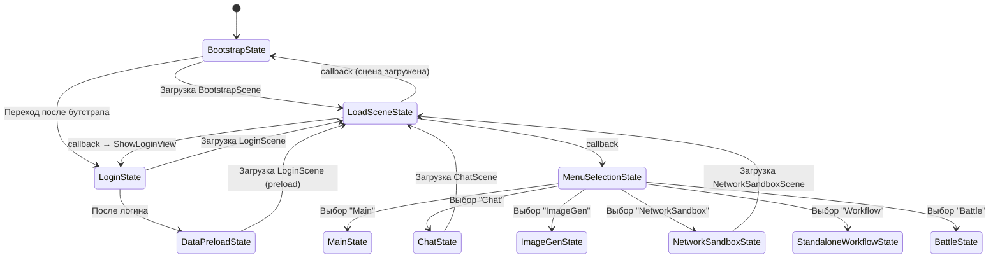

# Presentation — State Machine

*Обновлено: 2026-02-11*

---

## Архитектура

### Базовые интерфейсы

| Интерфейс | Описание |
|-----------|----------|
| `IGameState` | Базовый контракт state'а (`StateType`, `Exit()`) |
| `IEnterState` | State без параметров (`Enter()`) |
| `IPayloadState<T>` | State с параметрами (`Enter(T payload)`) |
| `IGameStateMachine` | Управление переходами (`Enter<TState>()`) |
| `GameStateBase<TSelf>` | Абстрактный базовый класс с доступом к `StateMachine` |

---

## Все States

| State | Тип | Сцена | Описание |
|-------|-----|-------|----------|
| `BootstrapState` | `IEnterState` | BootstrapScene | Точка входа приложения |
| `DataPreloadState` | `IEnterState` | — | Предзагрузка данных |
| `LoadSceneState` | `IPayloadState<SceneLoadPayload>` | (любая) | Утилитарный — загрузка сцены |
| `LoginState` | `IEnterState` | LoginScene | Авторизация |
| `MenuSelectionState` | `IEnterState` | — | Выбор режима из меню |
| `MainState` | `IEnterState` | — | Главный экран |
| `ChatState` | `IEnterState` | ChatScene | Чат |
| `ImageGenState` | `IEnterState` | — | Генерация изображений |
| `NetworkSandboxState` | `IEnterState` | NetworkSandboxScene | Сетевая песочница |
| `StandaloneWorkflowState` | `IEnterState` | — | Standalone workflow |
| `BattleState` | `IEnterState` | — | Бой (⚠️ пустая реализация) |

---

## Диаграмма переходов



---

## Bootstrap Flow

```
1. Приложение запускается
   │
2. BootstrapState.Enter()
   ├─ Если текущая сцена ≠ BootstrapScene:
   │   └─ LoadSceneState → загрузка BootstrapScene → BootstrapState.Enter() (повтор)
   └─ Если BootstrapScene:
       └─ StateMachine.Enter<LoginState>()
           │
3. LoginState.Enter()
   └─ LoadSceneState → загрузка LoginScene → ShowLoginView()
       │
4. Пользователь логинится
   │
5. DataPreloadState.Enter()
   └─ PreloadDataAsync() → LoadSceneState → MenuSelectionState
       │
6. MenuSelectionState.Enter()
   └─ ShowAsync<MenuSelectionViewModel>()
       │
7. Пользователь выбирает режим → NavigateCommand<T> → Handler → State
```

---

## Navigation Handlers

| Handler | Navigation Target | Target State |
|---------|------------------|--------------|
| `NavigateToLoginHandler` | `LoginNavigation` | `LoginState` |
| `NavigateToMenuSelectionHandler` | `MenuSelectionNavigation` | `MenuSelectionState` |
| `NavigateToChatHandler` | `ChatNavigation` | `ChatState` |
| `NavigateToImageGenHandler` | `ImageGenNavigation` | `ImageGenState` |
| `NavigateToMainHandler` | `MainNavigation` | `MainState` |
| `NavigateToStandaloneWorkflowHandler` | `StandaloneWorkflowNavigation` | `StandaloneWorkflowState` |

Все handlers наследуют `NavigateHandlerBase<TTarget, TState>` — однострочные классы, которые просто вызывают `StateMachine.Enter<TState>()`.

---

## SceneLoadPayload

```csharp
SceneLoadPayload(
    string sceneName,        // Имя сцены
    SceneLoadType loadType,  // Regular / Additive
    LoadSceneMode mode,      // Single / Additive
    Action onLoaded          // Callback после загрузки
)
```

`LoadSceneState` — единственный state с payload. Используется как утилитарный промежуточный state для асинхронной загрузки сцен. После загрузки вызывает `onLoaded` callback, который обычно показывает View или переходит в следующий state.
